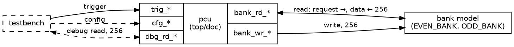

# Graphviz DOT in bankside

For block diagrams (hierarchy, datapaths, register files, testbench
architecture), flows and state machines.

The examples below use names from spec draft 0.1. They show the format and
the style; in a real diagram, take every name from the current spec.

## House template

Start every diagram from this header, so all diagrams share one look:

```dot
digraph top_hierarchy {
  graph [rankdir=LR, fontname="Helvetica", fontsize=11, nodesep=0.35, ranksep=0.6,
         newrank=true, labeljust=l];
  node  [shape=record, fontname="Helvetica", fontsize=10, height=0.3];
  edge  [fontname="Helvetica", fontsize=9, arrowsize=0.7];

  // diagram body
}
```

- `rankdir=LR`: data flows left to right. Use `TB` only for a hierarchy tree
  or a flow that reads top-down.
- Graph name = file stem, so a reader who sees one can find the other.
- No colours for meaning. If a distinction matters, label it. Colour is fine
  for grouping, but the diagram must read correctly in greyscale.

## Blocks with ports

Use a **record** node: a left port column, the block name and its doc in the
middle, a right port column. `<name>` makes a port that edges can attach to.

```dot
alu [label="{{<a>a|<b>b}|pcu_alu\n(alu/doc)|{<y>y}}"];
```

- **Put each port on the side that faces what it connects to**, not by
  direction. With `rankdir=LR`, a port that talks to a block on the right
  goes in the right column, even if it's an input. Grouping ports by
  direction makes return paths loop around the block and cross other edges.
- **Draw edges in the layout direction** (left to right) and show the real
  data direction with `dir=back` (data flows right to left) or `dir=both` (a
  request one way, data the other). Say which in the edge label when it isn't
  obvious, e.g. `"read: request →, data ← 256"`.
- Port names are the spec's port names, or a prefix group like `bank_rd_*`
  when several ports form one interface. Leave out ports that don't matter
  for this diagram's idea, and say "selected ports" in the caption.
- Inside a record label, `{ } | < >` are syntax. Escape them with `\` when
  you mean the character, e.g. `"a \| b"` for a literal bar.

## Hierarchy: clusters

A parent module is a `subgraph cluster_<name>`; its children sit inside it.

```dot
subgraph cluster_pcu {
  label="pcu\n(top/doc)";
  style=rounded;
  crf  [label="CRF\n32 × 32-bit"];
  grf  [label="{GRF_A|GRF_B}|8 × 256-bit each"];
  pipe [label="pipeline\nS1–S5"];
}
```

## Buses and edges

- Label an edge with its width when the width isn't 1: `[label="256"]`.
- Several signals that travel together become one edge labelled with the
  bundle name from the spec, e.g. "bank read", not one edge per wire.
- Connect to ports with `node:port`, e.g. `bank -> alu:a`.
- Use `style=dashed` for control or configuration paths, solid for data.
  Say so in the caption the first time.

## Example: v1 top level



The testbench-facing ports are on the left and the bank-facing ports on the
right, so every edge runs straight.

## State machines and flows

- States are `shape=ellipse` (set `node [shape=ellipse]` after the header);
  the reset state gets `peripheries=2`.
- Edge labels are the transition conditions, in the spec's signal names:
  `idle -> run [label="trig_valid"]`.
- For a flow (e.g. a test sequence): `shape=box` for steps, `shape=diamond`
  for decisions, and `rankdir=TB`.
