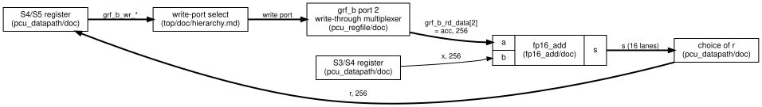

# fp16_add: specification

Owner: architect. Readers: everyone. The designer and DV each build from this
alone, so anything they would have to guess belongs here.

Every rule is tagged `[paper]`, `[ANEMOS]` or `[bankside]`, and every rule a
test can check has an ID: `[FADD-1]`, `[FADD-2]`, ...

## Overview

`fp16_add` is one lane of the S4 add: a purely combinational IEEE 754
binary16 adder. It takes two 16-bit operands and gives their sum, correctly
rounded to nearest, ties to even, with subnormals in and out, overflow to
±Inf, an exact zero sum +0 unless both operands are −0, and every NaN result
the canonical 0x7E00. It has no clock, no reset, no state and no other
output: no exception flags. It only adds; there is no subtract input (a
program subtracts by adding a negative operand).

`pcu_datapath` has 16 instances, one per lane, and defines how they connect
([DP-11], [DP-16], [DP-17]); this doc defines the unit's own ports, function
and timing. The unit sits in the one-cycle MAC accumulator loop
([TOP-HAZ-2], [TOP-HAZ-4]), which sets its timing budget ([FADD-11]). The
rules it carries out are those of the top spec:

| Top rule | What it asks of `fp16_add` | Here |
|---|---|---|
| [TOP-HIER-3] | one lane, purely combinational: no clock, no reset, no state | [FADD-1], [FADD-3], [FADD-11] |
| [TOP-FP-1] | IEEE 754-2019 binary16 | [FADD-4] |
| [TOP-FP-2] | correctly rounded, round to nearest, ties to even | [FADD-7] |
| [TOP-FP-4] | subnormals in and out, no flush to zero; overflow to ±Inf by RNE | [FADD-4], [FADD-5], [FADD-7] |
| [TOP-FP-5] | Inf − Inf = NaN, a NaN operand gives a NaN, x + (−x) = +0, (−0) + (−0) = −0 | [FADD-5], [FADD-6] |
| [TOP-FP-6] | every NaN result is 0x7E00 | [FADD-8] |
| [TOP-FP-7] | no exception flags | [FADD-9] |
| [TOP-HAZ-2], [TOP-HAZ-4] | the accumulator bypass is a one-cycle loop through the adder | [FADD-11] |

[TOP-ARCH-3]: ../../top/doc/theory_of_operation.md#architecture
[TOP-ARCH-9]: ../../top/doc/theory_of_operation.md#register-files
[TOP-FP-1]: ../../top/doc/theory_of_operation.md#fp16-arithmetic
[TOP-FP-2]: ../../top/doc/theory_of_operation.md#fp16-arithmetic
[TOP-FP-3]: ../../top/doc/theory_of_operation.md#fp16-arithmetic
[TOP-FP-4]: ../../top/doc/theory_of_operation.md#fp16-arithmetic
[TOP-FP-5]: ../../top/doc/theory_of_operation.md#fp16-arithmetic
[TOP-FP-6]: ../../top/doc/theory_of_operation.md#fp16-arithmetic
[TOP-FP-7]: ../../top/doc/theory_of_operation.md#fp16-arithmetic
[TOP-HAZ-2]: ../../top/doc/theory_of_operation.md#hazards
[TOP-HAZ-4]: ../../top/doc/theory_of_operation.md#hazards
[TOP-HIER-3]: ../../top/doc/hierarchy.md#fp16-units
[TOP-HIER-5]: ../../top/doc/hierarchy.md#register-files
[TOP-HIER-6]: ../../top/doc/hierarchy.md#how-top-connects-its-children
[DP-11]: ../../pcu_datapath/doc/README.md#s3-and-s4-the-lanes
[DP-12]: ../../pcu_datapath/doc/README.md#s3-and-s4-the-lanes
[DP-16]: ../../pcu_datapath/doc/README.md#lanes-and-the-fp16-units
[DP-17]: ../../pcu_datapath/doc/README.md#timing
[RF-9]: ../../pcu_regfile/doc/README.md#read
[RF-13]: ../../pcu_regfile/doc/README.md#timing
[VER-2]: ../../top/dv/README.md#anemos-kernel-translation-ver-2
[VER-4]: ../../top/dv/README.md#fp16-units
[FMUL-4]: ../../fp16_mul/doc/README.md#operand-classes
[FMUL-7]: ../../fp16_mul/doc/README.md#the-result
[FMUL-11]: ../../fp16_mul/doc/README.md#timing

**Sources.** The papers give the unit's place, not its arithmetic. ISCA 2021
(Section III-A) has "a pair of 16 FP16 multipliers and adders, each with 5
stages" in the 16-wide SIMD FPU, and Section IV-B makes ADD the fourth of
five pipeline stages ("MAC goes through both the third and fourth stages,
while MULT and ADD skip the fourth and third stages, respectively"); they say
nothing on rounding, subnormals, overflow, signed zeros or NaNs. ANEMOS
(github.com/gem5-X/cnm_framework at `f2d4018`) adds one lane in
`src/fp_adder.cpp` with the `half` library's `operator+` (half 2.2.0,
`src/half.hpp`), followed by `ADD_STAGES` = 1 register (`src/defs.h`). Its
rounding, subnormal, overflow and signed-zero behaviour is the library's;
bankside's is the same on every non-NaN result, run on all 2³² pairs
([ANEMOS compared](#anemos-compared)). The top rules cited above settle the
arithmetic; the choices this doc adds for the adder are tagged where they are
made and listed under [Choices weighed](#choices-weighed).

"Each with 5 stages" is read as for `fp16_mul` ([FMUL-11]): the five-stage
pipeline of Section IV-B, in which ADD is one stage, not five registers inside
each adder. ANEMOS's model of the paper also has one register after its add
(`ADD_STAGES` = 1), and [TOP-HIER-3] places that register in `pcu_datapath`
(the S4/S5 register), not in this unit, because the accumulator loop has to
close in one cycle ([FADD-11]).

The rules below follow `fp16_mul`'s doc where the two units share a rule (the
operand classes of [FMUL-4], the rounding definition of [FMUL-7], the NaN, flag
and commutativity rules), with the same structure and numbering, so a reader
of one can check the other line by line. Each rule is stated here in full: this
doc doesn't depend on the multiplier's.

## Ports

- **[FADD-1]** The ports. No other ports exist: in particular **no clock, no
  reset, no enable, no rounding-mode input, no subtract input and no flag
  output** ([TOP-HIER-3], [FADD-9]). **[bankside]**

  | Port | Dir | Width | Type | Description |
  |---|---|---|---|---|
  | `a` | in | 16 | `logic [15:0]` | First operand, binary16 bits ([FADD-4]) |
  | `b` | in | 16 | `logic [15:0]` | Second operand, binary16 bits |
  | `s` | out | 16 | `logic [15:0]` | The sum `a` + `b`, binary16 bits ([FADD-5] to [FADD-8]); combinational ([FADD-3]) |

  Bit 15 is the sign, bits 14 to 10 the biased exponent field *e*, bits 9 to
  0 the trailing significand field *m* ([TOP-FP-1]). The module has no
  parameters.

- **[FADD-2]** **Instances.** `pcu_datapath` has 16 instances,
  `g_lane[l].u_add` for lane *l* = 0 … 15, seen from `top` as
  `dp.g_lane[l].u_add` ([DP-16]). Lane *l*'s `a` and `b` are lane *l*
  (bits `[16l+15 : 16l]`) of the two S4 operands of [DP-11]: *x* and *y* for
  ADD and MAD, *acc* and *x* for MAC; its `s` is the sum from which
  `pcu_datapath` chooses lane *l* of the S4 result *r* ([DP-11]). That
  connection is the parent's; it is restated here only to name the ports it
  uses. Since `s` doesn't depend on which operand is on which port
  ([FADD-10]), the parent may connect them either way, and [FADD-11] holds
  for both. **[bankside]**, **[ANEMOS]** (one adder per lane).

  The port is `s`, not `r`: in [DP-11] *r* is the S4 result, which is `s`
  for ADD, MAD and MAC but *x* for MOV, FILL and MUL ([DP-12]), so the two
  are different signals.

## Behaviour

- **[FADD-3]** **A pure function.** `s` is a function of `a` and `b` alone:
  no clock, no state, no latch, no memory of earlier inputs. For any `a` and
  `b` with no X or Z bit, `s` has no X or Z bit. **[bankside]**, following
  [TOP-HIER-3].

### Operand classes

- **[FADD-4]** Each operand is in exactly one class, by its bits alone
  ([TOP-FP-1]). Subnormals are operands like any other: no input is flushed
  to zero ([TOP-FP-4]). These are the classes of `fp16_mul`'s [FMUL-4].
  **[bankside]**

  | Class | *e* | *m* | Value | Patterns, each sign |
  |---|---|---|---|---|
  | zero | 0 | 0 | ±0 | 1 |
  | subnormal | 0 | ≠ 0 | ± *m* · 2⁻²⁴ | 1023 |
  | normal | 1 … 30 | any | ± (1024 + *m*) · 2^(*e* − 25) | 30720 |
  | Inf | 31 | 0 | ±∞ | 1 |
  | NaN | 31 | ≠ 0 | none | 1023 |

  The adder does not tell signalling NaNs (*m* bit 9 = 0) from quiet ones
  (*m* bit 9 = 1), nor one payload from another: every NaN operand is
  treated alike ([FADD-8]).

### The result

- **[FADD-5]** **Result by operand class.** The table is symmetric, so it
  holds with `a` and `b` swapped. "Bit for bit" means `s` equals that
  operand's 16 bits. **[bankside]**, following [TOP-FP-4] to [TOP-FP-6].

  | `a` \ `b` | zero | subnormal or normal | Inf | NaN |
  |---|---|---|---|---|
  | **zero** | [FADD-6]: −0 (0x8000) if both are −0, else +0 (0x0000) | `b`, bit for bit | `b` | 0x7E00 |
  | **subnormal or normal** | `a`, bit for bit | [FADD-7]; an exact zero sum is +0 ([FADD-6]) | `b` | 0x7E00 |
  | **Inf** | `a` | `a` | `a` if `a` = `b`; **0x7E00** if the signs differ (invalid) | 0x7E00 |
  | **NaN** | 0x7E00 | 0x7E00 | 0x7E00 | 0x7E00 |

  A zero operand gives the other operand unchanged, a subnormal included
  (0x8001 + 0x0000 = 0x8001): this is [FADD-7] (the sum is exact) and is
  stated so no design flushes it. A finite operand plus Inf is that Inf,
  whatever its size (65504 included).

- **[FADD-6]** **Sign.** **[bankside]**, following [TOP-FP-5] (IEEE 754-2019
  clause 6.3).
  - A non-zero finite result has the sign of the exact sum: the sign of the
    operand with the larger magnitude. An Inf result has the sign of the Inf
    operand (or of the exact sum, on overflow).
  - **A zero result** comes only from an **exact zero sum**: no non-zero
    sum rounds to zero ([FADD-7]). Its sign is **+0 (0x0000) in every case
    but one: (−0) + (−0) = −0 (0x8000).** So x + (−x) = +0 for every finite
    non-zero x, subnormals and ±65504 included, in either order; and
    (+0) + (−0) = (−0) + (+0) = (+0) + (+0) = +0. Over all 2³² pairs, −0
    is the result of exactly one pair, (0x8000, 0x8000).
  - A NaN result has sign 0 ([FADD-8]).

  IEEE 754 gives −0 for x + (−x) only when rounding toward −∞; bankside
  has round to nearest only ([FADD-7]), so that case doesn't arise.

- **[FADD-7]** **A finite sum is the exact sum, rounded once.** When both
  operands are finite and the exact real sum *v* = value(`a`) + value(`b`)
  is not zero, `s` is the binary16 value nearest to *v*, over every finite
  binary16 value (subnormals included), with **ties to the value whose *m* is
  even** ([TOP-FP-2]); and when |*v*| ≥ 65520 = 2¹⁵ · (2 − 2⁻¹¹), `s` is ±∞
  with the sign of *v* ([TOP-FP-4], IEEE 754-2019 clause 4.3.1). There is no
  other rounding mode and no saturation to ±65504. This is the rounding
  definition of `fp16_mul`'s [FMUL-7], applied to a sum. **[ANEMOS]** (half's
  default, round to nearest), **[bankside]**.

  Every *v* is a multiple of 2⁻²⁴ (each operand is), with |*v*| from 2⁻²⁴ to
  131008 = 2 · 65504. On a magnitude scale, with *q* the spacing of binary16
  values at |*v*| (2⁻²⁴ below 2⁻¹³, 2^(*E* − 10) in [2^*E*, 2^(*E*+1)) for
  *E* = −14 … 15):

  | |*v*| | `s` (magnitude) | Cases |
  |---|---|---|
  | ≥ 65520 | Inf, 0x7C00 | [#15, #18, #19](#worked-cases) |
  | [65504, 65520) | 65504, 0x7BFF (the largest finite) | [#16, #17, #20](#worked-cases) |
  | [2⁻¹³, 65504) | the nearest multiple of *q*, ties to even *m*; one that rounds up to 2^(*E*+1) is the normal with the next exponent and *m* = 0 | [#1 to #14, #21](#worked-cases) |
  | [2⁻²⁴, 2⁻¹³) | *v* itself, **exact**: every multiple of 2⁻²⁴ in this range is a binary16 value (subnormal below 2⁻¹⁴, normal with *q* = 2⁻²⁴ above) | [#22 to #26, #34, #35](#worked-cases) |
  | 0 | [FADD-6] | [#27 to #33](#worked-cases) |

  So for the adder, unlike the multiplier: **a subnormal result is always
  exact, and no non-zero sum underflows to zero**. Overflow needs two
  operands of the same sign; the smallest sum that overflows is
  65504 + 16 = 65520, the tie between 65504 (*m* odd) and 2¹⁶ (#15).

- **[FADD-8]** **NaN result.** Every NaN result is exactly **0x7E00**, both
  for a NaN operand (either operand or both, any sign, quiet or signalling,
  any payload) and for +Inf + (−Inf) in either order. No operand bit is
  propagated into a NaN result. **[bankside]**, following [TOP-FP-6], settled
  in #7. ANEMOS propagates the first NaN operand, quietened, and gives 0x7FFF
  for Inf − Inf ([ANEMOS compared](#anemos-compared)).

- **[FADD-9]** **No flags and no other outputs.** Invalid, overflow,
  underflow and inexact are not signalled ([TOP-FP-7]); `s` is the only
  output. IEEE 754's choice of detecting tininess before or after rounding
  changes only the underflow flag, never the result, so it doesn't arise
  here. **[bankside]**

- **[FADD-10]** **Commutative, bit for bit.** For every pair, `s` for
  (`a`, `b`) equals `s` for (`b`, `a`), NaN results and signed zeros
  included. This follows from [FADD-5] to [FADD-8] (it would not under NaN
  propagation, which can keep the first NaN); it is stated as a rule because
  [FADD-2] and [DP-11] rely on it and a test can check it. **[bankside]**

### One way to compute it

This section is informative: it shows one structure that meets [FADD-5] to
[FADD-8], checked on all 2³² pairs ([how the cases are
checked](#how-the-cases-are-checked)). The designer may build any structure
with the same function: a dual-path (near and far) adder, a leading-zero
anticipator in place of the count, or the rounding increment merged into the
add. It is the textbook guard, round and sticky adder; the integer model in
the script follows these steps.

1. **Classify and order.** Classify the operands ([FADD-4]) and select the
   [FADD-5] special results by a final multiplexer: 0x7E00, an Inf operand,
   the zero-plus-zero sign of [FADD-6]. Swap the operands so that the first,
   *x*, has the larger magnitude: comparing bits 14 to 0 as unsigned
   integers compares magnitudes. The result's sign is *x*'s sign; *sub* =
   the signs differ.
2. **Unpack and align.** For each: *M* = (*e* ≠ 0) · 1024 + *m*, 11 bits,
   and *F* = max(*e*, 1), so the value is *M* · 2^(*F* − 25). With
   *d* = *F*x − *F*y ≥ 0: *X* = *M*x · 8 and *Y* = (*M*y · 8) shifted right
   by *d*, with the OR of the bits shifted out ORed into bit 0 (the sticky
   bit). The three low bits are guard, round and sticky. For *d* ≥ 14 only
   the sticky bit is left, so the shifter needs no more than 14 places.
3. **Add.** *S* = *X* − *Y* if *sub*, else *X* + *Y*: 15 bits, never
   negative. *S* = 0 is the exact zero sum: `s` = +0 ([FADD-6]).
4. **Normalise.** If *S* ≥ 2¹⁴ (a carry), shift right by one, ORing the bit
   shifted out into bit 0, and add 1 to *F*. Otherwise shift left until
   *S* ≥ 2¹³ or *F* = 1, taking 1 from *F* per place (the subnormal range
   stops the shift). A left shift of more than one place happens only for
   *d* ≤ 1, where *Y* lost no bits, so the sum is exact.
5. **Round.** *n* = *S* shifted right by 3; with *g* = bit 2 of *S* and
   *st* = bit 1 OR bit 0, add 1 to *n* when *g* AND (*st* OR *n*[0]).
6. **Pack.** The magnitude is (*F* − 1) · 1024 + *n*. A rounding carry
   (*n* = 2048, or *n* = 1024 at *F* = 1) lands in the exponent field by
   itself, and a subnormal result (*F* = 1, *n* < 1024) has *e* = 0. A
   magnitude ≥ 0x7C00 is replaced by Inf.

### Timing

- **[FADD-11]** **Combinational, inside the one-cycle accumulator loop.**
  The only paths are `a` → `s` and `b` → `s`; there are no registers and no
  clock ([FADD-3]). In the pipeline the unit is the S4 add, and it sits in
  the **accumulator loop** that [DP-17] defines, which has to close in one
  clock cycle for back-to-back MACs into one GRF_B entry ([TOP-HAZ-2],
  [TOP-HAZ-4]):

  the S4/S5 register (`grf_b_wr_*`) → `top`'s write-port select
  ([TOP-HIER-6]) → `grf_b`'s write-through multiplexer on port 2, the bypass ([TOP-HIER-5], [RF-9],
  [RF-13]) → `grf_b_rd_data[2]`, the accumulator → **`fp16_add`** → the
  choice of *r* ([DP-11]) → the S4/S5 register.

  So `fp16_add` gets one clock period of [TOP-ARCH-3] **minus the top
  write-port select, `grf_b`'s write-through multiplexer and the setup** of
  the S4/S5 register, as [DP-17] gives it; the S4/S5 register's
  clock-to-output and the choice of *r*, which [DP-17]'s path also passes
  through, come off the same period:

  *t*(`fp16_add`) ≤ *T*clk − *t*clk→Q(S4/S5) − *t*(write-port select) −
  *t*(write-through multiplexer) − *t*(choice of *r*) − *t*setup(S4/S5)

  The budget holds for **both** paths, `a` → `s` and `b` → `s`, because the
  parent may put the accumulator on either port ([FADD-2]). The other input
  of a MAC's add, the product *x*, comes from the S3/S4 register and arrives
  early; ADD and MAD take both operands from it, so their path is shorter
  than the loop. **[bankside]**, following [TOP-HIER-3] and [DP-17].

  This doc sets **no delay figure** of its own: the clock period is
  [TOP-ARCH-3]'s, and the M2 synthesis run on ASAP7 measures the adder's delay
  and the loop around it. A design that can't meet the budget is not fixed by
  adding a register inside the unit, since that breaks [TOP-HAZ-4]
  ([TOP-HIER-3]); it is a finding for the architect.



*Figure 1: the one-cycle accumulator loop of [FADD-11] and [DP-17]. Bold
edges are the loop; `fp16_add`'s budget is the clock period less the other
blocks on it. The product x reaches the adder from the S3/S4 register, off the
loop. The accumulator is drawn on `a`; the parent may connect it to either
port ([FADD-2]). Source: [fadd_accumulator_loop.dot](img/fadd_accumulator_loop.dot).*

## Choices weighed

The arithmetic was settled in the top spec ([TOP-FP-2], [TOP-FP-4] to
[TOP-FP-7]; the NaN rule in #7) and the combinational unit in
[TOP-HIER-3]; the options weighed there (a pipelined unit, NaN
propagation) are not repeated here. The choices left to this doc:

| Choice | Options | Where they differ | Chosen |
|---|---|---|---|
| Port names | (a) `a`, `b`, `s`; (b) `a`, `b`, `r`; (c) `op_a`, `op_b`, `sum`; (d) suffixed `a_i`, `b_i`, `s_o` | No behaviour differs. (a) matches `fp16_mul`'s `a`, `b`, `p`, and names the sum. (b) would reuse [DP-11]'s *r*, which is a different signal: the S4 result is *x*, not the sum, for MOV, FILL and MUL. The merged module docs don't suffix ports | (a), [FADD-1]. **[bankside]** |
| Operand order | (a) a rule that `s` doesn't depend on it ([FADD-10]); (b) leave it unstated | No result differs. Under (a) DV checks it with one swapped sweep, and the parent's freedom to connect either way rests on a rule | (a). **[bankside]** |
| Which port gets the accumulator | (a) either: the budget on both paths ([FADD-11]); (b) fix the accumulator on one port, so a design may make that path the shorter | No result differs. (b) would be a rule on the parent's connection ([DP-16]), which this doc doesn't own, and it pays only if a synthesis run finds the loop short of time. M2 measures first | (a). **[bankside]** |
| The timing budget | (a) the clock period less every other block on [DP-17]'s loop, clock-to-output and the choice of *r* included; (b) only the three that [DP-17]'s sentence names | They differ by the clock-to-output and one 2-to-1 multiplexer. (b) would let an adder that uses that time pass the budget and fail the loop | (a), [FADD-11]. **[bankside]** |
| Port type | (a) `logic [15:0]`; (b) a shared `fp16_t` typedef in `bankside_pkg` (#53) | No behaviour differs; as for `fp16_mul` | (a), [FADD-1]. **[bankside]** |
| How the function is specified | (a) the result only ([FADD-5] to [FADD-8]), with an informative structure; (b) a mandated structure | No result differs, by definition. (b) would rule out a dual-path adder or a leading-zero anticipator, which synthesis may need for the one-cycle loop | (a). **[bankside]** |
| X on the inputs | (a) nothing beyond [FADD-3]; (b) X in gives all-X out | Only in a four-state simulation; v1 simulates two-state with Verilator ([TOP-ARCH-9]) | (a). **[bankside]** |

## Examples

### Worked cases

Each row is one operand pair; `s` is the result [FADD-5] to [FADD-8] give,
and the rule column says which. The NumPy column is NumPy 2.5.1 `float16`
on x86-64, run: it agrees with `s` on every row except the NaN bits, which
are the host's ([TOP-FP-6]). The ANEMOS column is ANEMOS's `half` 2.2.0,
run: "same" where it equals `s`. Exact sums are written *k* · 2^*e*, in
lowest terms; *q* is the spacing at the sum.

| # | `a` | `b` | Values | Exact sum | `s` | Rule and what it shows | NumPy | ANEMOS |
|---|---|---|---|---|---|---|---|---|
| 1 | 0x3C00 | 0x3C00 | 1 + 1 | `2` | 0x4000 | [FADD-7]: exact | 0x4000 | same |
| 2 | 0x3E00 | 0x3E00 | 1.5 + 1.5 | `3` | 0x4200 | [FADD-7]: exact; the carry out of the significands raises the exponent | 0x4200 | same |
| 3 | 0x3C00 | 0x1400 | 1 + 2⁻¹⁰ | `1025·2^−10` | 0x3C01 | [FADD-7]: exact, one *q* above 1 | 0x3C01 | same |
| 4 | 0x3C00 | 0x1000 | 1 + 2⁻¹¹ | `2049·2^−11` | 0x3C00 | [FADD-7]: a **tie**, 1 + *q*/2, between *m* = 0 (even) and *m* = 1: rounds **down** to even | 0x3C00 | same |
| 5 | 0x3C01 | 0x1000 | (1 + 2⁻¹⁰) + 2⁻¹¹ | `2051·2^−11` | 0x3C02 | [FADD-7]: a **tie** between *m* = 1 and *m* = 2 (even): rounds **up** | 0x3C02 | same |
| 6 | 0x3C00 | 0x1001 | 1 + (2⁻¹¹ + 2⁻²¹) | `2098177·2^−21` | 0x3C01 | [FADD-7]: just above the tie, by 2⁻²¹: up. The sticky bit decides it | 0x3C01 | same |
| 7 | 0x3C00 | 0x0FFF | 1 + (2⁻¹¹ − 2⁻²²) | `4196351·2^−22` | 0x3C00 | [FADD-7]: just below the tie: down | 0x3C00 | same |
| 8 | 0x3FFF | 0x1000 | (2 − 2⁻¹⁰) + 2⁻¹¹ | `4095·2^−11` | 0x4000 | [FADD-7]: a tie between *m* = 1023 (odd) and 2: the rounding carry raises the exponent | 0x4000 | same |
| 9 | 0x6800 | 0x3C00 | 2048 + 1 | `2049` | 0x6800 | [FADD-7]: *q* = 2 at 2048; 2049 is a tie, to 2048 (even) | 0x6800 | same |
| 10 | 0x6800 | 0x4200 | 2048 + 3 | `2051` | 0x6802 | [FADD-7]: 2051 is a tie between 2050 (odd *m*) and 2052: up | 0x6802 | same |
| 11 | 0x6800 | 0xB800 | 2048 − 0.5 | `4095·2^−1` | 0x6800 | [FADD-7]: below a power of two the spacing halves: 2047.5 is a tie between 2047 (odd) and 2048: up | 0x6800 | same |
| 12 | 0x6800 | 0xBA00 | 2048 − 0.75 | `8189·2^−2` | 0x67FF | [FADD-7]: 2047.25, nearest 2047: the result drops a binade | 0x67FF | same |
| 13 | 0x3C00 | 0xC000 | 1 + (−2) | `−1` | 0xBC00 | [FADD-6]: the sign of the larger operand; exact | 0xBC00 | same |
| 14 | 0x3C00 | 0xBBFF | 1 + (−(1 − 2⁻¹¹)) | `2^−11` | 0x1000 | [FADD-7]: cancellation, exact; normalising shifts left by 11 places | 0x1000 | same |
| 15 | 0x7BFF | 0x4C00 | 65504 + 16 | `65520` | 0x7C00 | [FADD-7]: exactly 65520, the tie between 65504 (odd *m*) and 2¹⁶: to even, past the largest finite, so **+Inf** | 0x7C00 | same |
| 16 | 0x7BFF | 0x4BFF | 65504 + 15.9921875 | `8386559·2^−7` | 0x7BFF | [FADD-7]: the largest sum below 65520: 65504 | 0x7BFF | same |
| 17 | 0x7BFF | 0x4800 | 65504 + 8 | `65512` | 0x7BFF | [FADD-7]: a quarter of *q* above 65504: 65504 | 0x7BFF | same |
| 18 | 0x7BFF | 0x7BFF | 65504 + 65504 | `131008` | 0x7C00 | [FADD-7]: the largest sum, **overflow** to +Inf | 0x7C00 | same |
| 19 | 0xFBFF | 0xCC00 | −65504 + (−16) | `−65520` | 0xFC00 | [FADD-7], [FADD-6]: overflow to −Inf | 0xFC00 | same |
| 20 | 0x7BFF | 0x0001 | 65504 + 2⁻²⁴ | `1098974756865·2^−24` | 0x7BFF | [FADD-7]: the widest alignment, *d* = 29: only the sticky bit is left; 65504 | 0x7BFF | same |
| 21 | 0x3C00 | 0x0001 | 1 + 2⁻²⁴ | `16777217·2^−24` | 0x3C00 | [FADD-7]: 2⁻²⁴ is far below *q*/2: 1 | 0x3C00 | same |
| 22 | 0x0400 | 0x83FF | 2⁻¹⁴ + (−1023 · 2⁻²⁴) | `2^−24` | 0x0001 | [FADD-7]: normal minus subnormal, an exact **subnormal**, the smallest | 0x0001 | same |
| 23 | 0x03FF | 0x0001 | 1023 · 2⁻²⁴ + 2⁻²⁴ | `2^−14` | 0x0400 | [FADD-7]: two subnormals give the smallest **normal**, exact | 0x0400 | same |
| 24 | 0x0001 | 0x0001 | 2⁻²⁴ + 2⁻²⁴ | `2^−23` | 0x0002 | [FADD-7]: subnormal + subnormal, exact | 0x0002 | same |
| 25 | 0x8200 | 0x8200 | −2⁻¹⁵ + (−2⁻¹⁵) | `−2^−14` | 0x8400 | [FADD-7]: two negative subnormals give −2⁻¹⁴, a normal | 0x8400 | same |
| 26 | 0x0001 | 0x8002 | 2⁻²⁴ + (−2⁻²³) | `−2^−24` | 0x8001 | [FADD-6], [FADD-7]: −2⁻²⁴, exact; no sum rounds to zero | 0x8001 | same |
| 27 | 0x3C00 | 0xBC00 | 1 + (−1) | `0` | 0x0000 | [FADD-6]: x + (−x) = **+0** | 0x0000 | same |
| 28 | 0x8001 | 0x0001 | −2⁻²⁴ + 2⁻²⁴ | `0` | 0x0000 | [FADD-6]: +0, the negative operand first | 0x0000 | same |
| 29 | 0x7BFF | 0xFBFF | 65504 + (−65504) | `0` | 0x0000 | [FADD-6]: +0 | 0x0000 | same |
| 30 | 0x0000 | 0x0000 | +0 + +0 | `0` | 0x0000 | [FADD-6]: +0 | 0x0000 | same |
| 31 | 0x0000 | 0x8000 | +0 + −0 | `0` | 0x0000 | [FADD-6]: +0 | 0x0000 | same |
| 32 | 0x8000 | 0x0000 | −0 + +0 | `0` | 0x0000 | [FADD-6]: +0 | 0x0000 | same |
| 33 | 0x8000 | 0x8000 | −0 + −0 | `0` | 0x8000 | [FADD-6]: **−0**, the only pair that gives −0 | 0x8000 | same |
| 34 | 0x8001 | 0x0000 | −2⁻²⁴ + +0 | `−2^−24` | 0x8001 | [FADD-5]: a zero operand returns the other bit for bit; no flush to zero | 0x8001 | same |
| 35 | 0x8000 | 0x0001 | −0 + 2⁻²⁴ | `2^−24` | 0x0001 | [FADD-5]: the same, zero first | 0x0001 | same |
| 36 | 0x0000 | 0xBC00 | +0 + −1 | `−1` | 0xBC00 | [FADD-5]: −1, the sign of the non-zero operand | 0xBC00 | same |
| 37 | 0x7C00 | 0x3C00 | +Inf + 1 | – | 0x7C00 | [FADD-5]: +Inf | 0x7C00 | same |
| 38 | 0xFC00 | 0x7BFF | −Inf + 65504 | – | 0xFC00 | [FADD-5]: −Inf, whatever the finite operand | 0xFC00 | same |
| 39 | 0x7C00 | 0x8000 | +Inf + −0 | – | 0x7C00 | [FADD-5]: +Inf | 0x7C00 | same |
| 40 | 0x7C00 | 0x7C00 | +Inf + +Inf | – | 0x7C00 | [FADD-5]: +Inf | 0x7C00 | same |
| 41 | 0xFC00 | 0xFC00 | −Inf + −Inf | – | 0xFC00 | [FADD-5]: −Inf | 0xFC00 | same |
| 42 | 0x7C00 | 0xFC00 | +Inf + −Inf | – | 0x7E00 | [FADD-8]: **invalid** | 0xFE00 | 0x7FFF |
| 43 | 0xFC00 | 0x7C00 | −Inf + +Inf | – | 0x7E00 | [FADD-8]: invalid, the other order | 0xFE00 | 0x7FFF |
| 44 | 0x7C01 | 0x3C00 | sNaN + 1 | – | 0x7E00 | [FADD-8]: a signalling NaN; not propagated or quietened into 0x7E01 | 0x7E01 | 0x7E01 |
| 45 | 0xFE00 | 0x3C00 | −qNaN + 1 | – | 0x7E00 | [FADD-8]: the result's sign is 0 | 0xFE00 | 0xFE00 |
| 46 | 0x3C00 | 0xFE02 | 1 + −NaN | – | 0x7E00 | [FADD-8]: NaN second; its payload is dropped | 0xFE02 | 0xFE02 |
| 47 | 0x7FFF | 0xFC00 | NaN + −Inf | – | 0x7E00 | [FADD-8]: a NaN operand beats the Inf | 0x7FFF | 0x7FFF |
| 48 | 0x7E01 | 0xFE02 | qNaN + −qNaN | – | 0x7E00 | [FADD-8]: two NaNs, neither kept | 0xFE02 | 0x7E01 |
| 49 | 0xFE02 | 0x7E01 | −qNaN + qNaN | – | 0x7E00 | [FADD-8], [FADD-10]: the same pair swapped gives the same `s`, where both references change | 0x7E01 | 0xFE02 |

### NumPy as a reference: double rounding

NumPy's `float16` add widens both operands to float32, adds in float32
(rounding once, to 24 bits) and rounds the float32 sum to binary16 (a second
rounding). [FADD-7] asks for one rounding of the exact sum. The top spec
says the second rounding is harmless because 24 ≥ 2 · 11 + 2 (the textbook
condition, which covers +, ×, ÷ and √ alike). This section proves it for the
adder directly and the sweep confirms it, so DV may use NumPy as the oracle
for every non-NaN sum ([VER-4]).

**Claim.** For all finite `a`, `b`: rounding *v* = value(`a`) +
value(`b`) to float32 and then to binary16 gives the same bits as rounding
*v* once to binary16 ([FADD-6], [FADD-7]).

**Proof.** If *v* is a float32 value, the float32 rounding returns *v* and
only one rounding happens. A zero *v* is such a value, and float32 gives it
the same sign as [FADD-6] (IEEE in float32 too). The float32 sum never
overflows (|*v*| ≤ 131008) and is never float32-subnormal (|*v*| ≥ 2⁻²⁴
> 2⁻¹²⁶), so its grid is the 24-bit one throughout. Otherwise, let |`a`| ≥
|`b`| > 0 (the sum is symmetric), with `a` in the binade [2^*A*, 2^(*A*+1))
and binary16 spacing *q*a = 2^(*A*−10), and `b` in binade *B* ≤ *A*, spacing
*q*b = 2^(*B*−10) (a subnormal counts as *A* or *B* = −14). *v* is a multiple
of *q*b and |*v*| < 2^(*A*+2), so it has at most *A* − *B* + 12 significant
bits. Since float32 holds 24, an inexact *v* needs *A* − *B* ≥ 13, and then
|`b`| < 2^(*B*+1) ≤ 2^(*A*−12) = *q*a / 4.

1. **The single rounding gives `a`.** The binary16 decision points nearest
   `a` (the midpoints to its neighbours, and the overflow bound 65520 =
   65504 + *q*a / 2) are *q*a / 2 from `a`. The exception is below a power of
   two, where the spacing halves and the midpoint is *q*a / 4 below `a`.
   |*v* − `a`| = |`b`| < *q*a / 4, so *v* is strictly nearer `a` than any
   decision point.
2. **The float32 rounding stays on the same side of each decision point.**
   Rounding to nearest is monotone, and it returns any value that is
   already a float32 number unchanged. `a` ± *q*a / 4 has at most 13
   significant bits, so it is a float32 number, and *v* lies strictly between
   the two. So the float32 sum lies in [`a` − *q*a / 4, `a` + *q*a / 4],
   strictly inside the midpoints at *q*a / 2. Below a power of two
   (|`a`| = 2^*A*, *v* on the smaller side) the midpoint is at *q*a / 4. But
   there |`b`| ≤ 2^(*B*+1) − *q*b ≤ 2^(*A*−12) − 2^(*A*−23), and the float32
   number 2^*A* − 2^(*A*−12) + 2^(*A*−24) (24 bits, from 2^(*A*−1) to
   2^(*A*−24)) lies strictly between that midpoint and |*v*|. So the float32
   sum is again strictly nearer `a`.
3. So the second rounding also gives `a`, the same bits. ∎

The rows below show the cases: the float32 sum exact, the float32 sum
inexact (the second rounding happens and changes nothing), and a narrower
intermediate, where the argument fails and so does the result. The "float32
sum" column is the float32 value, or "exact". "Through 12 bits" is the result
if the intermediate kept only 12 significant bits instead of 24.

| # | `a` | `b` | Exact sum | float32 sum | `s` | Through 12 bits | What it shows |
|---|---|---|---|---|---|---|---|
| D1 | 0x3C00 | 0x1001 | `2098177·2^−21` | exact | 0x3C01 | 0x3C00 | Worked case #6. float32 holds the sum (22 bits), so NumPy is right; a 12-bit intermediate rounds 1 + 2⁻¹¹ + 2⁻²¹ to the tie 1 + 2⁻¹¹ and then to 1, which is **wrong**: this is double rounding when the intermediate is too narrow |
| D2 | 0x3C00 | 0x0001 | `16777217·2^−24` | `1` | 0x3C00 | 0x3C00 | Worked case #21. float32 rounds 1 + 2⁻²⁴ (a float32 tie) to 1; binary16 gives 1 either way |
| D3 | 0x7BFF | 0x0001 | `1098974756865·2^−24` | `65504` | 0x7BFF | 0x7BFF | Worked case #20. The float32 sum is 65504, below the overflow bound: 65504 |
| D4 | 0x4000 | 0x8001 | `33554431·2^−24` | `2` | 0x4000 | 0x4000 | Below a power of two: float32 rounds 2 − 2⁻²⁴ up to 2, and the single rounding gives 2 as well |
| D5 | 0x3C01 | 0x87FF | `16791553·2^−24` | `8199·2^−13` | 0x3C01 | 0x3C01 | *A* − *B* = 14: the float32 sum moves by 2⁻²⁴, far from the midpoints at ± 2⁻¹¹ |
| D6 | 0x3C00 | 0x8BFF | `8386561·2^−23` | exact | 0x3C00 | 0x3C00 | The sum nearest the midpoint below 1 that an operand 13 binades down can reach: 1 − 2⁻¹² + 2⁻²³, exact in float32, rounds up to 1 |

**Swept.** Over all 2³² pairs, 1140785152 (26.6 %) have an inexact float32
sum, so NumPy's path really does round twice on about a quarter of all pairs.
On every one of them, and on every other pair, the float32 path gives the same
bits as the single rounding, the model and NumPy's own `+` (NaN as a class).
GCC's float path in [anemos_fadd.cpp](examples/anemos_fadd.cpp) finds the
same count and no difference. **The top spec's claim holds for the adder**:
NumPy is a valid oracle for every non-NaN sum.

### How the cases are checked

One script checks the tables and the rules against two models of this doc,
written independently of each other, and against NumPy and ANEMOS:

- **spec_add**, the rules as [FADD-5] to [FADD-8] state them: a finite sum
  computed exactly with Python's `fractions.Fraction` and rounded once by the
  IEEE 754 definition (the nearest value, ties to even *m*, |*v*| ≥ 65520 to
  Inf), and the zero signs of [FADD-6];
- **model_add**, the six steps of [one way to compute
  it](#one-way-to-compute-it), on integers.

Rerun from the repo root:

```
.venv/bin/python src/fp16_add/doc/examples/fadd_check.py
python3 src/fp16_add/doc/examples/fadd_check.py --numpy --exhaustive --anemos src/fp16_add/doc/examples/anemos_fadd.out
```

The first line needs only the standard library (a few minutes); the second
also needs NumPy, which `.venv` lacks. The saved output came from the system
`python3` (CPython 3.12.3, NumPy 2.5.1, x86-64), and the 2³² sweep took about
30 minutes. Output:
[examples/fadd_check.out](examples/fadd_check.out), from the second line.
The script exits non-zero if any check fails. What it covers:

| Check | Pairs | Against | Holds |
|---|---|---|---|
| The worked cases above: `s`, the exact-sum column, the swapped order | 49 | spec_add, model_add; NumPy and its column (`--numpy`); ANEMOS and its column (`--anemos`) | every row |
| The double-rounding table: `s`, the float32 column, the 12-bit column | 6 | spec_add; float32 by `struct` | every row |
| C1: each of 13 special operands (±0, ±Inf, NaNs 0x7C01, 0x7D55, 0x7DFF, 0x7E00, 0x7FFF, 0xFC01, 0xFDFF, 0xFE00, 0xFFFF) with all 65536 patterns, in both orders | 1703936 | model_add = spec_add; NumPy (`--numpy`) | every pair |
| C2: every pair of exponent fields 0 … 30, each with 12 values of *m* (0, 1, 2, 0x0AA, 0x155, 0x1FF, 0x200, 0x2AA, 0x300, 0x3FD, 0x3FE, 0x3FF), with equal and with opposite signs | 276768 | the same | every pair |
| C3: every subnormal, both signs, with 3 values of *m* (0, 0x155, 0x3FF) at every exponent field 0 … 30 | 190278 | the same | every pair |
| C4: every positive finite `a`, with the 4 patterns of `b` nearest 65520 − `a` (the overflow bound) and the 5 negative patterns nearest −`a` (cancellation, x + (−x) included) | 206328 | the same | every pair |
| C5: every exact tie of an `a` in [1, 2) and a `b` in [2⁻¹¹, 1), same sign: ties with an odd *m* below (round up) and with an even one (round down, where ties-away would differ); 393216 of each | 786432 ties | model_add = spec_add, and the result's *m* even | every tie |
| C6: 200000 random pairs over all 2³², and 100000 random finite non-zero pairs, both signs, about half of them with a subnormal `a` | 300000 | the same | every pair |
| C7: `a` of exponent 2⁻¹ … 2¹⁵ with *m* = 0, 1, 0x200, 0x3FF, and every `b` 13 to 15 binades below, both signs: the pairs near the bounds of the double-rounding proof | 417792 | the same | every pair |
| Double rounding on C1 to C7: the float32 sum (by `struct`, round to nearest even), rounded again to binary16 | every inexact one | spec_add | every pair |
| [FADD-10] on C1 to C7 | as above | model_add with the operands swapped | every pair |
| `--exhaustive`: all 2³² pairs | 4294967296 | a vectorised model_add = NumPy `+` = the explicit float32 path = the float64 sum converted once (a NaN as a class); every NaN result 0x7E00; −0 only for (0x8000, 0x8000); [FADD-10] | every pair |
| `--anemos`: all 2³² pairs, in [anemos_fadd.cpp](examples/anemos_fadd.cpp) | 4294967296 | ANEMOS's `half` = GCC's `_Float16` conversion of the exact double sum = GCC's float path; with `--exhaustive`, the digest of each (NaN as 0x7E00) = the model's | every non-NaN result; NaN exactly where [FADD-5] puts one |

Over all 2³² pairs the results are: zero 63490 (+0 on 63489 pairs, −0 on
one), subnormal 12185254, normal 4010090840, Inf 8640514, NaN 263987198 (the
263987196 pairs with a NaN operand, and the 2 Inf − Inf pairs).

For DV: every check above other than the NaN bits can use NumPy, GCC's
`_Float16` or the exact sum; the NaN bits are checked against 0x7E00 alone
([TOP-FP-6], [VER-4]).

### ANEMOS compared

ANEMOS's lane add is half 2.2.0's `operator+` (`src/fp_adder.cpp`,
`add_res = op1->read() + op2->read()`; integer arithmetic in `src/half.hpp`,
default round to nearest). [anemos_fadd.cpp](examples/anemos_fadd.cpp)
builds it against ANEMOS's own `src/half.hpp` at `f2d4018` and runs every one
of the 2³² pairs, comparing it with `_Float16` as above
([anemos_fadd.out](examples/anemos_fadd.out)):

- On all pairs with a non-NaN result, ANEMOS and the reference give the same
  bits, **signs of zero included** (x + (−x) = +0, (−0) + (−0) = −0): 0
  pairs differ. The program also prints a digest of all 2³² results of
  each, in order, with every NaN replaced by 0x7E00; `fadd_check.py
  --exhaustive --anemos` computes the same digest from bankside's model and
  finds it equal to all three (ANEMOS, the double reference, the float
  path). So rounding, ties, subnormals, overflow and the signs of zero and
  Inf are the same in ANEMOS and bankside ([FADD-5] to [FADD-7]).
- ANEMOS gives a NaN on exactly the 263987198 pairs where [FADD-5] does.
- **Intended difference, NaN bits only** ([FADD-8], [TOP-FP-6]): ANEMOS
  gives 0x7FFF for the 2 Inf − Inf pairs, and for a NaN operand the first
  NaN, quietened. bankside gives 0x7E00 on all of them. [VER-2] compares a
  NaN against ANEMOS as a class.

Rerun (needs SystemC; 2.3.4 was used; the sweep takes a few minutes):

```
A=<cnm_framework>
g++ -std=c++17 -O2 -I $A/src src/fp16_add/doc/examples/anemos_fadd.cpp -lsystemc -o <scratch>/anemos_fadd
python3 src/fp16_add/doc/examples/fadd_check.py --print-pairs \
  | SYSTEMC_DISABLE_COPYRIGHT_MESSAGE=1 <scratch>/anemos_fadd > src/fp16_add/doc/examples/anemos_fadd.out
```
