# fp16_add: review page

Owner: designer. This page shows, with toy examples, that the RTL in
[`../fp16_add.sv`](../fp16_add.sv) does what the spec
([`src/fp16_add/doc/README.md`](../../doc/README.md), [FADD-1] to [FADD-11])
says. It is a demonstration, not verification: DV's tests in
`src/fp16_add/dv/` are the check.

- **RTL commit:** `aa5ffd3`. Every result and waveform below comes from the
  RTL and examples of that commit.
- **Expected values:** the `s` column of the spec's
  [worked cases](../../doc/README.md#worked-cases) (#1 to #49) and of its
  [double-rounding table](../../doc/README.md#numpy-as-a-reference-double-rounding)
  (D1 to D6). The harness reads both tables from the spec file itself
  (`examples/toy/env/fadd_toy.py`), so an example can't check a value the spec
  doesn't give. The one exception is `example_zero_operand`'s six extra
  pairs, whose `s` is read off [FADD-5]'s table by hand (see there).
- **Every example applies its pairs twice:** as (`a`, `b`), then swapped as
  (`b`, `a`) ([FADD-10]). The waveforms show the first pass. Each pair is held
  10 ns and `s` is read 1 ns after the inputs change; case *i* of an example
  is applied at 10·*i* ns.
- **Rerun.** From `src/fp16_add/rtl/doc/examples/toy/`:

  ```
  ../../../../../common/util/opendv run example_<name> --seed 1
  ../../../../../common/util/opendv regress --all --seeds 3
  ```

  Then, from the repo root, redraw and check the images:

  ```
  .claude/skills/waves/scripts/waves png --check src/fp16_add/rtl/doc/
  ```

  The seed affects only the first 10 ns of each waveform, before the first
  pair: there the inputs hold random power-up values (`0x36BA`, `0x74D8` with
  seed 1, [TOP-ARCH-9]), and `s` is their sum (0x74D8: `a`'s exponent is 16 below
  `b`'s, `d` = 0x10, so it is left only as the sticky bit and rounds away).

## Ports and lint

[FADD-1], [FADD-3], [FADD-11], [TOP-HIER-3]: the module has ports `a`, `b`
and `s`, all `logic [15:0]`. It has no parameters, no clock, no reset and no
state. Every `always` block is `always_comb`, and every signal is assigned on
every path.

```
$ src/common/util/opendv lint fp16_add
fp16_add: clean  (1 file)
```

There are no waivers. The filelist `rtl/fp16_add.f` lists `fp16_add.sv`, and
`src/fp16_add/opendv.yaml` names toplevel `fp16_add` and filelist
`rtl/fp16_add.f`. The two agree.

## Structure

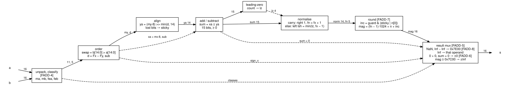

*Figure 1: the datapath of `fp16_add.sv`. Solid lines are data, dashed lines
are control. Internal names are the RTL's own; the spec fixes only `a`, `b`
and `s`. Source: [fp16_add_datapath.dot](img/fp16_add_datapath.dot).*

The spec's "one way to compute it" is informative. This is a single-path
guard, round and sticky adder with the same six steps, a choice of the
designer's **[bankside]** (see [Choices](#choices)):

1. **Unpack** ([FADD-4]): `ma`, `mb` = significand with its hidden bit;
   `fea`, `feb` = the exponent field, where a subnormal counts as 1. The
   value is `M · 2^(F − 25)` for both classes.
2. **Order:** `swap = b[14:0] > a[14:0]` (unsigned, so it compares
   magnitudes). *x* is the larger: `mx`, `fx`, `sign_x`; *y* the smaller.
   `d = fx − fy` is taken from two subtractors (`fea − feb`, `feb − fea`)
   that work in parallel with the compare, which only selects one.
   `sub = a[15] ^ b[15]`.
3. **Align:** `xa = mx · 8`; `ya = (my · 8) >> min(d, 14)`, with every bit
   shifted out ORed into `ya[0]`. The three low bits are guard, round and
   sticky. For `d ≥ 14` only the sticky bit is left.
4. **Add:** `sum = xa − ya` if `sub`, else `xa + ya`, 15 bits and never
   negative. `sum = 0` is the exact zero sum.
5. **Normalise:** a carry (`sum[14]`) shifts right by one, ORing the lost bit
   into sticky, and `fn = fx + 1`. Otherwise shift left by
   `lsh = min(lz, fx − 1)`, where `lz` counts the leading zeros of
   `sum[13:0]`, and `fn = fx − lsh`: the shift stops at the subnormal range.
   The result is `norm`, 14 bits, with the hidden bit at bit 13.
6. **Round** ([FADD-7]): `n = norm[13:3]`, `guard = norm[2]`,
   `sticky = norm[1] | norm[0]`, `inc = guard & (sticky | n[0])`. Then
   `mag = (fn − 1) · 1024 + n + inc`, 16 bits. With the hidden bit set this
   is `fn · 1024 + m`; a subnormal (`fn = 1`, `n < 1024`) gets exponent
   field 0; a rounding carry runs into the exponent field by itself.
   `ovf = mag ≥ 0x7C00`.
7. **Result mux** ([FADD-5]), in priority order:
   - a NaN operand, or two Infs of opposite sign: 0x7E00 ([FADD-8]);
   - `a` is Inf: `a`; `b` is Inf: `b`;
   - both operands zero: `{a[15] & b[15], 0}`, so −0 only for (−0) + (−0)
     ([FADD-6]);
   - `sum = 0`: +0 ([FADD-6]);
   - `ovf`: `{sign_x, 0x7C00}`;
   - otherwise `{sign_x, mag[14:0]}`.

   A single zero operand has no case of its own: with *y* = 0, `sum = xa`,
   which normalises and packs back to *x* bit for bit, subnormals included
   ([zero operand](#a-zero-operand-returns-the-other-bit-for-bit) shows it).

[FADD-10] holds by construction: the only asymmetric step is the compare,
which picks `a` on equal magnitudes, and then the sum is either an exact
zero (opposite signs, +0) or 2*x* (same signs), the same whichever operand
is *x*. Every example checks both orders.

## Examples

Each example lists its cases by the spec's case numbers. The marker on each
case is the time its pair is applied.

### Exact sums, the sign and cancellation

Cases #1, #2, #3, #13 and #14, in `example_exact`.

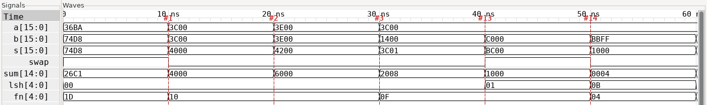

*Figure 2: [FADD-6], [FADD-7]. Source: [exact.waves.yaml](img/exact.waves.yaml).*

| Case | s | What it shows |
|---|---|---|
| #1 | 0x4000 | 1 + 1: `sum` = 0x4000 carries into bit 14, so `fn` = 15 + 1 = 0x10 |
| #2 | 0x4200 | 1.5 + 1.5 = 3: the carry again |
| #3 | 0x3C01 | 1 + 2⁻¹⁰, exact: `sum` = 0x2008, no shift |
| #13 | 0xBC00 | 1 + (−2) = −1: `swap` = 1, so the sign is `b`'s; `lsh` = 1 |
| #14 | 0x1000 | 1 − (1 − 2⁻¹¹) = 2⁻¹¹: `sum` = 0x0004, `lsh` = 11 (0x0B), `fn` = 4 |

**#14 worked by hand.** `a` = 0x3C00: `mx` = 0x400, `fx` = 15. `b` = 0xBBFF:
`my` = 0x7FF, `fy` = 14, so `d` = 1 and `sub` = 1. `xa` = 0x2000 and
`ya` = 0x3FF8 >> 1 = 0x1FFC (no bit lost). `sum` = 0x0004, whose leading 1
is at bit 2, so `lz` = 11 and `lsh` = min(11, 14) = 11. `norm` = 0x2000,
`fn` = 15 − 11 = 4. `n` = 0x400, `guard` = `sticky` = 0. `mag` = 3 · 1024 +
0x400 = 0x1000. Matches the figure.

```
cd src/fp16_add/rtl/doc/examples/toy && ../../../../../common/util/opendv run example_exact --seed 1
```

### Ties to even

Cases #4, #5, #8, #9, #10 and #11, in `example_ties`: every exact tie in the
worked-case table except #15, which is at the overflow bound and shown under
[Overflow](#overflow).

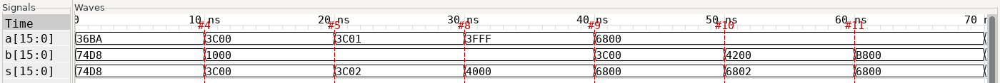

*Figure 3: [FADD-7], ties round to the even significand. Source:
[ties.waves.yaml](img/ties.waves.yaml).*

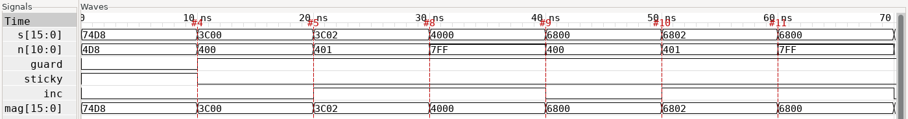

*Figure 4: the same run, with the rounding signals. On every tie `guard` is 1
and `sticky` is 0, so `inc` is `n[0]`: 1 on #5, #8 and #10 (odd, up), 0 on
#4, #9 and #11 (even, stay). On #8, `n` = 0x7FF plus `inc` carries into the
exponent field: `mag` = 0x4000. Source:
[ties_rounding.waves.yaml](img/ties_rounding.waves.yaml), same run.*

| Case | s | Which way the tie goes |
|---|---|---|
| #4 | 0x3C00 | 1 + 2⁻¹¹: down, `n` = 0x400 is even |
| #5 | 0x3C02 | (1 + 2⁻¹⁰) + 2⁻¹¹: up, `n` = 0x401 is odd |
| #8 | 0x4000 | (2 − 2⁻¹⁰) + 2⁻¹¹: up from `n` = 0x7FF, and the carry raises the exponent |
| #9 | 0x6800 | 2048 + 1: down to 2048 |
| #10 | 0x6802 | 2048 + 3: up from 2050 (odd) |
| #11 | 0x6800 | 2048 − 0.5: the difference drops a binade, `lsh` = 1, and the tie between 2047 (odd) and 2048 goes up |

**#5 worked by hand.** `a` = 0x3C01: `mx` = 0x401, `fx` = 15. `b` = 0x1000:
`my` = 0x400, `fy` = 4, `d` = 11. `xa` = 0x2008; `ya` = (0x400 · 8) >> 11 =
0x0004, no bit lost. `sum` = 0x200C, no shift. `n` = 0x401, `guard` = 1,
`sticky` = 0: a tie, and `n[0]` = 1. So `mag` = 14 · 1024 + 0x401 + 1 =
0x3C02. #4 is the same with `mx` = 0x400: `n[0]` = 0, `s` = 0x3C00.

```
cd src/fp16_add/rtl/doc/examples/toy && ../../../../../common/util/opendv run example_ties --seed 1
```

### The sticky bit and wide alignments

Cases #6, #7, #12, #20 and #21, in `example_sticky`.

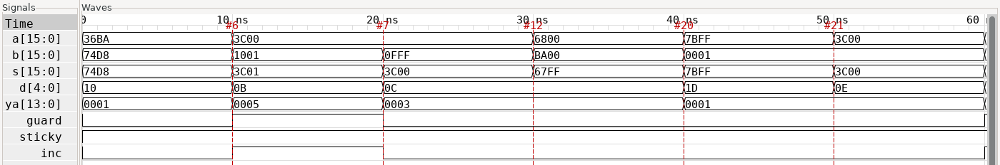

*Figure 5: [FADD-7]. `d` is the alignment distance and `ya` the aligned
smaller operand, whose bit 0 is the sticky bit. Source:
[sticky.waves.yaml](img/sticky.waves.yaml).*

| Case | s | What it shows |
|---|---|---|
| #6 | 0x3C01 | 1 + (2⁻¹¹ + 2⁻²¹), `d` = 11: `ya` = 0x0005, the 1 at bit 0 is the sticky bit from 2⁻²¹. `guard` = `sticky` = 1, so up |
| #7 | 0x3C00 | 1 + (2⁻¹¹ − 2⁻²²), `d` = 12: `ya` = 0x0003, `guard` = 0, so down |
| #12 | 0x67FF | 2048 − 0.75: the difference drops a binade and rounds to 2047 |
| #20 | 0x7BFF | 65504 + 2⁻²⁴, `d` = 29 (0x1D): the shift is capped at 14 and only the sticky bit is left |
| #21 | 0x3C00 | 1 + 2⁻²⁴, `d` = 14: again only the sticky bit |

```
cd src/fp16_add/rtl/doc/examples/toy && ../../../../../common/util/opendv run example_sticky --seed 1
```

### Overflow

Cases #15 to #19, in `example_overflow`.

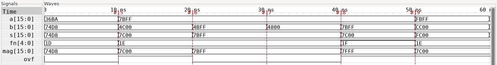

*Figure 6: [FADD-6], [FADD-7]. Overflow goes to ±Inf by round to nearest,
with no saturation. Source: [overflow.waves.yaml](img/overflow.waves.yaml).*

| Case | s | What it shows |
|---|---|---|
| #15 | 0x7C00 | 65504 + 16 = 65520, the tie between 65504 (odd) and 2¹⁶: `inc` carries `mag` from 0x7BFF to 0x7C00, so `ovf` |
| #16 | 0x7BFF | 65504 + 15.99, the largest sum below 65520: 65504 |
| #17 | 0x7BFF | 65504 + 8: 65504 |
| #18 | 0x7C00 | 65504 + 65504: the carry gives `fn` = 31 (0x1F), `mag` = 0x7FFF, so `ovf` |
| #19 | 0xFC00 | −65504 + (−16): −Inf, the sign of the sum |

```
cd src/fp16_add/rtl/doc/examples/toy && ../../../../../common/util/opendv run example_overflow --seed 1
```

### Exact subnormal sums

Cases #22 to #26, in `example_subnormals`. [FADD-7]: a subnormal sum is
always exact, and no non-zero sum becomes zero.

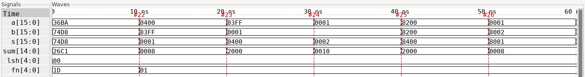

*Figure 7: [FADD-4], [FADD-7]. `lsh` stays 0 throughout: `fx` = 1 (#22's
normal operand 0x0400 has `fea` = 1 too), so `fx − 1` = 0 stops any left
shift and `fn` = 1. Source: [subnormals.waves.yaml](img/subnormals.waves.yaml).*

| Case | s | What it shows |
|---|---|---|
| #22 | 0x0001 | 2⁻¹⁴ − 1023 · 2⁻²⁴ = 2⁻²⁴: `sum` = 0x0008, not shifted, so `n` = 1, the smallest subnormal |
| #23 | 0x0400 | 1023 · 2⁻²⁴ + 2⁻²⁴: `sum` = 0x2000 reaches the hidden bit with `fn` = 1, which packs as exponent field 1, the smallest normal |
| #24 | 0x0002 | 2⁻²⁴ + 2⁻²⁴ |
| #25 | 0x8400 | two negative subnormals give −2⁻¹⁴, a normal |
| #26 | 0x8001 | 2⁻²⁴ − 2⁻²³ = −2⁻²⁴: `swap` takes `b`'s sign |

```
cd src/fp16_add/rtl/doc/examples/toy && ../../../../../common/util/opendv run example_subnormals --seed 1
```

### Signed zeros

Cases #27 to #33, in `example_signed_zeros`. [FADD-6]: an exact zero sum is
+0 in every case but (−0) + (−0).

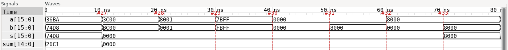

*Figure 8: [FADD-6]. #27 to #29 are x + (−x) for a normal, a subnormal and
±65504: `sum` = 0, so the mux gives +0. #30 to #32 are zero + zero with at
least one +0: +0. #33, (−0) + (−0), is the only pair that gives 0x8000.
Source: [signed_zeros.waves.yaml](img/signed_zeros.waves.yaml).*

```
cd src/fp16_add/rtl/doc/examples/toy && ../../../../../common/util/opendv run example_signed_zeros --seed 1
```

### A zero operand returns the other bit for bit

Cases #34 to #36, in `example_zero_operand`, then six more pairs, z1 to z6.
The spec's table has no row for them; their `s` is read off [FADD-5]'s table
("zero" row, "subnormal or normal" column: `b`, bit for bit):

| Pair | a | b | s |
|---|---|---|---|
| z1 | 0x0000 | 0x7BFF | 0x7BFF, 65504 |
| z2 | 0x8000 | 0xFBFF | 0xFBFF, −65504 |
| z3 | 0x0000 | 0x83FF | 0x83FF, the largest negative subnormal |
| z4 | 0x8000 | 0x03FF | 0x03FF, the largest subnormal |
| z5 | 0x8000 | 0x0200 | 0x0200, a middle subnormal |
| z6 | 0x0000 | 0x8400 | 0x8400, −2⁻¹⁴, the smallest normal |

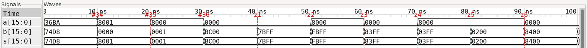

*Figure 9: [FADD-5]. `s` equals the non-zero operand on every pair, whichever
sign the zero has: no flush to zero, no sign change. The swapped pass (not
drawn) gives the same. Source: [zero_operand.waves.yaml](img/zero_operand.waves.yaml).*

```
cd src/fp16_add/rtl/doc/examples/toy && ../../../../../common/util/opendv run example_zero_operand --seed 1
```

### Infinities and Inf + (−Inf)

Cases #37 to #43, in `example_inf`.

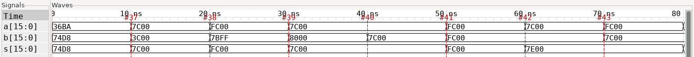

*Figure 10: [FADD-5], [FADD-8]. A finite operand plus Inf is that Inf, 65504
included (#38); Inf + (−0) is Inf (#39); Inf + Inf of one sign is that Inf
(#40, #41). +Inf + (−Inf) is 0x7E00 in either order (#42, #43). Source:
[inf.waves.yaml](img/inf.waves.yaml).*

```
cd src/fp16_add/rtl/doc/examples/toy && ../../../../../common/util/opendv run example_inf --seed 1
```

### NaN operands

Cases #44 to #49, in `example_nan`.

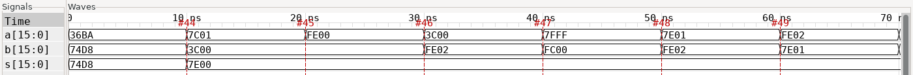

*Figure 11: [FADD-8], [FADD-10], [TOP-FP-6]. Every NaN result is 0x7E00: a
signalling NaN (#44), a negative quiet NaN (#45), a NaN second (#46), a NaN
with −Inf (#47), and two NaNs in either order (#48, #49). `s` stays 0x7E00
for the whole run, and no operand bit gets through. Source:
[nan.waves.yaml](img/nan.waves.yaml).*

```
cd src/fp16_add/rtl/doc/examples/toy && ../../../../../common/util/opendv run example_nan --seed 1
```

### The double-rounding rows

Rows D1 to D6, in `example_double_rounding`. The spec's table gives the
single-rounding result, `s`, next to what float32 and a 12-bit intermediate
give; the RTL rounds once, so it must give `s` on every row, including D1,
where a 12-bit intermediate would be wrong.

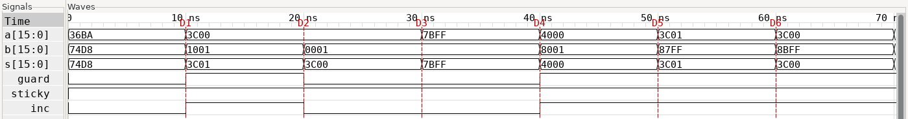

*Figure 12: [FADD-7]. Source: [double_rounding.waves.yaml](img/double_rounding.waves.yaml).*

| Row | s | What it shows in the RTL |
|---|---|---|
| D1 | 0x3C01 | #6 again: the sticky bit from 2⁻²¹ breaks the tie, so `inc` = 1. A 12-bit intermediate would have dropped it and given 0x3C00 |
| D2 | 0x3C00 | 1 + 2⁻²⁴: `guard` = 0, only sticky, down |
| D3 | 0x7BFF | 65504 + 2⁻²⁴: only sticky, down, no overflow |
| D4 | 0x4000 | 2 − 2⁻²⁴: `ya` is the sticky bit alone; `sum` = 0x1FFF shifts left by one, `n` = 0x7FF, `guard` = `sticky` = 1, so up, and the carry raises the exponent back to 2 |
| D5 | 0x3C01 | (1 + 2⁻¹⁰) − (2⁻¹⁴ − 2⁻²⁴), `d` = 14: `ya` is the sticky bit alone, `sum` = 0x2007 needs no shift, `n` = 0x400 with `guard` = `sticky` = 1, so up to 0x401: `s` = `a` |
| D6 | 0x3C00 | 1 − (2⁻¹² − 2⁻²³), `d` = 13: `sum` = 0x1FFF shifts left by one, `n` = 0x7FF, `guard` = `sticky` = 1: just above the midpoint below 1, so up to 1 |

```
cd src/fp16_add/rtl/doc/examples/toy && ../../../../../common/util/opendv run example_double_rounding --seed 1
```

## Results

All 49 worked cases and the 6 double-rounding rows, each in both orders,
give the spec's `s`, and so do the six [FADD-5] pairs z1 to z6: 122 pairs
applied in all. The run's log has one line per pair, with `ok` or `BAD`;
there is no `BAD`. Each example fails if any pair differs.

`regress --all --seeds 3` of the examples project at `aa5ffd3` passed: 33/33
runs (11 examples × 3 seeds, master seed 1331343813; replay with
`--master-seed 1331343813`), the sweep included on its 3 seeds, each with 0
mismatches.

### NumPy sanity sweep

`example_sweep` compares the RTL with NumPy `float16` addition, the oracle
the spec proves valid for every non-NaN sum ([NumPy as a
reference](../../doc/README.md#numpy-as-a-reference-double-rounding)), and
checks every NaN result against 0x7E00. Each pair is applied in both orders,
and both results must equal the reference ([FADD-10]). It covers:

- all 65536 values of `a` against 12 fixed values of `b` (±0, ±1, ±2⁻²⁴,
  0x03FF, 0x0400, ±65504, ±Inf);
- every `a` against −`a` (x + (−x), [FADD-6]);
- 200000 random pairs from the seed.

With seed 7, NumPy 2.5.1: 1051968 pairs, each in both orders, 30809 NaN
results (all 0x7E00), 0 mismatches. Exactly one result is −0, from the pair
(0x8000, 0x8000) ([FADD-6]).

```
cd src/fp16_add/rtl/doc/examples/toy && ../../../../../common/util/opendv run example_sweep --seed 7 --no-waves
```

This is the designer's sanity check, not the exhaustive check. The 2³² sweep
is DV's.

## Synthesis

The full-flow PPA is task #76. A quick run (synthesis and timing before
placement, no wires) on this RTL gave 110.7 µm² of cells (1057 cells) and a
delay of 1176.5 ps from `a`/`b` to `s` at the 3333 ps clock (ORFS
`26Q4-615-g8ba54e723`, ASAP7). It was run on the uncommitted working copy of
the RTL that was then committed unchanged as `aa5ffd3`, so it is an estimate
only: the numbers to quote will be #76's `syn/ppa.yaml`. For scale, fp16_mul's
quick run gave 1018 ps and its full flow 1239 ps. [FADD-11]'s budget is the
period less the S4/S5 register, the write-port select, `grf_b`'s
write-through multiplexer and the choice of *r*; it is checked when
`pcu_datapath` is synthesized.

```
.claude/skills/synth/scripts/synth fp16_add --quick
```

## Choices

| Choice | Options weighed | Chosen |
|---|---|---|
| Datapath | (a) single path, the spec's informative steps; (b) dual path (near and far), shorter in the worst case but about twice the shifters and adders; (c) a leading-zero anticipator beside the add | (a) **[bankside]**: smallest and easiest to check; the quick-run delay is about a third of the period. (b) or (c) only if #76 or the `pcu_datapath` loop shows it short of time |
| Order compare | (a) compare `a[14:0]` and `b[14:0]`, form both exponent differences in parallel; (b) compare, then subtract the selected exponents | (a) **[bankside]**: the two 5-bit subtractors run beside the 15-bit compare instead of after it. Not measured against (b) |
| Zero operand | (a) no case: the datapath returns *x* exactly when *y* = 0; (b) an explicit mux case | (a) **[bankside]**: no logic for it, shown in `example_zero_operand` and the sweep's 2 × 65536 pairs with ±0. Zero + zero does need a case, for the sign of [FADD-6] |
| Alignment shift cap | 14 places (all of `my · 8` gone) | **[bankside]**, as the spec's step 2 |

[FADD-1]: ../../doc/README.md#ports
[FADD-3]: ../../doc/README.md#behaviour
[FADD-4]: ../../doc/README.md#operand-classes
[FADD-5]: ../../doc/README.md#the-result
[FADD-6]: ../../doc/README.md#the-result
[FADD-7]: ../../doc/README.md#the-result
[FADD-8]: ../../doc/README.md#the-result
[FADD-10]: ../../doc/README.md#the-result
[FADD-11]: ../../doc/README.md#timing
[TOP-HIER-3]: ../../../top/doc/hierarchy.md#fp16-units
[TOP-ARCH-9]: ../../../top/doc/theory_of_operation.md#register-files
[TOP-FP-6]: ../../../top/doc/theory_of_operation.md#fp16-arithmetic
