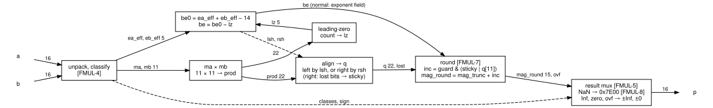
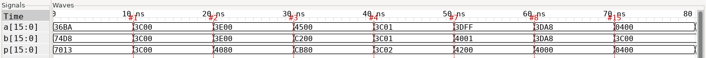
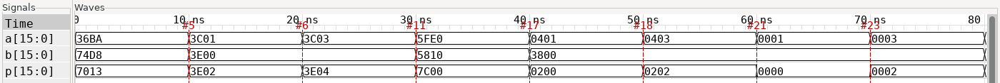
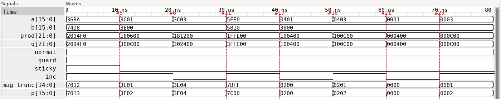
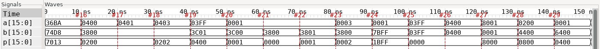
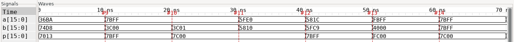
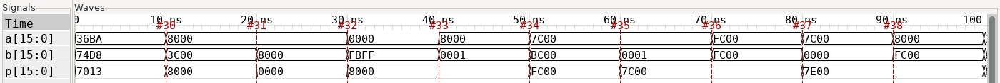
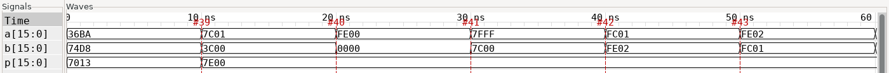

# fp16_mul: review page

Owner: designer. This page shows, with toy examples, that the RTL in
[`../fp16_mul.sv`](../fp16_mul.sv) does what the spec
([`src/fp16_mul/doc/README.md`](../../doc/README.md), [FMUL-1] to [FMUL-11])
says. It is a demonstration, not verification: DV's tests in
`src/fp16_mul/dv/` are the check.

- **RTL commit:** `e844553`. Every result and waveform below comes from that
  commit. The full-flow PPA comes from `83ea73a`, which has the same RTL
  (see [Synthesis](#synthesis)).
- **Expected values:** the `p` column of the spec's
  [worked cases](../../doc/README.md#worked-cases). The harness reads that
  table from the spec file itself (`examples/toy/env/fmul_toy.py`), so an
  example can't check a value the spec doesn't give.
- **Every example applies its pairs twice:** as (`a`, `b`), then swapped as
  (`b`, `a`) ([FMUL-10]). The waveforms show the first pass. Each pair is held
  10 ns and `p` is read 1 ns after the inputs change.
- **Rerun.** From `src/fp16_mul/rtl/doc/examples/toy/`:

  ```
  ../../../../../common/util/opendv run example_<name> --seed 1
  ../../../../../common/util/opendv regress --all --seeds 3
  ```

  Then, from the repo root, redraw and check the images:

  ```
  .claude/skills/waves/scripts/waves png --check src/fp16_mul/rtl/doc/
  ```

  The seed affects only the first 10 ns of each waveform, before the first
  pair: there the inputs hold random power-up values (`0x36BA`, `0x74D8` with
  seed 1, [TOP-ARCH-9]), and `p` is their product.

## Ports and lint

[FMUL-1], [FMUL-3], [FMUL-11], [TOP-HIER-3]: the module has ports `a`, `b` and
`p`, all `logic [15:0]`. It has no parameters, no clock and no state. Every
`always` block is `always_comb`, and every signal is assigned on every path.

```
$ src/common/util/opendv lint fp16_mul
fp16_mul: clean
```

There are no waivers. The filelist `rtl/fp16_mul.f` lists `fp16_mul.sv`, and
`src/fp16_mul/opendv.yaml` names toplevel `fp16_mul` and filelist
`rtl/fp16_mul.f`. The two agree.

## Structure



*Figure 1: the datapath of `fp16_mul.sv`. Solid lines are data, dashed lines
are control. Internal names are the RTL's own; the spec fixes only `a`, `b`
and `p`. Source: [fp16_mul_datapath.dot](img/fp16_mul_datapath.dot).*

The spec's "one way to compute it" is informative; this structure is the
designer's choice **[bankside]**. It has the same steps, arranged so that only
one shifter works on any given result:

1. **Unpack** ([FMUL-4]): `ma`, `mb` = significand with its hidden bit;
   `ea_eff`, `eb_eff` = the exponent field, where a subnormal counts as 1.
2. **Multiply:** `prod = ma × mb`, 22 bits and exact. The product's value is
   `prod · 2^(ea_eff + eb_eff − 50)`.
3. **Exponent:** `be0 = ea_eff + eb_eff − 14` is the biased exponent the
   result would have with `prod`'s leading 1 at bit 21. The real exponent is
   `be = be0 − lz`, where `lz` is `prod`'s leading-zero count.
4. **Align** so that bit 11 of `q` carries the result's quantum:
   - `be0 ≥ 1` and `lz ≤ be0 − 1`: a normal result. `q = prod << lz`, and
     `q[21] = 1`.
   - `be0 ≥ 1` and `lz > be0 − 1`: a subnormal result reached by
     normalising. `q = prod << (be0 − 1)`, so bit 21 weighs 2⁻¹⁴ and bit 11
     weighs 2⁻²⁴.
   - `be0 ≤ 0`: a subnormal result, or zero. `q = prod >> (1 − be0)`, a
     shift of 1 to 13 places. The bits shifted out OR into `lost`.

   The left shift never drops a 1. So `q[21]` is 1 exactly when the result
   is normal.
5. **Round** ([FMUL-7]): `guard = q[10]`, `sticky = |q[9:0] | lost`,
   `inc = guard & (sticky | q[11])`. Then
   `mag_round = {efield, q[20:11]} + inc`, where `efield` is `be` for a
   normal result and 0 for a subnormal one. A carry out of the significand
   runs into the exponent field: 0x03FF + 1 = 0x0400, and 0x7BFF + 1 =
   0x7C00 = Inf. `be ≥ 31` is an overflow to Inf (`ovf`).
6. **Result mux** ([FMUL-5], [FMUL-8]), in priority order:
   - a NaN operand, or zero × Inf: 0x7E00;
   - an Inf operand: `{s, 0x7C00}`;
   - a zero operand: `{s, 0}`;
   - `ovf`: `{s, 0x7C00}`;
   - otherwise: `{s, mag_round}`.

   `s = a[15] ^ b[15]` ([FMUL-6]), so a product that rounds to zero keeps
   its sign.

## Examples

Each example below lists its cases by the spec's case numbers. The marker on
each case is the time its pair is applied.

### Exact products, the sign and rounding to nearest

Cases #1, #2, #3, #4, #7, #8 and #15, in `example_exact`.



*Figure 2: [FMUL-6], [FMUL-7]. The markers sit on the cases. The `p` values
match the spec's column for each case:*

| Case | p | What it shows |
|---|---|---|
| #1 | 0x3C00 | 1 × 1 |
| #2 | 0x4080 | 2.25: the leading 1 is at bit 21, so the exponent goes up |
| #3 | 0xCB80 | −15: the sign is the XOR |
| #4 | 0x3C02 | rounds down |
| #7 | 0x4200 | just below a tie: rounds down |
| #8 | 0x4000 | rounds up, and the carry raises the exponent |
| #15 | 0x0400 | the smallest normal |

*Source: [exact.waves.yaml](img/exact.waves.yaml).*

```
cd src/fp16_mul/rtl/doc/examples/toy && ../../../../../common/util/opendv run example_exact --seed 1
```

### Ties to even

Cases #5, #6, #11, #17, #18, #21 and #23, in `example_ties`. These are every
exact tie in the spec's table: normal, subnormal, at the overflow bound and
at the underflow bound.



*Figure 3: [FMUL-7], ties round to the even significand. Source:
[ties.waves.yaml](img/ties.waves.yaml).*

| Case | p | Which way the tie goes |
|---|---|---|
| #5 | 0x3E02 | up, from odd *m* = 0x201 |
| #6 | 0x3E04 | down, from even *m* = 0x204 |
| #11 | 0x7C00 | 65520 is a tie between 65504 (odd) and 2¹⁶: rounds to even, which is Inf |
| #17 | 0x0200 | a subnormal tie, rounds down |
| #18 | 0x0202 | a subnormal tie, rounds up |
| #21 | 0x0000 | 2⁻²⁵, a tie between 0 and 2⁻²⁴: rounds to 0 |
| #23 | 0x0002 | rounds up to even |



*Figure 4: the same run, with the rounding signals. On every tie, `guard` is 1
and `sticky` is 0. `inc` then follows bit 0 of `mag_trunc` (that is, `q[11]`):
it is 1 on #5, #11, #18 and #23 (odd, round up) and 0 on #6, #17 and #21
(even, stay). On #11, `mag_trunc` = 0x7BFF plus `inc` carries into the
exponent field and gives 0x7C00. Source:
[ties_rounding.waves.yaml](img/ties_rounding.waves.yaml), same run.*

```
cd src/fp16_mul/rtl/doc/examples/toy && ../../../../../common/util/opendv run example_ties --seed 1
```

**Worked by hand, two cases with the same 11-bit significand pair:**

- **#5**, 0x3C01 × 0x3E00:
  - `ma` = 0x401, `mb` = 0x600, so `prod` = 0x180600 and `lz` = 1.
  - `be0` = 15 + 15 − 14 = 16, so the result is normal with `be` = 15.
  - `q` = 0x300C00.
  - `q[20:11]` = 0x201, `guard` = 1, `sticky` = 0: a tie, and `q[11]` = 1
    (odd).
  - So 0x3E01 + 1 = 0x3E02.
- **#17**, 0x0401 × 0x3800:
  - `ma` = 0x401, `mb` = 0x400, so `prod` = 0x100400 and `lz` = 1.
  - `be0` = 1 + 14 − 14 = 1, and `lz` > `be0` − 1 = 0, so the result is
    subnormal with `lsh` = 0.
  - `q` = 0x100400.
  - `q[20:11]` = 0x200, `guard` = 1, `sticky` = 0: a tie, and `q[11]` = 0
    (even).
  - So `p` = 0x0200.

Both match Figure 4.

### Subnormals and underflow

Cases #16 to #29, in `example_subnormals`.



*Figure 5: [FMUL-4], [FMUL-6], [FMUL-7]. Subnormal operands and results, no
flush to zero. Source: [subnormals.waves.yaml](img/subnormals.waves.yaml).*

| Case | p | What it shows |
|---|---|---|
| #16 | 0x0200 | normal × normal gives an exact subnormal |
| #19 | 0x0400 | a subnormal operand whose product rounds up to the smallest normal (the carry from 0x03FF) |
| #20 | 0x0001 | the smallest subnormal, exact |
| #22 | 0x0001 | just above 2⁻²⁵: rounds up, not to 0 |
| #24 | 0x1BFF | subnormal × normal gives a normal |
| #25 | 0x0000 | subnormal × subnormal: `be0` = −12, so the right shift is 13 and the product underflows |
| #26 | 0x0000 | normal × normal underflows: `be0` = −12 |
| #27 | 0x8000 | underflows to −0, keeping the sign |
| #28 | 0x0800 | subnormal × normal gives a normal |
| #29 | 0x0400 | subnormal × normal gives a normal |

*#17, #18, #21 and #23 are the ties above.*

```
cd src/fp16_mul/rtl/doc/examples/toy && ../../../../../common/util/opendv run example_subnormals --seed 1
```

### Overflow

Cases #9 to #14, in `example_overflow`.



*Figure 6: [FMUL-7]. Overflow goes to ±Inf, with no saturation. Source:
[overflow.waves.yaml](img/overflow.waves.yaml).*

| Case | p | What it shows |
|---|---|---|
| #9 | 0x7BFF | 65504, exact |
| #10 | 0x7C00 | 65567.97: Inf, not 65504 |
| #11 | 0x7C00 | the tie at 65520 |
| #12 | 0x7BFF | 65519.875, the largest product below the bound |
| #13 | 0xFC00 | −Inf |
| #14 | 0x7C00 | 65504², the largest product (`be` = 46, `ovf`) |

```
cd src/fp16_mul/rtl/doc/examples/toy && ../../../../../common/util/opendv run example_overflow --seed 1
```

### Zeros, infinities and zero × Inf

Cases #30 to #38, in `example_zero_inf`.



*Figure 7: [FMUL-5], [FMUL-6], [FMUL-8]. Source:
[zero_inf.waves.yaml](img/zero_inf.waves.yaml).*

| Case | p | What it shows |
|---|---|---|
| #30 to #33 | ±0 | signed zeros; zero × 65504 and zero × a subnormal are zero |
| #34 to #36 | ±Inf | Inf × the smallest subnormal is Inf (#35) |
| #37, #38 | 0x7E00 | zero × Inf, in either order and with any signs, is the canonical NaN |

```
cd src/fp16_mul/rtl/doc/examples/toy && ../../../../../common/util/opendv run example_zero_inf --seed 1
```

### NaN operands

Cases #39 to #43, in `example_nan`.



*Figure 8: [FMUL-8], [FMUL-10], [TOP-FP-6]. Every NaN result is 0x7E00. That
holds for a signalling NaN (#39), a negative NaN times zero (#40), a NaN
payload times Inf (#41), and two NaNs in either order (#42, #43). `p` stays
0x7E00 for the whole run, and no operand bit gets through. Source:
[nan.waves.yaml](img/nan.waves.yaml).*

```
cd src/fp16_mul/rtl/doc/examples/toy && ../../../../../common/util/opendv run example_nan --seed 1
```

## Results

All 43 worked cases, each in both orders, give the spec's `p`. That is 96
pairs applied, because #17, #18, #21 and #23 appear in two examples. The
run's log has one line per pair, with `ok` or `BAD`; there is no `BAD`. Each
example fails if any pair differs.

`regress --all --seeds 3` of the examples project at `e844553` passed: 21/21
runs (7 examples × 3 seeds, master seed 1200109266; replay with
`--master-seed 1200109266`), the sweep included on its 3 seeds.

### NumPy sanity sweep

`example_sweep` compares the RTL with NumPy 2.5.1 `float16`, the oracle the
spec names for non-NaN results ([how the cases are
checked](../../doc/README.md#how-the-cases-are-checked)). It checks every NaN
result against 0x7E00. It covers:

- all 65536 values of `a` against 8 fixed values of `b`, in both orders;
- 200000 random pairs from the seed.

With seed 7: 1248576 pairs, 36943 NaN results, 0 mismatches.

```
cd src/fp16_mul/rtl/doc/examples/toy && ../../../../../common/util/opendv run example_sweep --seed 7 --no-waves
```

This is the designer's sanity check, not the exhaustive check. The 2³² sweep
is DV's.

## Synthesis

The full flow (placement, clock tree, routing, finish), ORFS
`26Q4-615-g8ba54e723`, ASAP7, 3333 ps, from
[`syn/ppa.yaml`](../../syn/ppa.yaml) at commit `83ea73a` (`clean: true`). The
RTL is unchanged since `e844553`, the commit the examples above ran on.

```
.claude/skills/synth/scripts/synth fp16_mul
```

| Measure | Full flow (`ppa.yaml`) | Quick run at `e844553`, no wires |
|---|---|---|
| Area | 149.2 µm² (placed and routed) | 147.3 µm² |
| Cells | 1561 (48 timing buffers) | 1451 |
| Delay, `a`/`b` → `p` | 1238.8 ps | 1018.4 ps |
| DRC violations | 0 | n/a |

The full-flow numbers are the ones to quote; the quick run is kept only to
show what placement and routing add (220 ps of wire and buffer delay). The
worst path runs `b[14]` → hidden bit → significand multiplier → `lz` → shift
→ `inc` → `p[8]`, the datapath of Figure 1 in series. Power (0.128 mW) is
OpenSTA's default-activity guess, an indication only.

[FMUL-11] sets no budget of its own beyond the 3333 ps period, and the
multiplier is not on the accumulator loop. So 1239 ps (37% of the period)
leaves 2094 ps for the rest of [DP-17]'s S3 path, the register around it and
the choice of *x*; that path is checked when `pcu_datapath` is synthesized.
The details are in [`syn/README.md`](../../syn/README.md).

[FMUL-1]: ../../doc/README.md#ports
[FMUL-3]: ../../doc/README.md#behaviour
[FMUL-4]: ../../doc/README.md#operand-classes
[FMUL-5]: ../../doc/README.md#the-result
[FMUL-6]: ../../doc/README.md#the-result
[FMUL-7]: ../../doc/README.md#the-result
[FMUL-8]: ../../doc/README.md#the-result
[FMUL-10]: ../../doc/README.md#the-result
[FMUL-11]: ../../doc/README.md#timing
[TOP-HIER-3]: ../../../top/doc/hierarchy.md#fp16-units
[TOP-ARCH-9]: ../../../top/doc/theory_of_operation.md#register-files
[TOP-FP-6]: ../../../top/doc/theory_of_operation.md#fp16-arithmetic
[DP-17]: ../../../pcu_datapath/doc/README.md#timing
