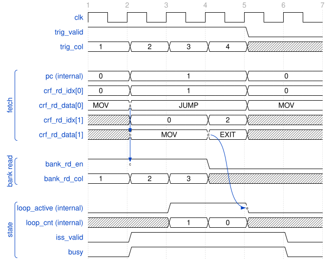

# pcu_ctrl: specification

Owner: architect. Readers: everyone. The designer and DV each build from this
alone, so anything they would have to guess belongs here.

Every rule is tagged `[paper]`, `[ANEMOS]` or `[bankside]`, and every rule a
test can check has an ID: `[CTRL-1]`, `[CTRL-2]`, ...

## Overview

`pcu_ctrl` is stage S1 of the pipeline. In each cycle with a trigger it
fetches the instruction at the PC from the CRF, resolves a JUMP in the same
cycle (a JUMP takes no slot), steps the PC, the loop state and the NOP
counter, requests the bank read of an instruction with a bank source, and
loads the S1/S2 register (the **issue** bundle) that `pcu_datapath` takes
in S2. It also holds the sticky `err_illegal` flag and drives its own term
of `busy`. It has one child, `pcu_decode` (instance `dec`), which decodes the
instruction word.

How `pcu_ctrl` connects to its siblings (`crf`, `pcu_datapath`, the top
ports) is defined by the parent, in
[hierarchy.md](../../top/doc/hierarchy.md#how-top-connects-its-children)
([TOP-HIER-2], [TOP-HIER-4], [TOP-HIER-8]), not here. The rules this module
carries out are those of the top spec:

| Top rule | What it asks of `pcu_ctrl` | Here |
|---|---|---|
| [TOP-ISA-3], [TOP-ISA-13], [TOP-ISA-28] | one loop state, its transitions on every JUMP | [CTRL-7], [CTRL-9] |
| [TOP-ISA-4], [TOP-PIPE-3] | a JUMP occupies no slot: resolved in S1, its next instruction fetched in the same cycle | [CTRL-3], [CTRL-7], [CTRL-8] |
| [TOP-ISA-5] | EXIT: PC ← 0, loop state cleared | [CTRL-9] |
| [TOP-ISA-7], [TOP-ISA-27] | a JUMP reached from a JUMP waits one `NOP 1` slot | [CTRL-8], [CTRL-9] |
| [TOP-ISA-8] | PC + 1, wrapping from 31 to 0 | [CTRL-9] |
| [TOP-ISA-12] | `NOP n`: max(*n*, 1) slots, the PC held until the last | [CTRL-9] |
| [TOP-ISA-2], [TOP-ISA-24], [TOP-ISA-26] | an illegal word, or a JUMP out of range, is a one-slot NOP and sets `err_illegal` at the end of its S1 cycle | [CTRL-7], [CTRL-9], [CTRL-10] |
| [TOP-IF-1], [TOP-PIPE-4] | one slot per cycle with a trigger outside reset; every slot is an entry | [CTRL-5], [CTRL-12] |
| [TOP-IF-2], [TOP-ARCH-6] | the bank read request in S1, combinational, at the trigger's row and column | [CTRL-11] |
| [TOP-ARCH-8] | a bank store's address is its own trigger's, carried down the pipeline | [CTRL-12] |
| [TOP-IF-4] | reset | [CTRL-4], [CTRL-5] |
| [TOP-IF-6], [TOP-IF-8] | the CRF is written only while idle | [CTRL-14] |
| [TOP-IF-7], [TOP-HIER-8] | `pcu_ctrl`'s term of `busy`, from registers only | [CTRL-13] |
| [TOP-ARCH-10], [TOP-HIER-4] | the CRF's read-port count | [CTRL-3] |

[TOP-ARCH-3]: ../../top/doc/theory_of_operation.md#architecture
[TOP-ARCH-6]: ../../top/doc/theory_of_operation.md#bank-access
[TOP-ARCH-7]: ../../top/doc/theory_of_operation.md#bank-access
[TOP-ARCH-8]: ../../top/doc/theory_of_operation.md#bank-access
[TOP-ARCH-10]: ../../top/doc/theory_of_operation.md#register-files
[TOP-PIPE-3]: ../../top/doc/theory_of_operation.md#pipeline
[TOP-PIPE-4]: ../../top/doc/theory_of_operation.md#pipeline
[TOP-ISA-2]: ../../top/doc/programmers_guide.md#illegal-instructions
[TOP-ISA-3]: ../../top/doc/programmers_guide.md#jump
[TOP-ISA-4]: ../../top/doc/programmers_guide.md#jump
[TOP-ISA-5]: ../../top/doc/programmers_guide.md#exit
[TOP-ISA-6]: ../../top/doc/programmers_guide.md#programming-rules
[TOP-ISA-7]: ../../top/doc/programmers_guide.md#programming-rules
[TOP-ISA-8]: ../../top/doc/programmers_guide.md#program-counter
[TOP-ISA-12]: ../../top/doc/programmers_guide.md#nop
[TOP-ISA-13]: ../../top/doc/programmers_guide.md#jump
[TOP-ISA-14]: ../../top/doc/programmers_guide.md#jump
[TOP-ISA-24]: ../../top/doc/programmers_guide.md#illegal-instructions
[TOP-ISA-25]: ../../top/doc/programmers_guide.md#illegal-instructions
[TOP-ISA-26]: ../../top/doc/programmers_guide.md#when-a-jump-rule-is-broken
[TOP-ISA-27]: ../../top/doc/programmers_guide.md#when-a-jump-rule-is-broken
[TOP-ISA-28]: ../../top/doc/programmers_guide.md#when-a-jump-rule-is-broken
[TOP-IF-1]: ../../top/doc/interfaces.md#timing
[TOP-IF-2]: ../../top/doc/interfaces.md#timing
[TOP-IF-4]: ../../top/doc/interfaces.md#timing
[TOP-IF-6]: ../../top/doc/interfaces.md#timing
[TOP-IF-7]: ../../top/doc/interfaces.md#timing
[TOP-IF-8]: ../../top/doc/interfaces.md#timing
[TOP-IF-10]: ../../top/doc/interfaces.md#register-file-access-through-the-ports
[TOP-HIER-1]: ../../top/doc/hierarchy.md#modules
[TOP-HIER-2]: ../../top/doc/hierarchy.md#who-owns-which-stage
[TOP-HIER-4]: ../../top/doc/hierarchy.md#register-files
[TOP-HIER-6]: ../../top/doc/hierarchy.md#how-top-connects-its-children
[TOP-HIER-7]: ../../top/doc/hierarchy.md#how-top-connects-its-children
[TOP-HIER-8]: ../../top/doc/hierarchy.md#how-top-connects-its-children
[RF-4]: ../../pcu_regfile/doc/README.md
[RF-13]: ../../pcu_regfile/doc/README.md
[TOP-HIER-9]: ../../top/doc/hierarchy.md#shared-package-and-the-wrapper

**Sources.** The papers give the zero-cycle JUMP and the loop and NOP
instructions ([TOP-ISA-4], [TOP-PIPE-3]), not how the fetch is built, so the
rules here are **[bankside]** unless marked. ANEMOS
(github.com/gem5-X/cnm_framework at `f2d4018`) has the same control state:
a registered PC (`src/pc_unit.cpp`), one loop state and a NOP counter in its
decoder (`src/instr_decoder.cpp`), and a CRF with one read port addressed by
the PC (`src/crf.cpp`; read, and run in the top spec's
[anemos_ctrl.out](../../top/doc/examples/anemos_ctrl.out)). Its PC unit
computes `pc_nxt = pc_reg - jump_num` and registers it, so the target is
fetched in the next cycle and every JUMP fetch takes a triggering command of
its own. bankside's zero-slot JUMP is the paper's and differs from ANEMOS
there on purpose; the
[programmer's guide](../../top/doc/programmers_guide.md#differences-from-anemos)
lists that difference.

**Clock edge.** Every register here is clocked on the **rising edge** of
`clk`, and "the end of cycle *t*" is the rising edge between cycles *t* and
*t* + 1. The top spec doesn't state the edge yet (#44); this doc assumes the
rising edge, as `pcu_regfile`'s does. **[bankside]**

## Parameters

- **[CTRL-1]** Two parameters, both set by `top` to its own values of the
  same names ([interfaces.md](../../top/doc/interfaces.md#parameters)).
  **[bankside]**

  | Parameter | Type | Default | Meaning |
  |---|---|---|---|
  | `ROW_W` | `int unsigned` | 14 | Width of `trig_row`, `bank_rd_row`, `iss_row` |
  | `COL_W` | `int unsigned` | 5 | Width of `trig_col`, `bank_rd_col`, `iss_col` |

  Everything else is fixed by the ISA: the PC is 5 bits (32 CRF entries),
  an instruction word 32 bits.

## Ports

- **[CTRL-2]** The ports. No other ports exist. **[bankside]**

  | Port | Dir | Width | Timing | Description |
  |---|---|---|---|---|
  | `clk` | in | 1 | – | Clock, rising edge |
  | `rst_n` | in | 1 | sampled at the edge; also gates the slot ([CTRL-5]) | Synchronous reset, active low ([TOP-IF-4]) |
  | **Trigger** | | | | |
  | `trig_valid` | in | 1 | combinational into the bank read; sampled at the edge | A triggering command in this cycle ([TOP-IF-1]) |
  | `trig_row` | in | `ROW_W` | as `trig_valid` | Its row |
  | `trig_col` | in | `COL_W` | as `trig_valid` | Its column |
  | **Fetch** (to `crf`) | | | | |
  | `crf_rd_idx` | out | 2 × 5 | combinational ([CTRL-6], [CTRL-7]) | The two CRF read indices, packed `logic [1:0][4:0]` |
  | `crf_rd_data` | in | 2 × 32 | combinational from `crf` | The two words read, packed `logic [1:0][31:0]` |
  | **Bank read request** (top ports) | | | | |
  | `bank_rd_en` | out | 1 | combinational ([CTRL-11]) | The slot in S1 reads a bank |
  | `bank_rd_sel` | out | 1 | combinational | 0 = EVEN_BANK, 1 = ODD_BANK |
  | `bank_rd_row` | out | `ROW_W` | combinational | The trigger's row |
  | `bank_rd_col` | out | `COL_W` | combinational | The trigger's column |
  | **Issue** (the S1/S2 register, to `pcu_datapath`) | | | | |
  | `iss_valid` | out | 1 | registered ([CTRL-12]) | An entry is in S2 |
  | `iss_instr` | out | `$bits(dec_instr_t)` | registered | The entry's decoded instruction ([CTRL-12], [CTRL-15]) |
  | `iss_row` | out | `ROW_W` | registered | The entry's trigger row |
  | `iss_col` | out | `COL_W` | registered | The entry's trigger column |
  | **Status** | | | | |
  | `busy` | out | 1 | registered ([CTRL-13]) | `pcu_ctrl`'s term of the top `busy` |
  | `err_illegal` | out | 1 | registered ([CTRL-10]) | The top `err_illegal`, sticky |

  `dec_instr_t` is the decoded-instruction type of the shared package
  ([TOP-HIER-9]); its fields are defined by `pcu_decode`'s doc (#31).

- **[CTRL-3]** **The fetch uses two CRF read ports.** `top` instantiates
  `crf` with `N_RD` = 2 and connects `crf_rd_idx` and `crf_rd_data`
  one-to-one to its `rd_idx` and `rd_data`, in the packed layout of
  `pcu_regfile` ([RF-4] in [its doc](../../pcu_regfile/doc/README.md)): port
  *p* is `crf_rd_idx[p]` = bits `[5p+4 : 5p]` and `crf_rd_data[p]` = bits
  `[32p+31 : 32p]`. Port 0 reads the word at the PC ([CTRL-6]); port 1 reads
  the word a JUMP leads to ([CTRL-7]). `crf`'s debug read port is not one of
  the two ([TOP-HIER-7]). **[bankside]** This settles #27: why two ports and
  this scheme are in [Choices weighed](#choices-weighed), and
  [case A](#case-a-the-loop-one-trigger-per-cycle) shows it cycle by cycle.

## Behaviour

The rules below are written as signals of one cycle. In short, every cycle
computes:

```
w0    = crf_rd_data[0]                     ; crf_rd_idx[0] = pc         [CTRL-6]
j0    = opcode(w0) == JUMP
jbad  = j0 && (imm0(w0) == 0 || imm0(w0) > pc)                          [CTRL-7]
a1    = taken ? pc - imm0(w0) : pc + 1     ; crf_rd_idx[1] = a1         [CTRL-7]
w1    = crf_rd_data[1]
slot  = trig_valid && rst_n                                             [CTRL-5]
jres  = j0 && !jbad && nop_cnt == 0        ; the slot resolves a JUMP
p, w  = jres ? (a1, w1) : (pc, w0)         ; the slot's PC and word     [CTRL-8]
kind  = NOPSLOT | ILLJ | HOLD | ILL | NOP | EXIT | OP                   [CTRL-8]
```

and at the rising edge that ends it, loads the next state of [CTRL-9],
[CTRL-10] and [CTRL-12]. The block is a summary; where it and a rule seem
to differ, the rule is right.

### State and reset

- **[CTRL-4]** **State.** `pcu_ctrl` holds exactly these registers, under
  these names (so that assertions can bind to them), all clocked on the
  rising edge of `clk`. **[bankside]**, **[ANEMOS]** (the same state:
  `pc_reg`, `jmp_act_reg`, `jmp_cnt_reg`, `nop_cnt_reg`).

  | Register | Width | Reset value | Meaning |
  |---|---|---|---|
  | `pc` | 5 | 0 | The PC: the CRF entry the next slot fetches first |
  | `loop_active` | 1 | 0 | The loop state of [TOP-ISA-3] |
  | `loop_cnt` | 11 | 0 | The loop state of [TOP-ISA-3]; its value matters only while `loop_active` = 1 |
  | `nop_cnt` | 8 | 0 | The slots of the current multi-cycle NOP not yet issued |
  | `err_illegal` | 1 | 0 | The output of the same name ([CTRL-10]) |
  | `iss_valid` | 1 | 0 | The S1/S2 valid bit ([CTRL-12]) |
  | `iss_instr`, `iss_row`, `iss_col` | as the ports | none | The rest of the S1/S2 register; don't-care while `iss_valid` = 0 |

  At the rising edge that ends a cycle with `rst_n` = 0, every register with
  a reset value takes it ([TOP-IF-4]); the registers without one may change
  or not. Before the first such edge after power-up, the state is undefined:
  the unit must be reset before its first trigger.

- **[CTRL-5]** **Slots and reset.** A cycle is a **slot** if and only if
  `trig_valid` = 1 and `rst_n` = 1 ([TOP-IF-1], [TOP-PIPE-4]). This settles
  #41: a trigger in a cycle with `rst_n` = 0 is not a slot. In such a cycle,
  as in any cycle that isn't a slot:
  - `bank_rd_en` = 0 ([CTRL-11]), whatever the word at the PC;
  - the fetch has no effect: no register changes because of the words read.

  At the end of a cycle that isn't a slot, with `rst_n` = 1, `pc`,
  `loop_active`, `loop_cnt`, `nop_cnt` and `err_illegal` keep their values
  and `iss_valid` ← 0. With `rst_n` = 0, [CTRL-4]'s reset values are loaded,
  and they **win over every other update** at that edge: in particular an
  illegal word at the PC in a reset cycle does not set `err_illegal`
  ([CTRL-10]). **[bankside]**: the papers don't say what a command does
  during reset. ANEMOS has no synchronous reset to compare with: its
  registers are set once, at the start of its clocked threads, and its
  decoder acts only when its trigger (`decode_en`) is set
  (`src/instr_decoder.cpp`; read, not run). See
  [case D](#case-d-triggers-in-reset-cycles).

### Fetch and the zero-slot JUMP

- **[CTRL-6]** **Port 0.** In every cycle, `crf_rd_idx[0]` = `pc`. Its word,
  `crf_rd_data[0]`, is called *w0*. **[ANEMOS]** (its CRF read address is
  `pc_reg`), **[bankside]**.

- **[CTRL-7]** **A JUMP at port 0.** *w0* is a **JUMP** if its opcode field
  (bits 31–28, the same in every format of
  [bankside_isa.yaml](../../top/doc/bankside_isa.yaml)) holds JUMP's opcode
  (1). Its IMM0 and IMM1 are bits 18–11 and 10–0 (the yaml's control format).
  - **Range check** ([TOP-ISA-26]). The JUMP is **out of range** if IMM0 = 0
    or IMM0 > `pc`, compared as unsigned 8-bit numbers with `pc`
    zero-extended. **[bankside]**
  - **Where it leads.** If the JUMP is in range, its outcome and the loop
    state it leaves are given by the table of [TOP-ISA-3] (with
    [TOP-ISA-13]), read with `loop_active`, `loop_cnt` and the JUMP's IMM1:
    *taken* in the first and third rows, not taken in the second and fourth.
    The word it leads to is at
    *a1* = `pc` − IMM0 if taken, `pc` + 1 (modulo 32) if not.
  - **Port 1.** In every cycle in which *w0* is an in-range JUMP, slot or
    not, `crf_rd_idx[1]` = *a1*, and `crf_rd_data[1]`, called *w1*, is the
    word the JUMP leads to. In every other cycle `crf_rd_idx[1]` is
    don't-care.

  The port-1 index depends on the port-0 data in the same cycle: the read is
  chained through `crf`. This is not a combinational loop, because a read
  index of `pcu_regfile` reaches only its own port's data ([RF-13]).
  **[paper]** (the JUMP resolved with no slot of its own, [TOP-ISA-4]),
  **[bankside]** (two ports, chained). Two ports are always enough: a slot
  resolves at most the one JUMP at port 0, and a JUMP that *w1* holds is
  left for the next slot ([CTRL-8]), so no slot needs a third word. That is
  how [TOP-ISA-7] and [TOP-ISA-27] bound the fetch.

- **[CTRL-8]** **The slot's word and its kind.** The slot *resolves the
  JUMP* at port 0 (*jres*) if *w0* is an in-range JUMP and `nop_cnt` = 0.
  The slot's PC and word are then *p* = *a1* and *w* = *w1*; otherwise
  *p* = `pc` and *w* = *w0*. A slot has exactly one **kind**, the first of
  these that applies:

  | Kind | When | The slot is |
  |---|---|---|
  | NOPSLOT | `nop_cnt` ≠ 0 | one more slot of a multi-cycle NOP ([TOP-ISA-12]); the words read are not used |
  | ILLJ | *w0* is a JUMP out of range | the illegal JUMP: a one-slot NOP ([TOP-ISA-26]) |
  | HOLD | *jres*, and *w1* is a JUMP | the `NOP 1` of [TOP-ISA-27]; the second JUMP is neither checked nor resolved in this slot |
  | ILL | `pcu_decode` flags *w* illegal ([CTRL-15]) | an illegal word: a one-slot NOP ([TOP-ISA-24]) |
  | NOP | *w* is a NOP (opcode 0) | the first slot of `NOP n` |
  | EXIT | *w* is EXIT (opcode 2) | EXIT |
  | OP | otherwise: *w* is a legal MOV, FILL, ADD, MUL, MAD or MAC | that instruction, at PC *p* |

  A JUMP is never a kind: it is resolved inside the slot of the word it
  leads to ([TOP-PIPE-4]). **[bankside]**

### What a slot does

- **[CTRL-9]** **Next state.** At the end of a slot, `pc`, the loop state
  (`loop_active`, `loop_cnt`) and `nop_cnt` change by the slot's kind.
  "+ 1" wraps from 31 to 0 ([TOP-ISA-8]). *loop′* is the loop state the
  resolved JUMP leaves ([CTRL-7]); "*loop′* if *jres*" means that the loop
  state takes *loop′* if the slot resolved a JUMP and is unchanged
  otherwise. **[bankside]**, carrying out the top rules named in each row.

  | Kind | `pc` ← | loop state ← | `nop_cnt` ← | Top rule |
  |---|---|---|---|---|
  | NOPSLOT | `pc` + 1 if `nop_cnt` = 1, else `pc` | unchanged | `nop_cnt` − 1 | [TOP-ISA-12] |
  | ILLJ | `pc` + 1 | unchanged | 0 (stays) | [TOP-ISA-26], [TOP-ISA-24] |
  | HOLD | *a1*, the second JUMP's address | *loop′* | 0 (stays) | [TOP-ISA-27] |
  | ILL | *p* + 1 | *loop′* if *jres* | 0 (stays) | [TOP-ISA-24] |
  | NOP | *p* + 1 if *n* = 1, else *p*; *n* = max(IMM0 of *w*, 1) | *loop′* if *jres* | *n* − 1 | [TOP-ISA-12], [TOP-ISA-8] |
  | EXIT | 0 | cleared: `loop_active` ← 0, `loop_cnt` ← 0, also if *jres* | 0 (stays) | [TOP-ISA-5] |
  | OP | *p* + 1 | *loop′* if *jres* | 0 (stays) | [TOP-ISA-8] |

  So EXIT's clear wins over a JUMP resolved in the same slot. With an
  in-range JUMP, `loop_cnt` stays within 0 to 2046, and `nop_cnt` within 0
  to 254. ILL after a resolved JUMP keeps the JUMP's effect: the JUMP was
  legal, only the word it led to is not. [TOP-ISA-24] and [TOP-ISA-26]
  leave the loop state alone for the illegal word itself, and so does this
  table.

### err_illegal

- **[CTRL-10]** `err_illegal` is the register of [CTRL-4], driven straight
  to the port. At the end of a slot of kind ILL or ILLJ it is set to 1; at
  the end of any other cycle with `rst_n` = 1 it keeps its value. So it
  reads 1 from the cycle after the illegal slot until reset
  ([TOP-ISA-24]), and a cycle with `rst_n` = 0 clears it even if the word
  at the PC is illegal ([CTRL-5]). HOLD doesn't set it ([TOP-ISA-27]).
  **[bankside]** See [case E](#case-e-the-jump-range-check-and-err_illegal).

### Bank read request

- **[CTRL-11]** **The bank read.** In each cycle, `bank_rd_en` = 1 if and
  only if the cycle is a slot of kind OP and `pcu_decode` reports that *w*
  reads a bank ([CTRL-15]). Then `bank_rd_sel` = 0 for EVEN_BANK or 1 for
  ODD_BANK, the bank it reads, and `bank_rd_row` = `trig_row`,
  `bank_rd_col` = `trig_col`. While `bank_rd_en` = 0, the other three are
  don't-care. All four are combinational, in the slot's own cycle (S1),
  as [TOP-IF-2] and [TOP-ARCH-6] require. A legal instruction reads at most
  one bank ([TOP-ARCH-7]); a bank destination (a store) is not a read. So
  NOP slots, ILL, ILLJ, HOLD, NOP, EXIT and every cycle that isn't a slot,
  reset cycles included ([CTRL-5]), give `bank_rd_en` = 0. **[bankside]**

### The issue bundle

- **[CTRL-12]** **The S1/S2 register.** At the end of every cycle with
  `rst_n` = 1:
  - `iss_valid` ← 1 if the cycle is a slot, of any kind, else 0. Every slot
    is a pipeline entry ([TOP-PIPE-4]), NOP slots, ILL, ILLJ, HOLD and EXIT
    included.
  - In a slot, `iss_row` ← `trig_row` and `iss_col` ← `trig_col`: the
    entry's own trigger, which a bank store uses in S5 ([TOP-ARCH-8]).
  - In a slot of kind OP, `iss_instr` ← `pcu_decode`'s decoded instruction
    of *w*. In a slot of any other kind, `iss_instr` ← `DEC_NOP`, the
    decoded instruction of the word 0x00000000 (`NOP 0`), on which
    `pcu_datapath` does nothing in S2 to S5 ([CTRL-15]).
  - In a cycle that isn't a slot, `iss_instr`, `iss_row` and `iss_col` are
    don't-care.

  `pcu_datapath` acts on `iss_instr`, `iss_row` and `iss_col` only while
  `iss_valid` = 1, and carries `iss_valid` down its stages
  ([TOP-HIER-8]). **[bankside]**

### busy

- **[CTRL-13]** `busy` = `iss_valid` OR (`nop_cnt` ≠ 0) OR `loop_active`,
  from the registers only, with no path from any input. These are the terms
  of [TOP-IF-7] that `pcu_ctrl` holds: an entry in S2 (term 1, for S2), a
  multi-cycle NOP with slots left (term 2: in the cycle of its last slot
  `nop_cnt` = 1), and the loop state (term 3). `top` ORs it with
  `pcu_datapath`'s term ([TOP-HIER-8]). **[bankside]**

### CRF writes

- **[CTRL-14]** **The fetch keeps no copy of a CRF word.** Every word a slot
  uses is read through `crf`'s ports in the slot's own cycle; the only fetch
  state is `pc` (and the loop state and `nop_cnt`). So nothing has to be
  refilled after reset, after EXIT, after any number of cycles without a
  trigger, or after a configuration write to the CRF: a CRF entry written
  by a configuration write that takes effect ([TOP-IF-10]) is the word the
  next slot that reads that entry gets. A configuration write never falls in
  a slot, since it takes effect only with `trig_valid` = 0 ([TOP-IF-8]).
  **[bankside]** See [case C](#case-c-bubbles-exit-and-a-crf-write).

### pcu_decode

- **[CTRL-15]** **The child `dec`.** `pcu_ctrl` has one instance of
  `pcu_decode`, `dec` ([TOP-HIER-1]). Its input is *w*, the slot's word of
  [CTRL-8], in every cycle. `pcu_ctrl` uses three of its outputs, whose
  names and encodings are defined by `pcu_decode`'s doc (#31):
  1. the **illegal** flag: [TOP-ISA-2] for the word alone. A JUMP word is
     never illegal to `pcu_decode`, since its range check needs the PC;
     `pcu_ctrl` makes that check ([CTRL-7]).
  2. the **bank read**: whether *w*, if legal, has a bank source (its SRC0,
     or for the ALU format its SRC1, is EVEN_BANK or ODD_BANK), and which
     bank.
  3. the **decoded instruction** (`dec_instr_t`), and the constant
     `DEC_NOP` that equals its value for the word 0x00000000.

  `pcu_ctrl` reads the opcode, IMM0 and IMM1 of *w0*, *w1* and *w* from the
  word's bits ([CTRL-7]), not through `dec`: *w0* is needed before *w* is
  chosen. **[bankside]**, **[ANEMOS]** (a decoder separate from the PC unit).

### Timing

- **[CTRL-16]** **Combinational paths.** **[bankside]**

  | Output | Combinational from |
  |---|---|
  | `crf_rd_idx[0]` | `pc` only |
  | `crf_rd_idx[1]` | `pc`, `loop_active`, `loop_cnt`, `crf_rd_data[0]` |
  | `bank_rd_en`, `bank_rd_sel` | `trig_valid`, `rst_n`, `pc`, `nop_cnt`, the loop state, `crf_rd_data[0]`, `crf_rd_data[1]` |
  | `bank_rd_row`, `bank_rd_col` | `trig_row`, `trig_col` (when `bank_rd_en` = 1) |
  | `iss_*`, `busy`, `err_illegal` | none: registers |

  The longest path is the one the zero-slot JUMP adds: `pc` → `crf` port 0
  → JUMP, range and loop decision → *a1* → `crf` port 1 → the choice of *w*
  → `dec` → `bank_rd_en`, a top output. It holds two 32-to-1 CRF read
  multiplexers, a 5-bit subtract and an 8-bit compare. With `trig_valid`
  arriving from outside, the same cycle also carries the path `trig_valid`
  → `bank_rd_en`. The synthesis run measures both against the clock period
  ([TOP-ARCH-3]).



*Figure 1: [case A](#case-a-the-loop-one-trigger-per-cycle), cycles 1 to 6:
`JUMP -1, 2` at PC 1 with one trigger per cycle in cycles 1 to 4. In cycle 2,
port 0 reads the JUMP (marker a), and port 1 reads the word it leads to,
CRF[0], in the same cycle (b); that MOV is the slot's instruction, and its
bank read is requested in that cycle (c): [CTRL-7], [CTRL-8], [CTRL-11],
[TOP-ISA-4]. In cycle 4 the loop ends: port 1 reads EXIT at PC 2 (d), and
the loop state clears at the end of that cycle (e): [CTRL-9]. `iss_valid`
and `busy` ([CTRL-12], [CTRL-13]) rise the cycle after the first slot and
`busy` falls 2 cycles after the last (`pcu_datapath`'s term keeps the top
`busy` up 3 cycles more). "x" on `crf_rd_idx[1]` is don't-care (*w0* is not
a JUMP); on `loop_cnt`, `loop_active` = 0. The script checks all 78 cells
against the model. Source:
[ctrl_jump_fetch.wave.json](img/ctrl_jump_fetch.wave.json).*

## Choices weighed

| Choice | Options | Where they differ | Chosen |
|---|---|---|---|
| The zero-slot JUMP fetch (#27) | (a) two CRF read ports, the second chained on the first: port 1 reads the word the JUMP at port 0 leads to; (b) read one ahead: a register holds the next word, loaded at the end of each slot; (c) resolve a JUMP at the end of the slot before it, looking ahead at CRF[next PC]; (d) three ports: CRF[PC], CRF[PC + 1], CRF[PC − IMM0]; (e) one port, a JUMP takes a slot (ANEMOS) | (e) breaks [TOP-ISA-4]: the loop of [case A](#case-a-the-loop-one-trigger-per-cycle) takes 7 commands in ANEMOS's run, 4 here. (c) moves the loop-state change one slot early, so a run cut off just before a JUMP keeps `busy` = 1 for ever ([case F](#case-f-resolving-a-jump-one-slot-early)), against [TOP-IF-7] term 3. (b) goes stale after a CRF write while idle ([case C](#case-c-bubbles-exit-and-a-crf-write)) unless it also reloads in every idle cycle, and it doesn't save a port: in a slot whose register holds a JUMP, the word the JUMP leads to must be read for this slot and the register loaded for the next one, two reads in one cycle, the second depending on the first. (d) behaves like (a); it costs one more 32 × 32 read multiplexer and saves only the 2-to-1 choice between PC − IMM0 and PC + 1 on the path of [CTRL-16] | (a), [CTRL-3], [CTRL-7]. **[paper]** (zero slots), **[bankside]** (the scheme) |
| A trigger while `rst_n` = 0 (#41) | (a) not a slot: `bank_rd_en` = 0, no state change but the reset; (b) the bank read outputs follow the word as usual, only the state is reset; (c) a host rule: `trig_valid` = 0 while `rst_n` = 0, with an assertion | [Case D](#case-d-triggers-in-reset-cycles), cycle 5: under (b) the bank sees a read request for an entry that never exists, and the bank model must accept it. (c) adds a host rule and an outcome for breaking it, for what (a) does with one gate. In every option reset wins over `err_illegal` (cycle 7) | (a), [CTRL-5], [CTRL-11]. **[bankside]** |
| `iss_instr` for a slot that does nothing | (a) `DEC_NOP`, the decoded `NOP 0`; (b) the decoded word, with an extra bit `iss_exec` that `pcu_datapath` checks; (c) the decoded word, whatever it is | (c): an ILL slot would issue the decoded fields of an illegal word, so `pcu_datapath` would have to check legality again, and ILLJ and HOLD would issue a JUMP. (b) and (a) give the same S2 to S5 behaviour; (b) adds a bit to every stage register, (a) keeps the S1/S2 register as [TOP-HIER-2] lists it: valid, the decoded instruction, row and column | (a), [CTRL-12]. **[bankside]** |
| Where `pcu_ctrl` reads opcode and immediates | (a) from the word's bits, at the yaml's positions; (b) from a second `pcu_decode` on *w0* | No behaviour differs. (b) puts a whole decoder in front of port 1, on the path of [CTRL-16], and adds an instance to [TOP-HIER-1] | (a), [CTRL-15]. **[bankside]** |
| Names of the state registers | (a) fixed by this doc; (b) the designer's | Assertions on the loop state ([TOP-ISA-6]) and the reference-model comparison bind to the registers; under (b) DV would have to read the RTL to find them, which [CLAUDE.md](../../../CLAUDE.md) keeps DV from doing | (a), [CTRL-4]. **[bankside]** |

## Examples

All six cases come from one script, a cycle-level model of this doc with
`crf`, the configuration write gate of [TOP-IF-8] and `pcu_datapath`'s valid
bits around it. It assembles every word from
[bankside_isa.yaml](../../top/doc/bankside_isa.yaml) through the top spec's
own [check_isa.py](../../top/doc/examples/check_isa.py), which also stands in
for `pcu_decode` until its doc exists. It also checks:

- Figure 1, cell by cell, against case A;
- the range check of [CTRL-7] against `check_isa.py`'s `legal(word, pc)`
  for every PC, every IMM0 and three IMM1 values (24576 JUMP words);
- 4000 random programs (2 to 10 words of MOVs, NOPs, JUMPs in and out of
  range, illegal words and EXIT), with random triggers, bubbles and resets
  (seed 30). After every slot the issued word, the PC, the loop state, the
  NOP counter and `err_illegal` equal those of the top spec's slot-level
  model ([loop_trace.py](../../top/doc/examples/loop_trace.py)). In every
  cycle the top `busy` (this doc's term OR the datapath's valid bits) equals
  the top spec's `busy` model
  ([busy_trace.py](../../top/doc/examples/busy_trace.py)), for the 2000
  programs whose JUMPs are in range, which is what that model assumes.
  Across the 4000 programs 11623 slots resolve a JUMP and read the CRF twice; 2131 hold a
  JUMP over ([TOP-ISA-27]), the slots that would need a third read without
  the hold.
- ANEMOS's run of case A's program in
  [anemos_ctrl.out](../../top/doc/examples/anemos_ctrl.out): EXIT on its 7th
  command, 3 of them JUMP fetches.

Rerun from the repo root:

```
.venv/bin/python src/pcu_ctrl/doc/examples/ctrl_trace.py
```

Output: [examples/ctrl_trace.out](examples/ctrl_trace.out). It exits
non-zero if a check fails or a table below differs from the model. In the
tables, "port 0" and "port 1" give the CRF index and the word read; "–" is
don't-care; "after" is the value from the next cycle on.

### Case A: the loop, one trigger per cycle

The `JUMP -1, 2` loop of the
[programmer's guide](../../top/doc/programmers_guide.md#jump), at the ports.
One trigger per cycle in cycles 1 to 4, the trigger of cycle *k* with column
*k*; idle before cycle 1 and after cycle 4. [CTRL-6] to [CTRL-9] and
[CTRL-11]; Figure 1 draws the same cycles.

```
PC 0  MOV GRF_A[0], EVEN_BANK  ; 0x41000000
PC 1  JUMP -1, 2               ; 0x10000802
PC 2  EXIT                     ; 0x20000000
```

| Cycle | `trig_valid` | `pc` | port 0: `crf_rd_idx[0]`: word | port 1: `crf_rd_idx[1]`: word | The slot issues | `bank_rd_en`, sel, col | `loop_active`, `loop_cnt` after | `pc` after |
|---|---|---|---|---|---|---|---|---|
| 1 | 1 | 0 | 0: MOV GRF_A[0], EVEN_BANK | – | PC 0 MOV GRF_A[0], EVEN_BANK | 1, EVEN, col 1 | 0, – | 1 |
| 2 | 1 | 1 | 1: JUMP -1, 2 | 0: MOV GRF_A[0], EVEN_BANK | PC 0 MOV GRF_A[0], EVEN_BANK | 1, EVEN, col 2 | 1, 1 | 1 |
| 3 | 1 | 1 | 1: JUMP -1, 2 | 0: MOV GRF_A[0], EVEN_BANK | PC 0 MOV GRF_A[0], EVEN_BANK | 1, EVEN, col 3 | 1, 0 | 1 |
| 4 | 1 | 1 | 1: JUMP -1, 2 | 2: EXIT | PC 2 EXIT | 0 | 0, – | 0 |
| 5 | 0 | 0 | 0: MOV GRF_A[0], EVEN_BANK | – | – | 0 | 0, – | 0 |
| 6 | 0 | 0 | 0: MOV GRF_A[0], EVEN_BANK | – | – | 0 | 0, – | 0 |

- In cycles 2 to 4 port 0 reads the JUMP at PC 1 and port 1 reads the word
  it leads to, in the same cycle, and that word is the slot's instruction:
  the JUMP takes no slot ([TOP-ISA-4]). Four slots run the MOV three times
  and EXIT once, as the guide's trace does. ANEMOS takes 7 commands for the
  same program, one for each of the three JUMP fetches
  ([anemos_ctrl.out](../../top/doc/examples/anemos_ctrl.out), case A).
- `pc` stays 1 while the loop runs: each slot leaves it at *p* + 1 = 1
  ([CTRL-9], OP). The loop state follows [TOP-ISA-3]: started in cycle 2
  (`loop_cnt` = IMM1 − 1 = 1), counted down in cycle 3, cleared in cycle 4,
  where the JUMP falls through to EXIT and EXIT clears it too.
- Each MOV's bank read is requested in its own slot with that slot's column
  ([CTRL-11]); EXIT requests none.
- In cycles 5 and 6, with no trigger, port 0 still reads CRF[0]; nothing
  changes ([CTRL-5]).

### Case B: a JUMP right after a JUMP

Case 9 of the [programmer's guide](../../top/doc/programmers_guide.md#when-a-jump-rule-is-broken),
which breaks [TOP-ISA-7]. One trigger per cycle. [CTRL-8] (HOLD),
[CTRL-9].

```
PC 0  MOV GRF_A[0], EVEN_BANK  ; 0x41000000
PC 1  JUMP -1, 1               ; 0x10000801
PC 2  JUMP -2, 0               ; 0x10001000
PC 3  EXIT                     ; 0x20000000
```

| Cycle | `trig_valid` | `pc` | port 0: `crf_rd_idx[0]`: word | port 1: `crf_rd_idx[1]`: word | The slot issues | `bank_rd_en`, sel, col | `loop_active`, `loop_cnt` after | `pc` after |
|---|---|---|---|---|---|---|---|---|
| 1 | 1 | 0 | 0: MOV GRF_A[0], EVEN_BANK | – | PC 0 MOV GRF_A[0], EVEN_BANK | 1, EVEN, col 1 | 0, – | 1 |
| 2 | 1 | 1 | 1: JUMP -1, 1 | 0: MOV GRF_A[0], EVEN_BANK | PC 0 MOV GRF_A[0], EVEN_BANK | 1, EVEN, col 2 | 1, 0 | 1 |
| 3 | 1 | 1 | 1: JUMP -1, 1 | 2: JUMP -2, 0 | `NOP 1`: the JUMP at PC 2 waits ([TOP-ISA-27]) | 0 | 0, – | 2 |
| 4 | 1 | 2 | 2: JUMP -2, 0 | 3: EXIT | PC 3 EXIT | 0 | 0, – | 0 |
| 5 | 1 | 0 | 0: MOV GRF_A[0], EVEN_BANK | – | PC 0 MOV GRF_A[0], EVEN_BANK | 1, EVEN, col 5 | 0, – | 1 |

In cycle 3 the JUMP at PC 1 ends its loop and falls through to PC 2, so port
1 returns a JUMP. The slot is HOLD: it issues `NOP 1`, applies the first
JUMP's loop state, sets `pc` to 2 and doesn't look at the second JUMP. In
cycle 4 that JUMP is at port 0, in range (IMM0 = 2 = `pc`), never taken
(IMM1 = 0, [TOP-ISA-13]), and port 1 brings EXIT. No slot reads more than
two words, and `err_illegal` stays 0. The issued sequence is the guide's,
slot for slot.

### Case C: bubbles, EXIT and a CRF write

A loop run with bubbles, EXIT, the host loading a new word into CRF[0] once
the unit is idle, and the next run. Triggers in cycles 1, 3, 5 and 11
(column = cycle); in cycle 10 a configuration write CRF[0] ←
`MOV GRF_B[0], ODD_BANK` (0x43400000). "`busy` (top)" is this module's term
OR `pcu_datapath`'s valid bits. The last column is option (b) of
[Choices weighed](#choices-weighed), a register loaded with CRF[`pc`] at the
end of each slot. [CTRL-5], [CTRL-7], [CTRL-14].

```
PC 0  MOV GRF_A[0], EVEN_BANK  ; 0x41000000
PC 1  JUMP -1, 1               ; 0x10000801
PC 2  EXIT                     ; 0x20000000
```

| Cycle | `trig_valid` | `pc` | port 0: word | port 1: word | The slot issues | `bank_rd_en`, sel, col | `busy` (top) | CRF write | (b): word in the read-ahead register |
|---|---|---|---|---|---|---|---|---|---|
| 1 | 1 | 0 | MOV GRF_A[0], EVEN_BANK | – | PC 0 MOV GRF_A[0], EVEN_BANK | 1, EVEN, col 1 | 0 | – | MOV GRF_A[0], EVEN_BANK |
| 2 | 0 | 1 | JUMP -1, 1 | MOV GRF_A[0], EVEN_BANK | – | 0 | 1 | – | JUMP -1, 1 |
| 3 | 1 | 1 | JUMP -1, 1 | MOV GRF_A[0], EVEN_BANK | PC 0 MOV GRF_A[0], EVEN_BANK | 1, EVEN, col 3 | 1 | – | JUMP -1, 1 |
| 4 | 0 | 1 | JUMP -1, 1 | EXIT | – | 0 | 1 | – | JUMP -1, 1 |
| 5 | 1 | 1 | JUMP -1, 1 | EXIT | PC 2 EXIT | 0 | 1 | – | JUMP -1, 1 |
| 6 | 0 | 0 | MOV GRF_A[0], EVEN_BANK | – | – | 0 | 1 | – | MOV GRF_A[0], EVEN_BANK |
| 7 | 0 | 0 | MOV GRF_A[0], EVEN_BANK | – | – | 0 | 1 | – | MOV GRF_A[0], EVEN_BANK |
| 8 | 0 | 0 | MOV GRF_A[0], EVEN_BANK | – | – | 0 | 1 | – | MOV GRF_A[0], EVEN_BANK |
| 9 | 0 | 0 | MOV GRF_A[0], EVEN_BANK | – | – | 0 | 1 | – | MOV GRF_A[0], EVEN_BANK |
| 10 | 0 | 0 | MOV GRF_B[0], ODD_BANK | – | – | 0 | 0 | takes effect | MOV GRF_A[0], EVEN_BANK |
| 11 | 1 | 0 | MOV GRF_B[0], ODD_BANK | – | PC 0 MOV GRF_B[0], ODD_BANK | 1, ODD, col 11 | 0 | – | MOV GRF_A[0], EVEN_BANK |

- In cycles 2 and 4, bubbles, `pc` points at the JUMP and port 1 reads the
  word it would lead to ([CTRL-7] defines the port-1 index slot or not), but
  nothing changes: the slot in cycle 3 finds the same loop state as it would
  have without the bubble.
- EXIT in cycle 5 sets `pc` to 0. Its entry leaves S5 in cycle 9, so `busy`
  is 0 from cycle 10 and the configuration write there takes effect
  ([TOP-IF-8]). Port 0 shows the new word in cycle 10 already (`crf`'s
  write-through) and the slot of cycle 11 runs it, with an ODD bank read:
  nothing had to be refilled ([CTRL-14]).
- Option (b), loaded at the end of the EXIT slot, still holds the old
  `MOV GRF_A[0], EVEN_BANK` in cycle 11 and would run it. To avoid that it
  would have to reload in idle cycles as well, which is what port 0 of the
  chosen scheme does with no register.

### Case D: triggers in reset cycles

The rule of [CTRL-5] that settles #41. Cycle 1 is the reset that starts the
unit. Triggers in cycles 2, 3, 5, 6 and 7, of which 5 and 7 are in reset
cycles; column = cycle. The `bank_rd_en` (b) column is option (b) of #41,
where the bank read outputs follow the word at the PC in a reset cycle too.
[CTRL-5], [CTRL-10], [CTRL-11], [CTRL-12].

```
PC 0  MOV GRF_A[0], EVEN_BANK  ; 0x41000000
PC 1  (opcode 3, reserved)     ; 0x30000000
PC 2  MOV GRF_B[0], ODD_BANK   ; 0x43400000
PC 3  EXIT                     ; 0x20000000
```

| Cycle | `rst_n` | `trig_valid` | `pc` | CRF[`pc`] | The slot issues | `bank_rd_en` (chosen) | `bank_rd_en` under (b) | `err_illegal` | `iss_valid` | `busy` (top) |
|---|---|---|---|---|---|---|---|---|---|---|
| 1 | 0 | 0 | 0 | MOV GRF_A[0], EVEN_BANK | – | 0 | 0 | 0 | 0 | 0 |
| 2 | 1 | 1 | 0 | MOV GRF_A[0], EVEN_BANK | PC 0 MOV GRF_A[0], EVEN_BANK | 1, EVEN, col 2 | 1, EVEN, col 2 | 0 | 0 | 0 |
| 3 | 1 | 1 | 1 | illegal | PC 1 illegal word | 0 | 0 | 0 | 1 | 1 |
| 4 | 1 | 0 | 2 | MOV GRF_B[0], ODD_BANK | – | 0 | 0 | 1 | 1 | 1 |
| 5 | 0 | 1 | 2 | MOV GRF_B[0], ODD_BANK | – | 0 | 1, ODD, col 5 | 1 | 0 | 1 |
| 6 | 1 | 1 | 0 | MOV GRF_A[0], EVEN_BANK | PC 0 MOV GRF_A[0], EVEN_BANK | 1, EVEN, col 6 | 1, EVEN, col 6 | 0 | 0 | 0 |
| 7 | 0 | 1 | 1 | illegal | – | 0 | 0 | 0 | 1 | 1 |
| 8 | 1 | 0 | 0 | MOV GRF_A[0], EVEN_BANK | – | 0 | 0 | 0 | 0 | 0 |

- Cycle 3: an illegal word in a slot. `err_illegal` is 1 from cycle 4
  ([CTRL-10]).
- Cycle 5: a trigger with `rst_n` = 0 at PC 2, a word with an ODD bank
  source. It is not a slot: `bank_rd_en` = 0 (under (b) it would be 1, a
  read request for an entry that never exists), and `iss_valid` is 0 in
  cycle 6. The reset clears `pc`, so the trigger of cycle 6 runs PC 0: the
  trigger of cycle 5 is lost, not deferred. `err_illegal` and `busy` are 0
  from cycle 6 ([TOP-IF-7]).
- Cycle 7: a trigger with `rst_n` = 0 at PC 1, the illegal word.
  `err_illegal` stays 0 in cycle 8: reset wins over setting it.

### Case E: the JUMP range check and err_illegal

Case 7 of the [programmer's guide](../../top/doc/programmers_guide.md#when-a-jump-rule-is-broken)
with a bubble in cycle 4: `JUMP -5, 1` at PC 2, IMM0 > PC. [CTRL-7] (range
check), [CTRL-9] (ILLJ), [CTRL-10].

```
PC 0  MOV GRF_A[0], EVEN_BANK  ; 0x41000000
PC 1  MOV GRF_B[0], ODD_BANK   ; 0x43400000
PC 2  JUMP -5, 1               ; 0x10002801
PC 3  EXIT                     ; 0x20000000
```

| Cycle | `trig_valid` | `pc` | port 0: word | IMM0 > `pc`? | port 1 | The slot issues | `bank_rd_en` | `err_illegal` | `loop_active` after |
|---|---|---|---|---|---|---|---|---|---|
| 1 | 1 | 0 | MOV GRF_A[0], EVEN_BANK | – | – | PC 0 MOV GRF_A[0], EVEN_BANK | 1 | 0 | 0 |
| 2 | 1 | 1 | MOV GRF_B[0], ODD_BANK | – | – | PC 1 MOV GRF_B[0], ODD_BANK | 1 | 0 | 0 |
| 3 | 1 | 2 | JUMP -5, 1 | 5 > 2: yes | – | PC 2 JUMP, illegal ([TOP-ISA-26]) | 0 | 0 | 0 |
| 4 | 0 | 3 | EXIT | – | – | – | 0 | 1 | 0 |
| 5 | 1 | 3 | EXIT | – | – | PC 3 EXIT | 0 | 1 | 0 |
| 6 | 1 | 0 | MOV GRF_A[0], EVEN_BANK | – | – | PC 0 MOV GRF_A[0], EVEN_BANK | 1 | 1 | 0 |

In cycle 3 the range check finds IMM0 = 5 > `pc` = 2: the slot is ILLJ, a
one-slot NOP. Port 1 is don't-care (an out-of-range JUMP doesn't lead
anywhere), no bank read is requested, the loop state stays clear and `pc`
goes to 3. `err_illegal` reads 1 from cycle 4, the cycle after the JUMP's
S1 cycle, bubble or not, and stays 1 ([TOP-ISA-24]). The script checks the
range check itself against the top spec's `legal(word, pc)` for all 24576
combinations of PC, IMM0 and three IMM1 values.

### Case F: resolving a JUMP one slot early

Where option (c) of the fetch choice differs from the chosen one. Case A's
program (`JUMP -1, 2` at PC 1), with a single trigger in cycle 1: the host
runs one slot and stops, as a host may. Under (c) the JUMP at PC 1 is
resolved at the end of the MOV's slot, by looking ahead at CRF[1].

| Cycle | `trig_valid` | chosen: `pc` after | chosen: `loop_active` after | chosen: `busy` (top) | (c): `pc` after | (c): `loop_active` after | (c): `busy` (top) |
|---|---|---|---|---|---|---|---|
| 1 | 1 | 1 | 0 | 0 | 0 | 1 | 0 |
| 2 | 0 | 1 | 0 | 1 | 0 | 1 | 1 |
| 3 | 0 | 1 | 0 | 1 | 0 | 1 | 1 |
| 4 | 0 | 1 | 0 | 1 | 0 | 1 | 1 |
| 5 | 0 | 1 | 0 | 1 | 0 | 1 | 1 |
| 6 | 0 | 1 | 0 | 0 | 0 | 1 | 1 |
| 7 | 0 | 1 | 0 | 0 | 0 | 1 | 1 |
| 8 | 0 | 1 | 0 | 0 | 0 | 1 | 1 |

Under the chosen fetch, the JUMP hasn't been reached: `loop_active` stays 0
and `busy` falls in cycle 6, 5 cycles after the last trigger ([TOP-IF-7]).
Under (c) the JUMP was resolved without a slot of its own and set
`loop_active`, so `busy` stays 1 until reset, and the host can't write
configuration. The program and the trigger sequence are the same; only the
cycle in which the loop state changes differs, and [TOP-IF-7] term 3 ties
`busy` to it.
