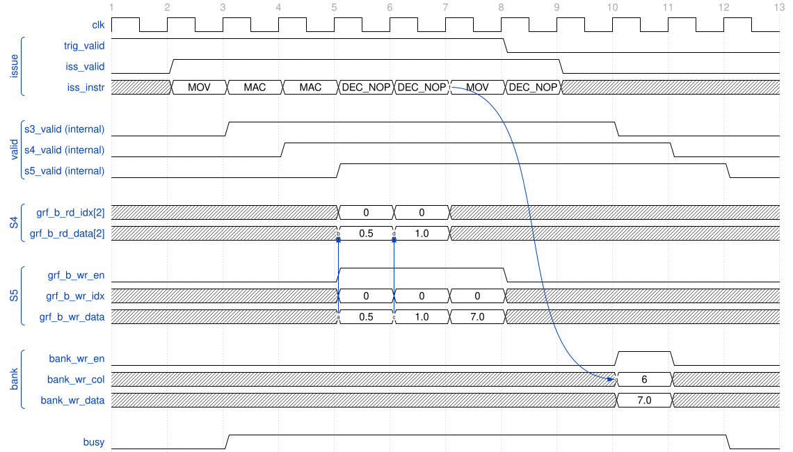

# pcu_datapath: specification

Owner: architect. Readers: everyone. The designer and DV each build from this
alone, so anything they would have to guess belongs here.

Every rule is tagged `[paper]`, `[ANEMOS]` or `[bankside]`, and every rule a
test can check has an ID: `[DP-1]`, `[DP-2]`, ...

## Overview

`pcu_datapath` is stages S2 to S5 of the pipeline. It takes each entry that
`pcu_ctrl` issues (the S1/S2 register), reads the entry's sources in S2
(the bank data and the GRF and SRF read ports), applies the SRF broadcast
and ReLU, multiplies in S3 and adds in S4 on 16 lanes, reads the MAC
accumulator in S4, and makes the entry's one write in S5: a register-file
write port or the bank write port. It holds the S2/S3, S3/S4 and S4/S5
registers, with a valid bit in each, and drives its own term of `busy`. Its
children are 16 `fp16_mul` and 16 `fp16_add`, one of each per lane.

How `pcu_datapath` connects to its siblings (`ctrl`, the four GRF and SRF
instances of `pcu_regfile`, the write-port select, the top ports) is defined
by the parent, in
[hierarchy.md](../../top/doc/hierarchy.md#how-top-connects-its-children)
([TOP-HIER-2], [TOP-HIER-4] to [TOP-HIER-6], [TOP-HIER-8]), not here. The
rules this module carries out are those of the top spec:

| Top rule | What it asks of `pcu_datapath` | Here |
|---|---|---|
| [TOP-PIPE-1] | every write in S5, one per cycle, in program order | [DP-13], [DP-14] |
| [TOP-PIPE-4], [TOP-IF-4] | every slot is an entry that moves one stage per cycle; reset removes every entry | [DP-4], [DP-5] |
| [TOP-HIER-2] | S2 to S5 and the S2/S3, S3/S4, S4/S5 registers, control next to data | [DP-4] |
| [TOP-HIER-3] | 16 `fp16_mul` and 16 `fp16_add`, lane *i* on bits 16*i* + 15 to 16*i* | [DP-10], [DP-11], [DP-16] |
| [TOP-HIER-5], [TOP-HAZ-2], [TOP-HAZ-4] | the MAC accumulator read through `grf_b`'s S4 port, write-through, no bypass mux | [DP-11] |
| [TOP-ARCH-10], [TOP-HIER-4] | the read ports each file has | [DP-3], [DP-7] |
| [TOP-ISA-11] | an SRF source broadcast to 16 lanes | [DP-8] |
| [TOP-ISA-15], [TOP-ISA-16] | what each MOV and FILL pair does | [DP-8], [DP-9], [DP-13], [DP-14] |
| [TOP-ISA-17] to [TOP-ISA-21] | ADD, MUL, MAD (addend SRF_A[SRC1#]), MAC | [DP-7], [DP-10], [DP-11] |
| [TOP-ISA-29] | GRF to SRF takes lane 0 | [DP-13] |
| [TOP-ISA-30], [TOP-FP-8] | ReLU by the sign bit, on every MOV pair with R = 1 | [DP-9] |
| [TOP-FP-6], [TOP-FP-9] | NaN results are the units'; MOV and FILL copy bits | [DP-12] |
| [TOP-ARCH-8], [TOP-IF-3] | the bank store in S5, registered, at the entry's own trigger address | [DP-14] |
| [TOP-IF-7], [TOP-HIER-8] | `pcu_datapath`'s term of `busy`, from registers only | [DP-15] |

[TOP-ARCH-3]: ../../top/doc/theory_of_operation.md#architecture
[TOP-ARCH-5]: ../../top/doc/theory_of_operation.md#register-files
[TOP-ARCH-7]: ../../top/doc/theory_of_operation.md#bank-access
[TOP-ARCH-8]: ../../top/doc/theory_of_operation.md#bank-access
[TOP-ARCH-9]: ../../top/doc/theory_of_operation.md#register-files
[TOP-ARCH-10]: ../../top/doc/theory_of_operation.md#register-files
[TOP-PIPE-1]: ../../top/doc/theory_of_operation.md#pipeline
[TOP-PIPE-4]: ../../top/doc/theory_of_operation.md#pipeline
[TOP-HAZ-1]: ../../top/doc/theory_of_operation.md#hazards
[TOP-HAZ-2]: ../../top/doc/theory_of_operation.md#hazards
[TOP-HAZ-3]: ../../top/doc/theory_of_operation.md#hazards
[TOP-HAZ-4]: ../../top/doc/theory_of_operation.md#hazards
[TOP-HAZ-5]: ../../top/doc/theory_of_operation.md#what-happens-when-a-rule-is-broken
[TOP-HAZ-6]: ../../top/doc/theory_of_operation.md#the-v1-bank
[TOP-FP-2]: ../../top/doc/theory_of_operation.md#fp16-arithmetic
[TOP-FP-3]: ../../top/doc/theory_of_operation.md#fp16-arithmetic
[TOP-FP-5]: ../../top/doc/theory_of_operation.md#fp16-arithmetic
[TOP-FP-6]: ../../top/doc/theory_of_operation.md#fp16-arithmetic
[TOP-FP-8]: ../../top/doc/theory_of_operation.md#relu
[TOP-FP-9]: ../../top/doc/theory_of_operation.md#relu
[TOP-ISA-9]: ../../top/doc/programmers_guide.md#instruction-formats
[TOP-ISA-10]: ../../top/doc/programmers_guide.md#instruction-formats
[TOP-ISA-11]: ../../top/doc/programmers_guide.md#instruction-reference
[TOP-ISA-15]: ../../top/doc/programmers_guide.md#mov
[TOP-ISA-16]: ../../top/doc/programmers_guide.md#fill
[TOP-ISA-17]: ../../top/doc/programmers_guide.md#add
[TOP-ISA-18]: ../../top/doc/programmers_guide.md#mul
[TOP-ISA-19]: ../../top/doc/programmers_guide.md#mad
[TOP-ISA-20]: ../../top/doc/programmers_guide.md#mad
[TOP-ISA-21]: ../../top/doc/programmers_guide.md#mac
[TOP-ISA-23]: ../../top/doc/programmers_guide.md#mad
[TOP-ISA-29]: ../../top/doc/programmers_guide.md#mov
[TOP-ISA-30]: ../../top/doc/programmers_guide.md#mov
[TOP-IF-2]: ../../top/doc/interfaces.md#timing
[TOP-IF-3]: ../../top/doc/interfaces.md#timing
[TOP-IF-4]: ../../top/doc/interfaces.md#timing
[TOP-IF-7]: ../../top/doc/interfaces.md#timing
[TOP-IF-8]: ../../top/doc/interfaces.md#timing
[TOP-HIER-1]: ../../top/doc/hierarchy.md#modules
[TOP-HIER-2]: ../../top/doc/hierarchy.md#who-owns-which-stage
[TOP-HIER-3]: ../../top/doc/hierarchy.md#fp16-units
[TOP-HIER-4]: ../../top/doc/hierarchy.md#register-files
[TOP-HIER-5]: ../../top/doc/hierarchy.md#register-files
[TOP-HIER-6]: ../../top/doc/hierarchy.md#how-top-connects-its-children
[TOP-HIER-8]: ../../top/doc/hierarchy.md#how-top-connects-its-children
[TOP-HIER-9]: ../../top/doc/hierarchy.md#shared-package-and-the-wrapper
[VER-4]: ../../top/dv/README.md
[TOP-ARCH-11]: ../../top/doc/theory_of_operation.md#architecture
[TOP-IF-13]: ../../top/doc/interfaces.md#timing
[DEC-11]: ../../pcu_decode/doc/README.md#the-decoded-instruction
[DEC-13]: ../../pcu_decode/doc/README.md#the-decoded-instruction
[FMUL-1]: ../../fp16_mul/doc/README.md#ports
[FMUL-10]: ../../fp16_mul/doc/README.md#the-result
[FADD-1]: ../../fp16_add/doc/README.md#ports
[FADD-11]: ../../fp16_add/doc/README.md#timing
[VER-6]: ../../top/dv/README.md

The `pcu_ctrl` rules cited here are in [its doc](../../pcu_ctrl/doc/README.md)
and the `pcu_regfile` rules in [its doc](../../pcu_regfile/doc/README.md):
CTRL-4 (state and the rule before the first reset), CTRL-5 (a slot), CTRL-12
(the issue bundle and `DEC_NOP`), CTRL-15 (`pcu_decode`'s outputs); RF-4
(the packed port layout), RF-9 (write-through), RF-13 (port timing).

**Sources.** The papers give the stages and their order, 16 FP16 multipliers
and 16 FP16 adders, the scalar operands and ReLU as "a 2-to-1 multiplexer
controlled by the sign bit" (ISCA 2021, Section III-C); they don't describe
the stage registers or the ports, so the rules here are **[bankside]** unless
marked. ANEMOS (github.com/gem5-X/cnm_framework at `f2d4018`; read, not run)
splits the same work by function: its control unit drives every operand
select, its `grf` holds the write-data multiplexer and ReLU (`src/grf.cpp`),
its `fpu` holds one `fp_multiplier` and one `fp_adder` per lane, each
pipelined inside, and `src/imc_core.h` wires the SRF write input from a GRF
to lane 0. Where it agrees, the rule is tagged **[ANEMOS]** as well; where it
differs, the rule says so. The intended differences are already in the top
spec's
[list of differences](../../top/doc/programmers_guide.md#differences-from-anemos):
ReLU on SRF and bank destinations ([TOP-ISA-30]), every write in S5
([TOP-PIPE-1]) and GRF_B's own accumulator port ([TOP-ARCH-10]).

**Clock edge.** Every register here is clocked on the rising edge of `clk`,
and "the end of cycle *t*" is the rising edge between cycles *t* and *t* + 1,
as the top spec's [TOP-ARCH-11] states for the whole unit.

**Lanes.** A 256-bit value has 16 lanes; lane *l* is bits 16*l* + 15 to
16*l* ([TOP-ISA-29]). "Lane 0 values" in the examples are bits 15 to 0.

## Parameters

- **[DP-1]** Two parameters, both set by `top` to its own values of the same
  names ([interfaces.md](../../top/doc/interfaces.md#parameters)).
  **[bankside]**

  | Parameter | Type | Default | Meaning |
  |---|---|---|---|
  | `ROW_W` | `int unsigned` | 14 | Width of `iss_row`, `bank_wr_row` |
  | `COL_W` | `int unsigned` | 5 | Width of `iss_col`, `bank_wr_col` |

  Everything else is fixed by the ISA: 16 lanes of 16 bits, 8-entry GRFs and
  SRFs (3-bit indices, [RF-11] in `pcu_regfile`'s doc).

## Ports

- **[DP-2]** The ports. No other ports exist. "Registered" means the port is
  driven straight from a flip-flop of this module, with no logic between.
  **[bankside]**

  | Port | Dir | Width | Timing | Description |
  |---|---|---|---|---|
  | `clk` | in | 1 | – | Clock, rising edge |
  | `rst_n` | in | 1 | sampled at the edge | Synchronous reset, active low ([TOP-IF-4], [DP-5]) |
  | **Issue** (the S1/S2 register, from `pcu_ctrl`) | | | | |
  | `iss_valid` | in | 1 | registered in `pcu_ctrl` | An entry is in S2 |
  | `iss_instr` | in | `$bits(dec_instr_t)` | as `iss_valid` | Its decoded instruction ([DP-6]) |
  | `iss_row` | in | `ROW_W` | as `iss_valid` | Its trigger's row |
  | `iss_col` | in | `COL_W` | as `iss_valid` | Its trigger's column |
  | **Bank read data** (top port) | | | | |
  | `bank_rd_data` | in | 256 | valid in S2 of an entry with a bank source ([TOP-IF-2]) | The bank column |
  | **S2 reads** (to the register files) | | | | |
  | `grf_a_rd_idx` | out | 2 × 3 | combinational ([DP-17]) | `grf_a` read ports 0 and 1, packed `logic [1:0][2:0]` |
  | `grf_a_rd_data` | in | 2 × 256 | combinational from `grf_a` | Packed `logic [1:0][255:0]` |
  | `grf_b_rd_idx` | out | 3 × 3 | combinational | `grf_b` read ports 0 and 1 (S2) and 2 (S4), packed `logic [2:0][2:0]` |
  | `grf_b_rd_data` | in | 3 × 256 | combinational from `grf_b` | Packed `logic [2:0][255:0]` |
  | `srf_m_rd_idx` | out | 3 | combinational | `srf_m` read port 0 |
  | `srf_m_rd_data` | in | 16 | combinational from `srf_m` | |
  | `srf_a_rd_idx` | out | 3 | combinational | `srf_a` read port 0 |
  | `srf_a_rd_data` | in | 16 | combinational from `srf_a` | |
  | **S5 writes** (to the write-port select of `top`) | | | | |
  | `grf_a_wr_en`, `grf_b_wr_en`, `srf_m_wr_en`, `srf_a_wr_en` | out | 1 each | registered ([DP-13]) | The entry in S5 writes that file |
  | `grf_a_wr_idx`, `grf_b_wr_idx`, `srf_m_wr_idx`, `srf_a_wr_idx` | out | 3 each | registered | The entry written; don't-care while that file's `*_wr_en` = 0 |
  | `grf_a_wr_data`, `grf_b_wr_data` | out | 256 each | registered | The data; don't-care while `*_wr_en` = 0 |
  | `srf_m_wr_data`, `srf_a_wr_data` | out | 16 each | registered | The data; don't-care while `*_wr_en` = 0 |
  | **Bank write** (top ports) | | | | |
  | `bank_wr_en` | out | 1 | registered ([DP-14]) | A bank store in S5 |
  | `bank_wr_sel` | out | 1 | registered | 0 = EVEN_BANK, 1 = ODD_BANK |
  | `bank_wr_row` | out | `ROW_W` | registered | The store's own trigger row |
  | `bank_wr_col` | out | `COL_W` | registered | The store's own trigger column |
  | `bank_wr_data` | out | 256 | registered | The data |
  | **Status** | | | | |
  | `busy` | out | 1 | registered, or an OR of registers ([DP-15]) | `pcu_datapath`'s term of the top `busy` |

  `dec_instr_t` is the decoded-instruction type of the shared package
  ([TOP-HIER-9]); its fields are defined by
  [`pcu_decode`'s doc](../../pcu_decode/doc/README.md#the-decoded-instruction)
  ([DEC-11]). The bank-write and `busy` ports go to the top ports and the `busy` OR
  ([TOP-HIER-8]); the S5 writes go to `top`'s write-port select, which
  passes each file's bundle to that file's write port when no configuration
  write takes it ([TOP-HIER-6]).

- **[DP-3]** **Read-port numbering.** `top` connects each `*_rd_idx` and
  `*_rd_data` one-to-one to the `rd_idx` and `rd_data` of the instance of
  the same name, in `pcu_regfile`'s packed layout ([RF-4]): port *p* of
  `grf_a_rd_idx` is bits `[3p+2 : 3p]` and drives `grf_a`'s read port *p*,
  and so on. `grf_a` has `N_RD` = 2, `grf_b` 3, `srf_m` and `srf_a` 1
  ([TOP-ARCH-10]); for the SRFs the packed `[0:0]` vector is the same bits
  as the plain one. The debug read port of each instance is not
  `pcu_datapath`'s. Which port reads which operand is [DP-7]. **[bankside]**

## Behaviour

The rules below are written per stage. In short, for the entry in each
stage in one cycle:

```
S2   sources: ports of [DP-7], bank_rd_data; SRF broadcast; MOV(RELU)  -> S2/S3: a, b, c
S3   MUL, MAD, MAC: p = a x b on 16 fp16_mul; others carry a, b       -> S3/S4: x, y
S4   ADD: a + b; MAD: p + c; MAC: acc + p, acc = grf_b port 2;
     others carry x, on 16 fp16_add                                   -> S4/S5: write enables, idx, data, bank address
S5   no logic: the S4/S5 register drives the write ports and bank_wr_*
```

The block is a summary; where it and a rule seem to differ, the rule is
right.

### State, reset and the clock

- **[DP-4]** **State.** `pcu_datapath` holds exactly these registers. The
  valid bits and the S5 write enables have fixed names, so that assertions
  and the `busy` check can bind to them; the other fields hold the
  information listed, encoded as the designer chooses. All are clocked on
  the rising edge of `clk`. **[bankside]**

  | Register | Field | Width | Reset value | Holds |
  |---|---|---|---|---|
  | S2/S3 | `s3_valid` | 1 | 0 | An entry is in S3 |
  | | instruction | as needed | none | What S3 to S5 need of the entry's decoded instruction ([DP-6]) |
  | | *a*, *b* | 256 each | none | Operands A and B after [DP-8] and [DP-9] |
  | | *c* | 16 | none | MAD's addend, SRF_A[SRC1#] |
  | | row, column | `ROW_W`, `COL_W` | none | The entry's `iss_row`, `iss_col` |
  | S3/S4 | `s4_valid` | 1 | 0 | An entry is in S4 |
  | | instruction | as needed | none | As above |
  | | *x*, *y* | 256 each (*y* may be kept as 16 bits for MAD) | none | [DP-10]'s outputs |
  | | row, column | `ROW_W`, `COL_W` | none | As above |
  | S4/S5 | `s5_valid` | 1 | 0 | An entry is in S5 |
  | | `grf_a_wr_en`, `grf_b_wr_en`, `srf_m_wr_en`, `srf_a_wr_en`, `bank_wr_en` | 1 each | 0 | The output ports of the same names ([DP-13], [DP-14]) |
  | | write index | 3 | none | Drives every `*_wr_idx` |
  | | write data | 256 | none | Drives `grf_*_wr_data` and `bank_wr_data`; bits 15 to 0 drive `srf_*_wr_data` |
  | | `bank_wr_sel`, `bank_wr_row`, `bank_wr_col` | 1, `ROW_W`, `COL_W` | none | The output ports of the same names |

  The write index and write data may be one register shared by all the
  ports, or one per port; the ports' values are what [DP-13] and [DP-14]
  say either way. A register "without a reset value" is not reset and has
  no initial value.

  **Before the first reset.** At the rising edge that ends a cycle with
  `rst_n` = 0, every register with a reset value takes it ([DP-5]). Before
  the end of the first such cycle after power-up, the state is undefined:
  the valid bits, the write enables and so `busy`, every `*_wr_en` and
  `bank_wr_en` may be 0 or 1, so a register-file entry or a bank column may
  be written with undefined data in those cycles, the first reset cycle
  included. The unit must be reset before its first trigger, and the host
  must not count on any value written before the end of that reset. This
  is the top spec's [TOP-IF-13] for this module's registers, as CTRL-4 is
  for `pcu_ctrl`'s.

- **[DP-5]** **Valid bits and reset.** At the end of every cycle:
  - with `rst_n` = 1: `s3_valid` ← `iss_valid`, `s4_valid` ← `s3_valid`,
    `s5_valid` ← `s4_valid`, and the other fields of each register take the
    values its stage computed for the entry before it ([DP-8] to [DP-14]).
    So an entry moves one stage per cycle, whatever it is, a `DEC_NOP`
    entry included ([TOP-PIPE-4]), and nothing holds or stalls it.
  - with `rst_n` = 0: `s3_valid`, `s4_valid`, `s5_valid` and the five write
    enables take 0. Reset wins over every other update. This removes every
    entry in S2 to S5 at that edge ([TOP-PIPE-4], [TOP-IF-4]); `pcu_ctrl`
    clears `iss_valid` at the same edge (CTRL-5).

  The S5 outputs are registered, so in a cycle with `rst_n` = 0 the entry in
  S5, if any, still drives its write: the register file or the bank takes it
  at the end of that cycle. An entry is removed by the edge that ends the
  reset cycle; it has made its S5 write if it was in S5 in that cycle, and
  not otherwise. **[bankside]** This matches [TOP-IF-7], under which that
  entry is still in S5 in the reset cycle. Why the write isn't gated by
  `rst_n`: [Choices weighed](#choices-weighed),
  [case E](#case-e-reset-while-entries-are-in-flight).

### The issue bundle

- **[DP-6]** **What `pcu_datapath` takes from the issue bundle.**
  `pcu_datapath` acts on `iss_instr`, `iss_row` and `iss_col` only in a
  cycle with `iss_valid` = 1; in any other cycle they are don't-care and
  nothing it does depends on them (CTRL-12). While `iss_valid` = 1,
  `iss_instr` is either `DEC_NOP` or the decoded instruction of a legal
  MOV, FILL, ADD, MUL, MAD or MAC word (CTRL-12: every other slot kind
  issues `DEC_NOP`). From it `pcu_datapath` uses only these, named and
  encoded by
  [`pcu_decode`'s doc](../../pcu_decode/doc/README.md#the-decoded-instruction)
  ([DEC-11], [DEC-13]):

  | Information | From the word ([bankside_isa.yaml](../../top/doc/bankside_isa.yaml)) | Used for |
  |---|---|---|
  | the operation: MOV, FILL, ADD, MUL, MAD, MAC, or none (`DEC_NOP`) | the opcode | everything below |
  | DST, SRC0 operand codes | `dst`, `src0` | [DP-7], [DP-13], [DP-14] |
  | SRC1 operand code (ALU format only) | `src1` | [DP-7] |
  | DST#, SRC0#, SRC1# (SRC1# ALU format only) | `dst_idx`, `src0_idx`, `src1_idx` | [DP-7], [DP-11], [DP-13] |
  | R (MOV only) | `relu` | [DP-9] |

  It never uses SRC2: MAD's addend is always SRF_A ([TOP-ISA-23]) and ADD,
  MUL and MAC ignore the field ([TOP-ISA-10]). It never uses the index of a
  bank operand other than MAD's SRC1# ([TOP-ISA-9]), and for MOV and FILL it
  never uses `src1`, `src1_idx` or the unused bits of the data format.
  An entry whose operation is none (`DEC_NOP`) reads nothing that matters
  and writes nothing in S2 to S5; it still sets the valid bits as it moves
  ([DP-5]). For an `iss_instr` value outside this set, which CTRL-12 never
  issues, the behaviour is not specified. **[bankside]**

### S2: sources

- **[DP-7]** **Which read port reads which operand.** In the cycle an entry
  is in S2 (`iss_valid` = 1), its operands A, B and C come from these
  sources, and only these:

  | Operand | Of | Operand code | Read from | Index |
  |---|---|---|---|---|
  | A | every operation | GRF_A (SRC0) | `grf_a` port 0 | SRC0# |
  | | | GRF_B | `grf_b` port 0 | SRC0# |
  | | | SRF_M | `srf_m` port 0 | SRC0# |
  | | | SRF_A | `srf_a` port 0 | SRC0# |
  | | | EVEN_BANK, ODD_BANK | `bank_rd_data` | – |
  | B | ADD, MUL, MAD, MAC | GRF_A (SRC1) | `grf_a` port 1 | SRC1# |
  | | | GRF_B | `grf_b` port 1 | SRC1# |
  | | | SRF_M | `srf_m` port 0 | SRC1# |
  | | | SRF_A | `srf_a` port 0 | SRC1# |
  | | | EVEN_BANK, ODD_BANK | `bank_rd_data` | – |
  | C | MAD | always SRF_A ([TOP-ISA-23]) | `srf_a` port 0 | SRC1# ([TOP-ISA-20]) |

  In S4 the MAC accumulator is read from `grf_b` port 2 ([DP-11]). The
  legal combinations of the yaml never need one port twice in a stage: SRF_M
  is a source of MOV (A) or of MUL, MAD, MAC (B), never both; SRF_A is read
  at most once by ADD (`one_read_per_srf`) and MAD's sources are never SRF_A.
  So these ports are enough, and they are the counts of [TOP-ARCH-10]
  ([checked for every combination](#every-legal-combination)). In every
  cycle, a read port that the entry in its stage doesn't use (or every S2
  port, while `iss_valid` = 0) has a don't-care index, and its data is not
  used. Every port is write-through in `pcu_regfile` ([RF-9]), so an S2
  read in the cycle of an S5 write to the same entry gets the new value
  ([TOP-HAZ-1]); `pcu_datapath` adds no forwarding of its own. **[bankside]**
  See [case F](#case-f-which-port-reads-what).

- **[DP-8]** **Operands.** Each operand is a 256-bit value:
  - a GRF operand is the port's 256 bits; a bank operand is `bank_rd_data`,
    whichever bank it names (`pcu_ctrl` requested that bank in the entry's
    S1 cycle, [TOP-IF-2]);
  - an SRF operand (A or B from `srf_*_rd_data`, and MAD's C) is
    **broadcast**: the same 16 bits in each of the 16 lanes
    ([TOP-ISA-11]). **[paper]** (scalar operands), **[ANEMOS]** (MOV SRF →
    GRF).

  Broadcasting also covers a MOV with an SRF source and an SRF destination:
  its lane 0, which [DP-13] writes, is the SRF value itself. **[bankside]**

- **[DP-9]** **ReLU.** In S2, if the entry is a MOV with R = 1, every lane
  of A is replaced by ReLU of the lane: 0x0000 if the lane's bit 15 is 1,
  the lane unchanged otherwise ([TOP-FP-8]). This applies on every MOV pair,
  whatever the source and the destination ([TOP-ISA-30]): for an SRF
  destination it gives ReLU of lane 0, the value [DP-13] writes. FILL never
  applies ReLU, whatever its R bit holds ([TOP-ISA-16]), and the ALU
  operations have no R. Nothing else in the datapath looks at a sign bit.
  **[paper]** (the sign-bit multiplexer, "during data movement", with no
  restriction to a destination). ANEMOS applies ReLU in its `grf` write
  multiplexer, so its R acts only on a GRF destination, and it compares with
  zero instead of using the sign bit; both are intended differences of the
  top spec ([TOP-ISA-30], [TOP-FP-8]). See
  [case C](#case-c-mov-lanes-broadcast-and-relu).

  At the end of S2 the S2/S3 register takes *a* = A (after ReLU), *b* = B,
  *c* = SRF_A[SRC1#] (MAD), and the entry's row and column. A field the
  entry has no operand for is don't-care.

### S3 and S4: the lanes

- **[DP-10]** **S3, multiply.** For MUL, MAD and MAC, the 16 `fp16_mul`
  compute *x* = *a* × *b* lane by lane: lane *l*'s multiplier takes lane *l*
  of *a* and of *b* and gives lane *l* of *x*. For the other operations
  *x* = *a*. *y* = *b* for ADD, *y* = *c* broadcast to 16 lanes for MAD, and
  don't-care otherwise. **[paper]** (16 FP16 multipliers in the MULT stage),
  **[ANEMOS]** (one multiplier per lane). Lane *l* of *a* goes to the
  multiplier's `.a`, lane *l* of *b* to its `.b`, and its `.p` is lane *l*
  of *x* ([`fp16_mul`'s ports](../../fp16_mul/doc/README.md#ports),
  [FMUL-1]); the unit is commutative ([FMUL-10]), so the result doesn't
  depend on that order.

- **[DP-11]** **S4, add and the MAC accumulator.** The 16 `fp16_add`
  compute, lane by lane:

  | Operation | S4 result *r* |
  |---|---|
  | ADD | *x* + *y* (that is, src0 + src1) |
  | MAD | *x* + *y* (the product + SRF_A[SRC1#]) |
  | MAC | *acc* + *x* (the accumulator + the product) |
  | MOV, FILL, MUL | *x*, unchanged ([DP-12]) |

  For a MAC in S4 (`s4_valid` = 1), `grf_b_rd_idx[2]` = the entry's DST#,
  and *acc* = `grf_b_rd_data[2]`, in the same cycle. When the entry in S5 in
  that cycle writes that GRF_B entry, `grf_b`'s write-through returns the
  S5 data on port 2 ([RF-9]): that is the accumulator bypass of
  [TOP-HAZ-2], so a MAC may follow any producer of its entry at once
  ([TOP-HAZ-4]). `pcu_datapath` has **no bypass multiplexer and no compare
  of its own** for it ([TOP-HIER-5]). While the entry in S4 is not a MAC,
  `grf_b_rd_idx[2]` is don't-care. MAC and MAD round twice, once in each
  unit ([TOP-FP-3]). **[paper]** (16 FP16 adders in the ADD stage),
  **[bankside]** (the accumulator read in S4 through its own port). ANEMOS
  reads the accumulator through GRF_B's port 1, ORing the indices; case B
  shows where that differs ([TOP-ARCH-10]). See
  [case A](#case-a-the-gemv-pattern-at-the-ports) and
  [case B](#case-b-grf_bs-three-read-ports-in-one-cycle).

- **[DP-12]** **Values a stage doesn't compute are carried as bits.** An
  operand or result that a stage doesn't compute on (*a* through S3 for
  MOV, FILL and ADD, *b* through S3 for ADD, *x* through S4 for MOV, FILL
  and MUL) reaches the next register **bit for bit**. It is selected around
  the FP16 units, never passed through them (no × 1.0 and no + 0). So MOV
  and FILL copy NaNs, signs and payloads unchanged ([TOP-FP-9]), and a MUL
  product of −0 stays 0x8000. The results the units do compute, NaNs
  included (0x7E00, [TOP-FP-6]), are written as the units give them;
  `pcu_datapath` doesn't look at or change them. **[bankside]** See
  [case D](#case-d-values-carried-bit-for-bit).

### S5: writes

- **[DP-13]** **Register-file writes.** At the end of S4, the S4/S5 register
  takes, for the entry in S4 (`s4_valid` = 1) whose operation is MOV,
  FILL, ADD, MUL, MAD or MAC:
  - the write enable of the file its DST names, 1; the other four write
    enables, 0;
  - write index = DST# (a GRF or SRF destination);
  - write data = *r*, the S4 result, all 256 bits.

  For an entry with no operation (`DEC_NOP`), with `s4_valid` = 0, or whose
  DST is a bank, the four register-file enables take 0. In S5 there is no
  logic: `grf_a_wr_*` and `grf_b_wr_*` are the enable, the index and the
  256-bit data; `srf_m_wr_*` and `srf_a_wr_*` are the enable, the index and
  **bits 15 to 0 of the data, lane 0**. So a MOV from a GRF entry into an
  SRF entry writes lane 0 of it ([TOP-ISA-29]), and a MOV from an SRF into
  an SRF writes the value, by [DP-8]. At most one enable is 1 in a cycle,
  and the entry in S5 writes in its S5 cycle and no other ([TOP-PIPE-1]).
  **[ANEMOS]** (lane 0 for a GRF to SRF move, `src/imc_core.h`),
  **[bankside]** (the rest).

- **[DP-14]** **Bank writes.** For the entry in S4 that is a MOV or FILL with
  DST = EVEN_BANK or ODD_BANK, the S4/S5 register takes `bank_wr_en` = 1,
  `bank_wr_sel` = 0 for EVEN_BANK or 1 for ODD_BANK, `bank_wr_row` and
  `bank_wr_col` = the row and column the entry was issued with (its own
  `iss_row`, `iss_col`, carried down S2 to S4), and the write data = *r*.
  For any other entry, or none, `bank_wr_en` takes 0, and `bank_wr_sel`,
  `bank_wr_row`, `bank_wr_col` and `bank_wr_data` are don't-care. So
  `bank_wr_*` are registered outputs, valid in the store's S5 cycle only
  ([TOP-IF-3]), and the store goes to its own trigger's address, not to the
  trigger of the S5 cycle ([TOP-ARCH-8]). **[paper]** (the address of the
  command that triggers the instruction), **[bankside]** (S5, registered).
  ANEMOS drives a store in its decode cycle; [TOP-PIPE-1] gives the reasons
  bankside doesn't.

### busy

- **[DP-15]** `busy` = `s3_valid` OR `s4_valid` OR `s5_valid`, from the
  registers only, with no path from any input. It is term 1 of [TOP-IF-7]
  for S3, S4 and S5; `pcu_ctrl`'s term covers S2 (its `iss_valid`), the NOP
  slots and the loop state, and `top` ORs the two ([TOP-HIER-8]). A
  `DEC_NOP` entry counts like any other ([TOP-PIPE-4]). The designer may
  build it as the OR or as a register of its own with the same value in
  every cycle. **[bankside]**

### Lanes and the FP16 units

- **[DP-16]** **Lane instances.** The 16 lanes are one generate loop:

  ```systemverilog
  for (genvar l = 0; l < 16; l++) begin : g_lane
    fp16_mul u_mul (.a(/* lane l of a */), .b(/* lane l of b */), .p(/* lane l of x */));
    fp16_add u_add (.a(/* lane l of the first S4 operand */),
                    .b(/* lane l of the second S4 operand */),
                    .s(/* lane l of the sum, from which r is chosen */));
  end
  ```

  so lane *l*'s units are `g_lane[l].u_mul` and `g_lane[l].u_add`, and seen
  from `top`, `dp.g_lane[l].u_mul` and `dp.g_lane[l].u_add`. Lane *l* takes
  and gives bits `[16l+15 : 16l]` ([TOP-HIER-3], [TOP-ISA-29]). No signal
  crosses between lanes, except the SRF broadcast ([DP-8]) and the SRF
  write of lane 0 ([DP-13]). The units' ports `.a`, `.b`, `.p` and `.a`,
  `.b`, `.s` are defined by their own docs,
  [`fp16_mul`'s](../../fp16_mul/doc/README.md#ports) ([FMUL-1]) and
  [`fp16_add`'s](../../fp16_add/doc/README.md#ports) ([FADD-1]); this doc
  connects them by the meaning above and doesn't define them. The two S4
  operands are those of the [DP-11] table (*x* and *y* for ADD and MAD,
  *acc* and *x* for MAC), on either port: the sum doesn't depend on the
  order. Both units are combinational: no
  clock, no reset ([TOP-HIER-3]). **[bankside]**, **[ANEMOS]** (one unit of
  each per lane).

### Timing

- **[DP-17]** **Combinational paths.** **[bankside]**

  | Output | Combinational from |
  |---|---|
  | `grf_a_rd_idx`, `grf_b_rd_idx[0]`, `grf_b_rd_idx[1]`, `srf_m_rd_idx`, `srf_a_rd_idx` | `iss_instr` only |
  | `grf_b_rd_idx[2]` | the S3/S4 register only |
  | every `*_wr_*`, `bank_wr_*`, `busy` | none: registers |

  Inputs reach only registers: `iss_*`, `bank_rd_data` and the S2 read data
  reach the S2/S3 register; `grf_b_rd_data[2]` reaches the S4/S5 register
  through `fp16_add`. No path runs from an input of this module to one of
  its outputs except `iss_instr` to the S2 read indices.

  Two paths are long. The S2 path: `iss_instr` → S2 read indices → the
  register files' read multiplexers and write-through ([RF-13]) → the
  operand selection, broadcast and ReLU → the S2/S3 register. The
  **accumulator loop**, one cycle: the S4/S5 register (`grf_b_wr_*`) →
  `top`'s write-port select ([TOP-HIER-6]) → `grf_b`'s write-through
  multiplexer on port 2 → `grf_b_rd_data[2]` → `fp16_add` → the choice of
  *r* → the S4/S5 register. `fp16_add` gets the clock period minus the
  S4/S5 register's clock-to-output, the select, the write-through
  multiplexer, the choice of *r* and the setup: every other item on the
  loop. Its doc gives that budget
  ([FADD-11](../../fp16_add/doc/README.md#timing)). The synthesis run measures both paths against the clock
  period ([TOP-ARCH-3]).



*Figure 1: [case A](#case-a-the-gemv-pattern-at-the-ports), the GEMV pattern,
cycles 1 to 12, lane 0 values. One slot per cycle in cycles 1 to 7, so
`iss_valid` is 1 in cycles 2 to 8; `DEC_NOP` is a slot of `NOP 2` or EXIT. Each
valid bit follows the one before by a cycle, and `busy` is their OR
([DP-5], [DP-15]). In cycle 5 the MOV in S5 writes GRF_B[0] ← 0.5 (marker a),
and the MAC in S4 reads it through `grf_b` port 2 in the same cycle (b),
by write-through; in cycle 6 the same for the second MAC (c → d): [DP-11],
[TOP-HIER-5]. The store, in S2 in cycle 7 (f), was issued with column 6; it
writes the bank in its S5 cycle, cycle 10, at column 6 (g): [DP-14],
[TOP-ARCH-8]. The script checks all 180 cells against the model. Source:
[dp_gemv.wave.json](img/dp_gemv.wave.json).*

## Choices weighed

| Choice | Options | Where they differ | Chosen |
|---|---|---|---|
| Values carried through a stage | (a) selected around the FP16 units, bit for bit; (b) passed through them as × 1.0 in S3 and + (+0) in S4, which saves the bypass multiplexers | [Case D](#case-d-values-carried-bit-for-bit): under (b) a MUL product of −0 becomes +0 in S4, and a MOV of a signalling NaN becomes 0x7E00 and of −0 becomes +0, against [TOP-FP-9]. ADD is the same under both | (a), [DP-12]. **[bankside]** |
| The S5 write in a reset cycle | (a) goes ahead: the S5 outputs are registers; (b) gated by `rst_n` | [Case E](#case-e-reset-while-entries-are-in-flight): reset in cycle 5 with a MOV in S5. Under (a) GRF_A[1] gets 2.0, under (b) it keeps 0.5. (b) puts a path from the input `rst_n` to `bank_wr_en`, against "registered outputs" in [TOP-IF-3], and disagrees with [TOP-IF-7], which still counts that entry in S5. (b) would suppress a write of undefined enables in the first reset cycle, which (a) leaves to the rule of [DP-4] | (a), [DP-5]. **[bankside]** |
| The S5 write ports | (a) one bundle per file, the enables registered; (b) one shared bundle (enable, a file code, index, 256-bit data) that `top` decodes; (c) enables computed in S5 from `s5_valid` and the decoded DST | No program tells them apart. (b) puts a decoder in `top`'s write-port select, between the S4/S5 register and `grf_b`'s write-through, on the accumulator loop of [DP-17]; (c) puts an AND there. (a) leaves only `top`'s configuration mux, and each port of [TOP-HIER-6] is one bundle | (a), [DP-2], [DP-13]. **[bankside]** |
| Which port reads which operand | (a) by field: SRC0 on port 0, SRC1 on port 1 ([DP-7]); (b) by order of use: the first GRF source of an instruction on port 0, whatever field it is in | No program tells them apart. Under (a) each port's index comes from one field, a 2-to-1 choice less in front of each read multiplexer, and DV can predict each port's index from the word alone | (a). **[bankside]** |
| GRF_B's accumulator port | (a) its own port 2 in S4; (b) ANEMOS's: the accumulator index ORed into port 1 | [Case B](#case-b-grf_bs-three-read-ports-in-one-cycle): an ADD reading GRF_B[1] and GRF_B[2] in S2 while a MAC into GRF_B[4] is in S4. Under (b) port 1 reads GRF_B[6] for both, so both results are wrong | (a), settled by [TOP-ARCH-10]; [DP-11] carries it out |
| Where ReLU is | (a) in S2, on A; (b) in S5, on the write data | No program tells them apart: a MOV's value passes S3 and S4 unchanged ([DP-12]). (a) is where the [pipeline table](../../top/doc/theory_of_operation.md#pipeline) puts it, and keeps S5 free of logic ([DP-13]) | (a), [DP-9]. **[bankside]** |
| Lane instance names | (a) one generate loop `g_lane` with `u_mul`, `u_add`; (b) 32 named instances `u_mul_0` … `u_add_15` | No behaviour differs. Under (a) a test reaches lane *l* by index, `dp.g_lane[l].u_mul`; (b) would need 32 lines of instantiation in the RTL | (a), [DP-16]. **[bankside]** |

## Examples

All cases come from one script, a cycle-level and bit-level model of this
doc with the four GRF and SRF instances of `pcu_regfile` (write-through,
[RF-9]), a stand-in for `pcu_ctrl`'s S1 without JUMPs (CTRL-5, CTRL-11,
CTRL-12) and the v1 bank (the store applied first on a shared edge,
[TOP-IF-3]). `fp16_mul` and `fp16_add` are stood in for by double-precision
arithmetic rounded once to binary16, which is correctly rounded with ties
to even ([TOP-FP-2]), with NaN results 0x7E00 ([TOP-FP-6]): the function
their docs specify ([FMUL-1], [FADD-1]), whose own scripts check it on all
2³² pairs. Words are assembled and checked by the top spec's own
[check_isa.py](../../top/doc/examples/check_isa.py), and the decoded
instruction is the word's yaml fields, which
[`pcu_decode`'s script](../../pcu_decode/doc/examples/dec_check.py) checks
against that module's model. The script also checks:

- Figure 1, cell by cell, against case A;
- case A against the top spec's
  [module_trace.py](../../top/doc/examples/module_trace.py) (the same
  program and data): one store, in cycle 10, to ODD col 6, the same 16
  lanes;
- every legal combination, below;
- MOV(RELU) on all 65536 lane patterns against
  [fp_relu_nan.py](../../top/doc/examples/fp_relu_nan.py)'s `relu_bankside`,
  and MOV with R = 0 and FILL with its R bit set copying all 65536 patterns
  bit for bit ([DP-9], [DP-12]);
- random programs, below.

Rerun from the repo root:

```
.venv/bin/python src/pcu_datapath/doc/examples/dp_trace.py
```

Output: [examples/dp_trace.out](examples/dp_trace.out). It exits non-zero if
a check fails or a table below differs from the model. It takes about half a
minute. "–" is don't-care or nothing; "[*i*]" is the index on a port.

### Case A: the GEMV pattern at the ports

The program and data of the
[hierarchy worked case](../../top/doc/hierarchy.md#worked-case-the-gemv-pattern-through-the-modules),
at `pcu_datapath`'s ports. One trigger per cycle in cycles 1 to 7, the
trigger of cycle *k* with row 0 and column *k*. GRF_B[0] holds −1.0 from an
earlier run; SRF_M[0] = 0.5, SRF_M[1] = 3.0. Lane 0 values. [DP-5],
[DP-7], [DP-11], [DP-13] to [DP-15]; Figure 1 draws the same cycles.

```
PC 0  MOV GRF_B[0], ODD_BANK
PC 1  MAC GRF_B[0], EVEN_BANK, SRF_M[0]
PC 2  MAC GRF_B[0], ODD_BANK,  SRF_M[1]
PC 3  NOP 2
PC 4  MOV ODD_BANK, GRF_B[0]
PC 5  EXIT
```

| Cycle | `iss_valid`, `iss_instr` | S2 reads (lane 0) | `s3_valid` `s4_valid` `s5_valid` | `grf_b` port 2 (S4, lane 0) | `grf_b_wr_*` (lane 0) | `bank_wr_*` (lane 0) | `busy` |
|---|---|---|---|---|---|---|---|
| 1 | 0 | – | 0 0 0 | – | 0 | 0 | 0 |
| 2 | 1, MOV GRF_B[0], ODD_BANK | `bank_rd_data` = 0.5 | 0 0 0 | – | 0 | 0 | 0 |
| 3 | 1, MAC GRF_B[0], EVEN_BANK, SRF_M[0] | `bank_rd_data` = 1.0; `srf_m` 0 [0] = 0.5 | 1 0 0 | – | 0 | 0 | 1 |
| 4 | 1, MAC GRF_B[0], ODD_BANK, SRF_M[1] | `bank_rd_data` = 2.0; `srf_m` 0 [1] = 3.0 | 1 1 0 | – | 0 | 0 | 1 |
| 5 | 1, `DEC_NOP` | – | 1 1 1 | [0] = 0.5 (write-through) | [0] ← 0.5 | 0 | 1 |
| 6 | 1, `DEC_NOP` | – | 1 1 1 | [0] = 1.0 (write-through) | [0] ← 1.0 | 0 | 1 |
| 7 | 1, MOV ODD_BANK, GRF_B[0] | `grf_b` 0 [0] = 7.0 (write-through) | 1 1 1 | – | [0] ← 7.0 | 0 | 1 |
| 8 | 1, `DEC_NOP` | – | 1 1 1 | – | 0 | 0 | 1 |
| 9 | 0 | – | 1 1 1 | – | 0 | 0 | 1 |
| 10 | 0 | – | 0 1 1 | – | 0 | 1, ODD, row 0, col 6, 7.0 | 1 |
| 11 | 0 | – | 0 0 1 | – | 0 | 0 | 1 |
| 12 | 0 | – | 0 0 0 | – | 0 | 0 | 0 |

- In cycles 5 and 6 each MAC reads its accumulator on `grf_b` port 2 in the
  cycle the instruction before it writes GRF_B[0] in S5, and gets the new
  value by write-through: the [TOP-HAZ-2] bypass, with nothing in
  `pcu_datapath` but the port ([DP-11]).
- The store reads GRF_B[0] on port 0 in cycle 7, in the last MAC's S5
  cycle ([TOP-HAZ-3] at distance 3), and writes it to the bank in its own S5
  cycle, 10, at the column of its own trigger, 6 ([DP-14]).
- The NOP and EXIT slots are entries (`DEC_NOP`) that write nothing; they
  keep the valid bits and `busy` up like any entry. `busy` here is
  `pcu_datapath`'s term only: it rises in cycle 3, the first cycle with an
  entry in S3, and falls in cycle 12, after EXIT's entry leaves S5 in cycle
  11 ([DP-15]); `pcu_ctrl`'s term covers cycle 2 ([TOP-IF-7]).
- The bank write equals in-order execution in all 16 lanes (7.0, 7.25, 7.5,
  7.75, …) and equals [module_trace.py](../../top/doc/examples/module_trace.py)'s
  option (a).

### Case B: grf_b's three read ports in one cycle

The [VER-6] case for GRF_B's ports: a MAC, and 2 slots after it an ADD with
two GRF_B sources, so that in cycle 5 the ADD reads `grf_b` ports 0 and 1 in
S2 while the MAC reads port 2 in S4, and the MOV in S5 writes one of the
ADD's sources. One trigger per cycle. Before the program (lane 0): GRF_B[1]
= 0.25, GRF_B[2] = 0.5, GRF_B[4] = 1.0, GRF_B[6] = −3.0, GRF_A[1] = 2.0,
SRF_M[0] = 0.5, SRF_M[1] = 4.0. [DP-7], [DP-11].

```
PC 0  MOV GRF_B[1], SRF_M[1]               ; in S5 in cycle 5
PC 1  MAC GRF_B[4], GRF_A[1], SRF_M[0]     ; in S4 in cycle 5
PC 2  NOP 1
PC 3  ADD GRF_A[0], GRF_B[1], GRF_B[2]     ; in S2 in cycle 5
PC 4  EXIT
```

| Cycle 5 | `grf_b` port 0 (ADD src0) | `grf_b` port 1 (ADD src1) | `grf_b` port 2 (MAC accumulator) | `grf_b_wr_*` (MOV, S5) | GRF_B[4] after | GRF_A[0] after |
|---|---|---|---|---|---|---|
| chosen: three ports | [1] = 4.0 (write-through) | [2] = 0.5 | [4] = 1.0 | [1] ← 4.0 | 2.0 | 4.5 |
| ANEMOS's sharing: port 1 at 2 OR 4, accumulator through port 1 | [1] = 4.0 (write-through) | [6] = -3.0 | not used | [1] ← 4.0 | -2.0 | 1.0 |
| in-order execution | – | – | – | – | 2.0 | 4.5 |

The three ports read three different entries in one cycle, and port 0 gets
the MOV's value by write-through ([TOP-HAZ-3] at distance 3). With ANEMOS's
sharing, built into bankside's pipeline as option (c) of [TOP-ARCH-10]
describes, port 1 reads entry 2 OR 4 = 6 for both the ADD and the MAC, and
both results are wrong.

### Case C: MOV lanes, broadcast and ReLU

Each row is a one-instruction program run on its own. Before each, GRF_A[1]
holds, in lanes 0 to 7, −1 (0xBC00), +2 (0x4000), −0, a negative
signalling NaN, a positive signalling NaN, a negative quiet NaN, a positive
quiet NaN and the smallest negative subnormal, and 0x3C00 + *l* in lane *l*
= 8 to 15; SRF_M[0] = −2 (0xC000). The first, second, fourth and ninth
words are the [programmer's guide's MOV cases](../../top/doc/programmers_guide.md#mov),
with the same results. [DP-8], [DP-9], [DP-13], [DP-14].

| Instruction | Word | Written | Value |
|---|---|---|---|
| `MOV SRF_M[2], GRF_A[1]` | `0x44000210` | SRF_M[2] | 0xBC00 |
| `MOV(RELU) SRF_M[2], GRF_A[1]` | `0x44001210` | SRF_M[2] | 0x0000 |
| `MOV GRF_B[0], SRF_M[0]` | `0x42800000` | GRF_B[0] | 0xC000 in all 16 lanes |
| `MOV(RELU) GRF_B[0], SRF_M[0]` | `0x42801000` | GRF_B[0] | 0x0000 in all 16 lanes |
| `MOV SRF_A[3], SRF_M[0]` | `0x46800300` | SRF_A[3] | 0xC000 |
| `MOV(RELU) SRF_A[3], SRF_M[0]` | `0x46801300` | SRF_A[3] | 0x0000 |
| `MOV GRF_B[2], GRF_A[1]` | `0x42000210` | GRF_B[2], lanes 0 to 7 | 0xBC00 0x4000 0x8000 0xFC01 0x7C01 0xFE00 0x7E00 0x8001 |
| `MOV(RELU) GRF_B[2], GRF_A[1]` | `0x42001210` | GRF_B[2], lanes 0 to 7 | 0x0000 0x4000 0x0000 0x0000 0x7C01 0x0000 0x7E00 0x0000 |
| `MOV(RELU) EVEN_BANK, GRF_A[1]` | `0x48001010` | the EVEN_BANK column, lanes 0 to 7 | 0x0000 0x4000 0x0000 0x0000 0x7C01 0x0000 0x7E00 0x0000 |
| `FILL EVEN_BANK, GRF_A[1]` | `0x58000010` | the EVEN_BANK column, lanes 0 to 7 | 0xBC00 0x4000 0x8000 0xFC01 0x7C01 0xFE00 0x7E00 0x8001 |
| `FILL EVEN_BANK, GRF_A[1] with R = 1` | `0x58001010` | the EVEN_BANK column, lanes 0 to 7 | 0xBC00 0x4000 0x8000 0xFC01 0x7C01 0xFE00 0x7E00 0x8001 |

- GRF to SRF writes lane 0, and with R = 1 ReLU of lane 0 ([TOP-ISA-29],
  [TOP-ISA-30]); SRF to GRF writes the value in every lane ([TOP-ISA-11]);
  SRF to SRF copies it, ReLU included.
- ReLU on a GRF and on a bank destination clears exactly the lanes whose
  sign bit is 1: −1, −0, both negative NaNs and the negative subnormal;
  the positive NaNs pass bit for bit ([TOP-FP-8]).
- FILL copies every bit with its R bit 0 or 1 ([TOP-ISA-16], [TOP-FP-9]).

### Case D: values carried bit for bit

Three one-instruction programs, lanes 0 to 3. GRF_A[1] holds −1, a positive
signalling NaN, −0 and +1 in lanes 0 to 3; GRF_A[2] holds +0, +1, +1 and −0.
The last column is option (b) of the first choice weighed: carried values
passed through the units, × 1.0 in S3 and + (+0) in S4. [DP-12].

| Instruction | Path | Lane | Inputs | Chosen: carried as bits | Through the units: x × 1.0 in S3, x + (+0) in S4 |  |
|---|---|---|---|---|---|---|
| `MUL GRF_A[0], GRF_A[1], GRF_A[2]` | a × b in S3, then carried through S4 | 0 | 0xBC00, 0x0000 | 0x8000 | 0x0000 | **differs** |
|  |  | 1 | 0x7C01, 0x3C00 | 0x7E00 | 0x7E00 | same |
|  |  | 2 | 0x8000, 0x3C00 | 0x8000 | 0x0000 | **differs** |
|  |  | 3 | 0x3C00, 0x8000 | 0x8000 | 0x0000 | **differs** |
| `MOV GRF_B[0], GRF_A[1]` | carried through S3 and S4 | 0 | 0xBC00 | 0xBC00 | 0xBC00 | same |
|  |  | 1 | 0x7C01 | 0x7C01 | 0x7E00 | **differs** |
|  |  | 2 | 0x8000 | 0x8000 | 0x0000 | **differs** |
|  |  | 3 | 0x3C00 | 0x3C00 | 0x3C00 | same |
| `ADD GRF_A[0], GRF_A[1], GRF_A[2]` | carried through S3, then a + b in S4 | 0 | 0xBC00, 0x0000 | 0xBC00 | 0xBC00 | same |
|  |  | 1 | 0x7C01, 0x3C00 | 0x7E00 | 0x7E00 | same |
|  |  | 2 | 0x8000, 0x3C00 | 0x3C00 | 0x3C00 | same |
|  |  | 3 | 0x3C00, 0x8000 | 0x3C00 | 0x3C00 | same |

- MUL: lanes 0, 2 and 3 multiply to −0 (0x8000). Carried as bits through
  S4, −0 is written; added to +0 it would become +0 ([TOP-FP-5]). Lane 1
  is a NaN product, 0x7E00 from `fp16_mul` under both ([TOP-FP-6]).
- MOV: the signalling NaN and −0 are copied as they are ([TOP-FP-9]);
  through the units they would become 0x7E00 and +0.
- ADD: × 1.0 changes nothing that the add then sees, so the two options
  agree; the option matters for the values that skip a unit.

### Case E: reset while entries are in flight

`rst_n` = 0 in cycle 5 only; triggers in cycles 1 to 4. Before the program
GRF_A[1] = 0.5, GRF_A[2] = 0.25, GRF_A[3] = 1.5, SRF_M[1] = 2.0 and
EVEN_BANK column 3 holds 0.75. The last column is option (b) of the second
choice weighed, the S5 write gated by `rst_n`. [DP-5], [DP-15].

```
PC 0  MOV GRF_A[1], SRF_M[1]       ; in S5 in cycle 5
PC 1  MOV GRF_A[2], SRF_M[1]       ; in S4 in cycle 5
PC 2  MOV EVEN_BANK, GRF_A[3]      ; in S3 in cycle 5 (its trigger has column 3)
PC 3  EXIT                         ; in S2 in cycle 5
```

| Cycle | `rst_n` | `trig_valid` | `iss_valid`, `iss_instr` | `s3_valid` `s4_valid` `s5_valid` | S5 write ports (chosen) | `busy` | S5 write ports, gated by `rst_n` |
|---|---|---|---|---|---|---|---|
| 1 | 1 | 1 | 0 | 0 0 0 | – | 0 | – |
| 2 | 1 | 1 | 1, MOV GRF_A[1], SRF_M[1] | 0 0 0 | – | 0 | – |
| 3 | 1 | 1 | 1, MOV GRF_A[2], SRF_M[1] | 1 0 0 | – | 1 | – |
| 4 | 1 | 1 | 1, MOV EVEN_BANK, GRF_A[3] | 1 1 0 | – | 1 | – |
| 5 | 0 | 0 | 1, `DEC_NOP` | 1 1 1 | `grf_a` [1] ← 2.0 | 1 | – |
| 6 | 1 | 0 | 0 | 0 0 0 | – | 0 | – |
| 7 | 1 | 0 | 0 | 0 0 0 | – | 0 | – |

- In cycle 5, the reset cycle, PC 0 is in S5 and makes its write: GRF_A[1]
  ends as 2.0. Under (b) it would keep 0.5.
- The edge that ends cycle 5 removes the entries in S2 (EXIT), S3 (the
  store) and S4 (PC 1): GRF_A[2] keeps 0.25 and column 3 keeps 0.75. From
  cycle 6 there is no entry, and `busy` is 0 ([TOP-IF-7]: a reset clears
  every term).

### Case F: which port reads what

The ports of [DP-7] for a few words, as the entry in S2 uses them:
"a: [6]" is operand A read at index 6. `grf_b` port 2 is the MAC's
accumulator, read in S4 two cycles later. MAD's addend C is SRF_A at SRC1#,
also when SRC1 is a bank ([TOP-ISA-20]).

| Instruction | Word | `grf_a` 0 | `grf_a` 1 | `grf_b` 0 | `grf_b` 1 | `srf_m` 0 | `srf_a` 0 | `bank_rd_data` | `grf_b` 2 (S4) |
|---|---|---|---|---|---|---|---|---|---|
| `MOV GRF_A[3], EVEN_BANK` | `0x41000300` |  |  |  |  |  |  | a |  |
| `MOV SRF_A[1], GRF_B[6]` | `0x46400160` |  |  | a: [6] |  |  |  |  |  |
| `ADD GRF_A[2], EVEN_BANK, SRF_A[0]` | `0x81180200` |  |  |  |  |  | b: [0] | a |  |
| `ADD GRF_B[1], SRF_A[4], GRF_A[7]` | `0x82C00147` |  | b: [7] |  |  |  | a: [4] |  |  |
| `MUL GRF_B[3], GRF_A[1], SRF_M[4]` | `0x92100314` | a: [1] |  |  |  | b: [4] |  |  |  |
| `MAD GRF_A[0], ODD_BANK, SRF_M[2], SRF_A[2]` | `0xA1530002` |  |  |  |  | b: [2] | c: [2] | a |  |
| `MAD GRF_A[0], GRF_B[1], EVEN_BANK, SRF_A[5]` | `0xA0630015` |  |  | a: [1] |  |  | c: [5] | b |  |
| `MAC GRF_B[3], GRF_B[1], GRF_B[2]` | `0xB2490312` |  |  | a: [1] | b: [2] |  |  |  | acc: [3] |

### Every legal combination

For every legal operand combination of
[bankside_isa.yaml](../../top/doc/bankside_isa.yaml), 164 in all (MOV's 20
pairs with R = 0 and 1, FILL 4, ADD 40, MUL 32, MAD 32, MAC 16), the
script:

- checks that the entry uses no read port twice, and that the ports [DP-7]
  needs are, per file, `grf_a` 2, `grf_b` 3, `srf_m` 1, `srf_a` 1: the
  counts of the top spec's
  [regfile_ports.py](../../top/doc/examples/regfile_ports.py) and the
  `N_RD` of [TOP-HIER-4];
- runs it 20 times as a one-instruction program, with random indices,
  random register and bank contents (weighted towards ±0, ±Inf, NaNs,
  subnormals and the largest normal), random SRC2 for ADD, MUL and MAC,
  random bank-operand indices and a random R on FILL, and compares every
  register-file entry and bank column, all 16 lanes, with in-order
  execution: 3280 runs, all equal.

### Random programs

- 3000 random legal programs of 2 to 10 instructions and NOPs, with random
  bubbles, two rows and two columns, so that stores and later reads meet
  (seed 320). Each is built slot by slot: before an instruction, `NOP 1`
  slots are added until it keeps [TOP-HAZ-3] and [TOP-HAZ-6] against every
  instruction before it, at its own trigger's address, so the limits
  themselves (3 and 4 slots) come up often. 41 of them store a bank column
  and read it later. All 3000 end with every register-file entry and bank
  column equal to in-order execution, all 16 lanes. In no cycle is more
  than one write enable 1 ([TOP-PIPE-1]).
- The top spec's own
  [hazard_trace.py](../../top/doc/examples/hazard_trace.py) programs (seed
  8, the legal ones: 1134 programs, 497 of them breaking [TOP-HAZ-3]), with
  its random bubbles: every register, lane 0, equals its `pipeline()`
  model, which implements [TOP-HAZ-5] for the programs that break the rule.
- 500 programs with random triggers and resets (seed 33): in all 17500
  cycles `s3_valid`, `s4_valid`, `s5_valid` and `busy` equal term 1 of
  [TOP-IF-7] for S3 to S5, worked out from the triggers and resets alone.
