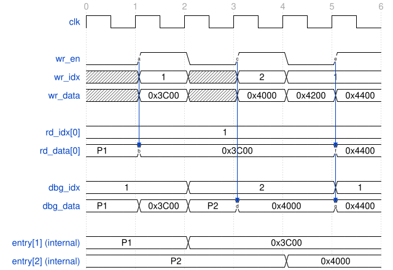

# pcu_regfile: specification

Owner: architect. Readers: everyone. The designer and DV each build from this
alone, so anything they would have to guess belongs here.

Every rule is tagged `[paper]`, `[ANEMOS]` or `[bankside]`, and every rule a
test can check has an ID: `[RF-1]`, `[RF-2]`, ...

## Overview

`pcu_regfile` is a parameterised register file: `DEPTH` entries of `WIDTH`
bits, one write port, `N_RD` functional read ports and one debug read port.
Reads are combinational and write-through; the write takes effect at the
clock edge; the entries are never reset.

`top` has five instances of it: `crf`, `grf_a`, `grf_b`, `srf_m` and `srf_a`.
Their parameter values, who drives each port, the write-port select and the
debug read select are defined by the parent, in
[hierarchy.md](../../top/doc/hierarchy.md#register-files) ([TOP-HIER-4] to
[TOP-HIER-7]), not here. The rules this module carries out are those of the
top spec:

| Top rule | What it asks of `pcu_regfile` | Here |
|---|---|---|
| [TOP-ARCH-4] | one write port per register file | [RF-3], [RF-7] |
| [TOP-ARCH-5] | contents not reset | [RF-5] |
| [TOP-ARCH-9] | an entry never written reads as its power-up value; no initial value in the RTL | [RF-5], [RF-6] |
| [TOP-ARCH-10] | the functional read-port counts | [RF-1] (`N_RD`) |
| [TOP-HAZ-1] | every read port write-through; the write at the end of the cycle | [RF-7], [RF-9], [RF-10] |
| [TOP-HAZ-5] | a read sees the newest write whose S5 cycle is its own cycle or earlier | follows from [RF-7] and [RF-9] |
| [TOP-HIER-4] | one module, parameters for depth, width and read ports | [RF-1] |
| [TOP-HIER-5] | the accumulator bypass is `grf_b`'s write-through on its S4 port | [RF-9], [worked case 6](#6-the-accumulator-bypass-on-grf_bs-ports) |
| [TOP-HIER-6], [TOP-HIER-7] | indices only as wide as the depth needs; range checks and zero-extension in `top` | [RF-11] |
| [TOP-IF-11], [TOP-IF-12] | the debug read: no latency, no side effect, write-through | [RF-10] |

[TOP-ARCH-4]: ../../top/doc/theory_of_operation.md#register-files
[TOP-ARCH-5]: ../../top/doc/theory_of_operation.md#register-files
[TOP-ARCH-9]: ../../top/doc/theory_of_operation.md#register-files
[TOP-ARCH-10]: ../../top/doc/theory_of_operation.md#register-files
[TOP-HAZ-1]: ../../top/doc/theory_of_operation.md#hazards
[TOP-HAZ-4]: ../../top/doc/theory_of_operation.md#hazards
[TOP-HAZ-5]: ../../top/doc/theory_of_operation.md#what-happens-when-a-rule-is-broken
[TOP-HIER-4]: ../../top/doc/hierarchy.md#register-files
[TOP-HIER-5]: ../../top/doc/hierarchy.md#register-files
[TOP-HIER-6]: ../../top/doc/hierarchy.md#how-top-connects-its-children
[TOP-HIER-7]: ../../top/doc/hierarchy.md#how-top-connects-its-children
[TOP-IF-9]: ../../top/doc/interfaces.md#register-file-access-through-the-ports
[TOP-IF-10]: ../../top/doc/interfaces.md#register-file-access-through-the-ports
[TOP-IF-11]: ../../top/doc/interfaces.md#register-file-access-through-the-ports
[TOP-IF-12]: ../../top/doc/interfaces.md#register-file-access-through-the-ports

**Sources.** The papers give the five files' sizes and roles (the
[register-file table](../../top/doc/theory_of_operation.md#register-files)),
not a module or its ports, so the port-level rules here are **[bankside]**
unless marked. ANEMOS (github.com/gem5-X/cnm_framework at `f2d4018`) has two
register-file templates, `rf_twoport<T, size>` (one read port) and
`rf_threeport<T, size>` (two read ports), each with one write port
(`src/rf_twoport.h`, `src/rf_threeport.h`; read, not run). Where they agree
with this doc the rule is tagged **[ANEMOS]** as well; where they differ, the
rule says so.

## Parameters

- **[RF-1]** The module has three parameters and one derived local parameter.
  **[bankside]**

  | Parameter | Type | Default | Legal values | Meaning |
  |---|---|---|---|---|
  | `DEPTH` | `int unsigned` | 8 | a power of two, ≥ 2 | Number of entries |
  | `WIDTH` | `int unsigned` | 16 | ≥ 1 | Bits per entry |
  | `N_RD` | `int unsigned` | 1 | ≥ 1 | Number of functional read ports. The debug read port is not counted |
  | `IDX_W` (localparam) | `int unsigned` | `$clog2(DEPTH)` | – | Width of every index port |

  A value outside the legal range stops elaboration with an error
  (`$error` or `$fatal` in an elaboration-time check), naming the parameter.
  The defaults are the SRF shape (8 × 16, one read port); `top` sets all
  three parameters explicitly on every instance, with the values of the
  [TOP-HIER-4] table: `crf` 2 (the fetch at the PC and a JUMP's target, in
  the same S1 cycle, set by `pcu_ctrl`'s doc, #27), `grf_a` 2, `grf_b` 3,
  `srf_m` 1, `srf_a` 1 ([TOP-ARCH-10]).

  `DEPTH` must be a power of two so that every value of an `IDX_W`-bit index
  names an entry ([RF-11]). Every v1 depth is one (8 and 32). The power-of-two
  check is `DEPTH >= 2 && (DEPTH & (DEPTH - 1)) == 0`.

  ANEMOS's templates have the type and the size as parameters and a fixed
  number of read ports per template (1 or 2); bankside makes the count a
  parameter, since `grf_b` needs 3 ([TOP-ARCH-10]) and `crf`'s count is set
  elsewhere.

## Ports

- **[RF-2]** The ports. No other ports exist: in particular there is **no
  reset input** ([RF-5]) and no read enable. **[bankside]**

  | Port | Dir | Width | Description |
  |---|---|---|---|
  | `clk` | in | 1 | Clock. The write takes effect at its rising edge ([RF-7]) |
  | `wr_en` | in | 1 | Write enable |
  | `wr_idx` | in | `IDX_W` | Entry written when `wr_en` = 1 |
  | `wr_data` | in | `WIDTH` | Data written when `wr_en` = 1 |
  | `rd_idx` | in | `N_RD` × `IDX_W` | Functional read port indices, packed ([RF-4]) |
  | `rd_data` | out | `N_RD` × `WIDTH` | Functional read port data, packed ([RF-4]); combinational, write-through ([RF-8], [RF-9]) |
  | `dbg_idx` | in | `IDX_W` | Debug read index |
  | `dbg_data` | out | `WIDTH` | Debug read data; combinational, write-through ([RF-10]) |

- **[RF-3]** There is exactly **one write port**: `wr_en`, `wr_idx`,
  `wr_data`. `top` chooses what drives it (the S5 write or a configuration
  write, [TOP-HIER-6]); the module doesn't know which. **[bankside]**,
  **[ANEMOS]** (one `wr_port` per template), following [TOP-ARCH-4].

- **[RF-4]** **Packed layout.** `rd_idx` and `rd_data` are packed
  two-dimensional vectors, `logic [N_RD-1:0][IDX_W-1:0] rd_idx` and
  `logic [N_RD-1:0][WIDTH-1:0] rd_data`, so read port *p* (0 ≤ *p* < `N_RD`)
  is `rd_idx[p]` = bits `[p·IDX_W + IDX_W − 1 : p·IDX_W]` and `rd_data[p]` =
  bits `[p·WIDTH + WIDTH − 1 : p·WIDTH]` of the flat vector. A testbench that
  sees the ports as flat vectors (cocotb on Verilator) uses this layout.
  Example ([worked case 5](#5-the-packed-port-layout)): on `grf_b`
  (`N_RD` = 3, `IDX_W` = 3), ports 0, 1 and 2 reading entries 5, 0 and 3 is
  `rd_idx` = 0x0C5, and port 2's data is `rd_data[767:512]`. **[bankside]**

## Behaviour

### Storage, reset and power-up

- **[RF-5]** **No reset and no initial value.** The entries are not reset
  and not initialised: the module has no reset input, the storage has no
  `initial` block, no initialiser in its declaration, and no assignment other
  than the write of [RF-7]. This carries out [TOP-ARCH-5] and the RTL bullet
  of [TOP-ARCH-9]. The storage is one variable (e.g.
  `logic [WIDTH-1:0] mem [DEPTH]`) written only by an `always_ff @(posedge
  clk)`, so the simulator decides its power-up value. **[bankside]**
  ANEMOS clears every entry on reset (`write_update_thread`); bankside
  doesn't, for the reasons given under [TOP-ARCH-5].

- **[RF-6]** **Reading an entry never written.** Until its first write, an
  entry reads as its power-up value, as [TOP-ARCH-9] defines it: the same
  bits on every read port and on the debug port, in every cycle, until the
  write; not predicted by the spec. In simulation those bits are random per
  run, from the run's seed, under the Verilator options [TOP-ARCH-9] names;
  they apply to this module's own tests as well. A test checks only that
  they are stable and equal across ports, never their value
  ([worked case 3](#3-an-entry-never-written)). **[bankside]**

- **[RF-12]** **Flip-flops.** Each entry is `WIDTH` flip-flops clocked by
  `clk`: no latches and no memory macro. **[bankside]** Four read ports with
  combinational, write-through reads (`grf_b`) are not the shape of an SRAM
  macro, and ASAP7 has no memory compiler in the flow.

### Write

- **[RF-7]** **Write at the edge.** At the rising edge of `clk` that ends a
  cycle with `wr_en` = 1, entry `wr_idx` takes `wr_data`. No other entry
  changes. With `wr_en` = 0 no entry changes, and `wr_idx` and `wr_data`
  are ignored. A value written in cycle *t* is the stored value from cycle
  *t* + 1 on; in cycle *t* itself it reaches the read ports only through
  write-through ([RF-9], [RF-10]). **[bankside]**, **[ANEMOS]** (written on
  `clk.pos()` when `wr_en`), following [TOP-HAZ-1] ("the write takes effect
  at the end of the cycle").

### Read

- **[RF-8]** **Combinational read.** Each read port *p* has no clock, no
  enable and no latency: `rd_data[p]` is a function of `rd_idx[p]`, the
  stored entries, and `wr_en`, `wr_idx`, `wr_data` ([RF-9]), in the same
  cycle. A read has no side effect. The ports are independent: any number of
  them, the debug port included, may read the same entry, or different
  entries, in one cycle. **[bankside]**, **[ANEMOS]** (its `read_method` is
  combinational).

- **[RF-9]** **Write-through on every read port.** For every *p* in
  0 … `N_RD` − 1, in every cycle:

  ```
  rd_data[p] = (wr_en == 1 && wr_idx == rd_idx[p]) ? wr_data : entry[rd_idx[p]]
  ```

  So a read port always shows what the entry will hold after this cycle's
  edge. With `wr_en` = 0, a matching `wr_idx` changes nothing. This carries
  out [TOP-HAZ-1] for the S2 source reads and the S4 accumulator read; on
  `grf_b`'s S4 port it is the accumulator bypass of [TOP-HIER-5]. Every port
  has it, so the module has no per-port write-through parameter
  ([TOP-HIER-7]). **[bankside]** ANEMOS's reads are not write-through: its
  `read_method` returns the stored `reg[]` signals, which change only after
  the clock edge ([TOP-HAZ-1] gives the reasons for the choice).

- **[RF-10]** **The debug read port** behaves exactly as a functional read
  port, [RF-8] and [RF-9] with `dbg_idx` and `dbg_data`:

  ```
  dbg_data = (wr_en == 1 && wr_idx == dbg_idx) ? wr_data : entry[dbg_idx]
  ```

  It is always present (no parameter removes it) and is not counted in
  `N_RD`. Its write-through is the same-cycle behaviour [TOP-IF-12] asks of
  `dbg_rd_data`; `top`'s debug select adds the zero-extension and the
  range check of [TOP-IF-11]. `top`'s synthesis wrapper ties the port off
  ([TOP-HIER-7]); the module does nothing different for that. **[bankside]**
  (ANEMOS has no debug read.)

### Indices

- **[RF-11]** **Indices are `IDX_W` = clog2(`DEPTH`) bits wide**: `wr_idx`,
  every `rd_idx[p]` and `dbg_idx` (3 bits for the 8-entry files, 5 for
  `crf`). With `DEPTH` a power of two ([RF-1]), every index value names an
  entry, so the module has no out-of-range case and no range check. Top-level
  indices that can be out of range (`cfg_wr_idx` and `dbg_rd_idx` are 5 bits
  for 8-entry files too) are checked by `top`'s glue before they reach an
  instance ([TOP-HIER-6], [TOP-HIER-7]; the rules are [TOP-IF-10],
  [TOP-IF-11]). **[bankside]** ANEMOS's ports carry a full `uint` index; its
  reads return 0 and its writes are ignored for an index not below `size`.
  bankside puts that check in `top`, where the 5-bit index exists.

### Timing

- **[RF-13]** **Timing of each port.** One clock, `clk`; everything below is
  relative to it. **[bankside]**

  | Port | Sampled / valid | Combinational paths |
  |---|---|---|
  | `wr_en`, `wr_idx`, `wr_data` | Sampled at the rising edge that ends the cycle ([RF-7]); must be stable before it (setup) | to every `rd_data[p]` and to `dbg_data` (write-through) |
  | `rd_idx[p]` | Any time in the cycle | to `rd_data[p]` only |
  | `rd_data[p]` | Valid in the same cycle, once its inputs have settled; no register on the path | from `rd_idx[p]`, `wr_en`, `wr_idx`, `wr_data`, and the entries |
  | `dbg_idx` | Any time in the cycle | to `dbg_data` only |
  | `dbg_data` | As `rd_data[p]` | from `dbg_idx`, `wr_en`, `wr_idx`, `wr_data`, and the entries |

  The entries change only at the rising edge, and only through [RF-7]. No
  output is registered, and no path runs from a read index to anything but
  its own port's data.

  For the designer: on `grf_b`, `wr_data` → `rd_data[2]` (the S4 port) lies
  in the one-cycle accumulator loop of [TOP-HIER-5] and [TOP-HAZ-4]: S5
  write data → `grf_b` port 2 → `fp16_add` → the S4/S5 register. The
  write-through multiplexer belongs at the output, after the stored-entry
  multiplexer, so this path is one 2-to-1 multiplexer long, not a pass
  through the `DEPTH`-to-1 read multiplexer.



*Figure 1: the ports of an `srf_m`-shaped instance (`DEPTH` = 8, `WIDTH` =
16, `N_RD` = 1), cycles 0 to 5. P1 and P2 are the power-up values of entries
1 and 2 ([RF-6]). Write-through on read port 0 in cycle 1 (a → b) and 5
(e → f), and on the debug port in cycles 3 (c → d) and 5 (e → g): [RF-9],
[RF-10]. The entries (internal, not ports) change at the edge that ends the
write's cycle: entry 1 at the start of cycle 2, entry 2 at the start of
cycle 4 ([RF-7]). In cycle 4, `wr_idx` = 1 with `wr_en` = 0 shows nothing
and writes nothing. In cycle 2 the debug port reads entry 2, never written:
P2 ([RF-6]). [Worked case 1](#1-the-timing-diagram-checked) checks every
cell. Source: [rf_port_timing.wave.json](img/rf_port_timing.wave.json).*

## Choices weighed

| Choice | Options | Where they differ | Chosen |
|---|---|---|---|
| Read-port shape | (a) packed `[N_RD-1:0][W-1:0]` vectors; (b) unpacked arrays `[N_RD]`; (c) named ports `rd0_*`, `rd1_*`, … | (c) can't follow `N_RD`. (b) vs (a): the same hardware, but an unpacked array at the module's top level is awkward to reach from cocotb on Verilator, and a unit test drives this module directly | (a), [RF-4]. **[bankside]** |
| Debug port | (a) a separate port, always present, not in `N_RD`; (b) the last of `N_RD` + 1 ports; (c) present only when a parameter says so | (b): `crf`'s `N_RD` (2, from `pcu_ctrl`'s doc, #27) would have to become 3, and `top`'s port numbers of [TOP-HIER-4] would shift. (c): the simulated and synthesised modules would differ, while [TOP-HIER-7] already removes the port in synthesis by tying it off | (a), [RF-10]. **[bankside]** |
| `DEPTH` | (a) a power of two only; (b) any depth, with an in-module range check | `DEPTH` = 6 with `IDX_W` = 3: under (b) index 7 needs a defined result, the check [TOP-HIER-6] and [TOP-HIER-7] already put in `top`; under (a) the case can't occur. All v1 depths are powers of two | (a), [RF-1], [RF-11]. **[bankside]** |
| Write-through mux placement | (a) after the stored-entry read mux; (b) folded into it | No behaviour differs; only the length of the [TOP-HAZ-4] loop does ([RF-13]) | (a), a note to the designer, not a rule a test can check |

Write-through itself, the absence of reset and the read-port counts were
settled in the top spec ([TOP-HAZ-1], [TOP-ARCH-5], [TOP-ARCH-10]; #8, #15);
the options weighed there are not repeated here.

## Examples

All six cases come from one script, which models the module as [RF-5] to
[RF-11] state it and can also run it without write-through (option (b) of
[TOP-HAZ-1]) to show where the two differ. Rerun from the repo root:

```
.venv/bin/python src/pcu_regfile/doc/examples/rf_trace.py
```

Output: [examples/rf_trace.out](examples/rf_trace.out). It exits non-zero if
any check fails. The power-up values come from fixed seeds in the script;
they stand for the random values of [RF-6] and are not predictions.

### 1. The timing diagram, checked

The script reads [img/rf_port_timing.wave.json](img/rf_port_timing.wave.json),
feeds its input rows to the model and compares every output and storage cell
with the diagram (Figure 1). With P1 = 0x91B7 and P2 = 0xD8F1:

| Cycle | `wr_en` `wr_idx` `wr_data` | `rd_idx[0]` → `rd_data[0]` | `dbg_idx` → `dbg_data` | Rule | Without write-through |
|---|---|---|---|---|---|
| 0 | 0 – – | 1 → P1 | 1 → P1 | [RF-6] | same |
| 1 | 1 1 0x3C00 | 1 → **0x3C00** | 1 → **0x3C00** | [RF-9], [RF-10] | P1, P1 |
| 2 | 0 – – | 1 → 0x3C00 (stored) | 2 → P2 | [RF-7], [RF-6] | same |
| 3 | 1 2 0x4000 | 1 → 0x3C00 | 2 → **0x4000** | [RF-10]; port 0 reads another entry | 0x3C00, P2 |
| 4 | 0 1 0x4200 | 1 → 0x3C00 | 2 → 0x4000 (stored) | [RF-7], [RF-9]: `wr_en` = 0 | same |
| 5 | 1 1 0x4400 | 1 → **0x4400** | 1 → **0x4400** | [RF-9], [RF-10] | 0x3C00, 0x3C00 |

The two models differ in cycles 1, 3 and 5 only, the cycles where a port
reads the entry being written.

### 2. Write-through on every read port

A `grf_b`-shaped instance (8 × 256, `N_RD` = 3, plus the debug port). In one
cycle, entry 5 is written with a 256-bit value V while one port reads entry 5
and the other three read entry 4. Repeated for each of `rd_data[0]`,
`rd_data[1]`, `rd_data[2]` and `dbg_data`: the port on entry 5 returns V,
the others the stored entry 4, and entry 5 holds V from the next cycle.
With all four ports on entry 5, all four return V. With `wr_en` = 0 and
`wr_idx` = 5, all four return the stored entry 5 and it doesn't change
([RF-7], [RF-9], [RF-10]).

### 3. An entry never written

An `srf_m`-shaped instance writes entries 0 to 4 over five cycles while
`rd_data[0]` and `dbg_data` both read entry 6, never written: all ten reads
return the same bits (0x9A9A with seed 3). In cycle 5 entry 6 is written with
0x3C00: both ports show 0x3C00 in cycle 5 (write-through) and in cycle 6
(stored). Under seed 4 entry 6 powers up as 0x27AC instead: a test can check
that the value is stable and the same on every port, not what it is
([RF-6], [TOP-ARCH-9]).

### 4. Index width on the five instances

For each instance, with the shapes of the [TOP-HIER-4] table (GRF and SRF
sizes checked against the yaml's `operands`; `crf`'s `N_RD` = 2 from
`pcu_ctrl`'s doc, #27): `IDX_W` = clog2(`DEPTH`) and 2^`IDX_W` = `DEPTH`, and every index
value is written and read back on every port, both in the write's cycle
(write-through) and the cycle after (stored).

| Instance | `DEPTH` | `WIDTH` | `N_RD` | `IDX_W` | Every index an entry | Read-back |
|---|---|---|---|---|---|---|
| `crf` | 32 | 32 | 2 | 5 | yes | ok |
| `grf_a` | 8 | 256 | 2 | 3 | yes | ok |
| `grf_b` | 8 | 256 | 3 | 3 | yes | ok |
| `srf_m` | 8 | 16 | 1 | 3 | yes | ok |
| `srf_a` | 8 | 16 | 1 | 3 | yes | ok |

The 5-bit `dbg_rd_idx` = 9 that [TOP-IF-11] answers with 0 never reaches
`grf_a`'s 3-bit `dbg_idx` as a valid read: `top` passes the low 3 bits (1)
and its debug select drives 0 instead of the instance's output
([TOP-HIER-7]). That check is tested at `top`, not here ([RF-11]).

### 5. The packed port layout

`grf_b`, ports 0, 1 and 2 reading entries 5, 0 and 3: `rd_idx` = 3·2⁶ +
0·2³ + 5 = 0x0C5 (9 bits), and port *p*'s data is
`rd_data[256p+255:256p]` (768 bits in all) ([RF-4]).

### 6. The accumulator bypass on grf_b's ports

Cycles 5 to 7 of the GEMV case of
[hierarchy.md](../../top/doc/hierarchy.md#worked-case-the-gemv-pattern-through-the-modules),
seen at `grf_b`'s ports (lane 0, FP16; GRF_B[0] holds −1.0 = 0xBC00 from an
earlier run):

| Cycle | Write port (S5) | Read | Write-through (chosen) | Without |
|---|---|---|---|---|
| 5 | `wr_idx` 0 ← 0x3800 (0.5) | `rd_idx[2]` = 0 (S4, MAC PC 1) | 0x3800 | 0xBC00 |
| 6 | `wr_idx` 0 ← 0x3C00 (1.0) | `rd_idx[2]` = 0 (S4, MAC PC 2) | 0x3C00 | 0x3800 |
| 7 | `wr_idx` 0 ← 0x4700 (7.0) | `rd_idx[0]` = 0 (S2, MOV PC 4) | 0x4700 | 0x3C00 |

With write-through, port 2 gives each MAC the result of the MAC just before
it, which is the bypass of [TOP-HIER-5] with no multiplexer outside the
module; without it, each read is one write late, the in-order mismatch of
option (c) in that worked case.
