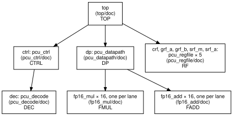
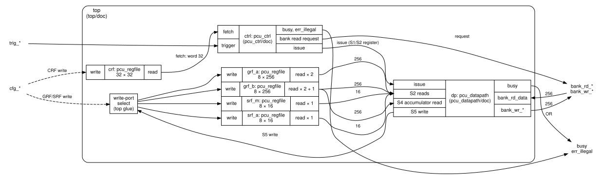

# Module hierarchy (v1)

This page splits the v1 unit into modules and says how `top` connects them.
Each child's ports, timing and requirement IDs are defined in the child's own
doc (`src/<module>/doc/`); this page refers to them and never copies them.
[Where each module is specified](#where-each-module-is-specified) lists
them.

The module boundaries don't change any behaviour in
[theory_of_operation.md](theory_of_operation.md),
[programmers_guide.md](programmers_guide.md) or
[interfaces.md](interfaces.md): they place that behaviour in modules. The
papers describe blocks (16 FP16 multipliers, 16 FP16 adders, the register
files, control), not an RTL module split, so where the split is our own
choice it is tagged **[bankside]**, and where ANEMOS
(github.com/gem5-X/cnm_framework, commit `f2d4018`, `src/*.h`) is split
differently, the rule says how.

## Modules

- **[TOP-HIER-1]** v1 has these modules, with this hierarchy, instance names
  and requirement-ID prefixes. A prefix belongs to its module only and is
  never reused. **[bankside]**

| Module | Instances (in parent) | Parent | Prefix | Role | First built in |
|---|---|---|---|---|---|
| `top` | – | none | `TOP` | The v1 unit: the ports of [interfaces.md](interfaces.md), the children below and the glue between them (write-port select, debug read select, `busy`). | M4 |
| [`pcu_ctrl`](../../pcu_ctrl/doc/README.md) | `ctrl` | `top` | `CTRL` | Stage S1: trigger, PC, loop state, NOP counter, CRF fetch, JUMP/EXIT, bank read request, `err_illegal`. Owns the S1/S2 register. | M4 |
| [`pcu_decode`](../../pcu_decode/doc/README.md) | `dec` | `pcu_ctrl` | `DEC` | Combinational: one 32-bit instruction word to its decoded fields and an illegal flag, from [bankside_isa.yaml](bankside_isa.yaml). | M4 |
| [`pcu_datapath`](../../pcu_datapath/doc/README.md) | `dp` | `top` | `DP` | Stages S2 to S5: source selection, SRF broadcast, ReLU, the 16 lanes of multiply and add, the MAC accumulator read, write-back and the bank write port. Owns the S2/S3, S3/S4 and S4/S5 registers. | M4 |
| [`fp16_mul`](../../fp16_mul/doc/README.md) | 16, one per lane | `pcu_datapath` | `FMUL` | One FP16 multiply, combinational ([TOP-HIER-3]). | M2 |
| [`fp16_add`](../../fp16_add/doc/README.md) | 16, one per lane | `pcu_datapath` | `FADD` | One FP16 add, combinational ([TOP-HIER-3]). | M2 |
| [`pcu_regfile`](../../pcu_regfile/doc/README.md) | `crf`, `grf_a`, `grf_b`, `srf_m`, `srf_a` | `top` | `RF` | A parameterised register file: depth, width, number of read ports; combinational reads, write-through, one write port, no reset ([TOP-HIER-4]). | M4 |
| [`common`](../../common/doc/README.md) | – | none | `CMN` | No module: the SystemVerilog package `bankside_pkg`, with the constants and types shared by several modules ([TOP-HIER-9]). | M4 |

`fp16_mul` and `fp16_add` are the names [VER-4] in the
[verification requirements](../dv/README.md) uses. The lane generate-block and
instance names inside `pcu_datapath` are set by
[its doc](../../pcu_datapath/doc/README.md#lanes-and-the-fp16-units).



*Figure 1: the v1 hierarchy ([TOP-HIER-1]), instance name : module, the doc
that specifies it, and its prefix. Source: [top_hierarchy.dot](img/top_hierarchy.dot).*

## Who owns which stage

- **[TOP-HIER-2]** The pipeline stages of the
  [theory of operation](theory_of_operation.md#pipeline) are split between two
  modules at a register boundary **[bankside]**:
  - `pcu_ctrl` does S1 and holds the **S1/S2 register**. What that register
    holds (valid, the decoded instruction, the trigger's row and column) is
    the **issue** output of `pcu_ctrl`, defined in
    [its doc](../../pcu_ctrl/doc/README.md#the-issue-bundle).
  - `pcu_datapath` does S2 to S5 and holds the **S2/S3, S3/S4 and S4/S5
    registers**, with each stage's control carried next to its data
    ([its doc](../../pcu_datapath/doc/README.md#state-reset-and-the-clock)). The
    `bank_wr_*` ports ([TOP-IF-3]) are driven from the S4/S5 register.
  - No other module holds pipeline state. `pcu_regfile` holds only its
    entries; `fp16_mul` and `fp16_add` hold nothing.

  ANEMOS splits by function instead: its `control_unit` drives every
  register-file and FPU select, and its `fpu` holds no stage registers (they
  are inside `fp_multiplier` and `fp_adder`). bankside keeps each stage's data
  and control in one module, so they can't drift apart.

## FP16 units

- **[TOP-HIER-3]** `fp16_mul` and `fp16_add` each compute **one lane** and
  are **purely combinational**: no clock, no reset, no state. `pcu_datapath`
  has 16 of each; lane *i* takes and gives bits `[16i+15 : 16i]` of the
  256-bit vectors. The S3 multiply and S4 add each sit between two stage
  registers of `pcu_datapath`.
  **[paper]** (16 FP16 multipliers and 16 FP16 adders, one per lane),
  **[ANEMOS]** (one `fp_multiplier` and one `fp_adder` per lane, in its
  `fpu`), **[bankside]** (combinational). ANEMOS's units are clocked, with
  `MULT_STAGES` pipeline registers inside `fp_multiplier`.

  The paper (ISCA 2021, Section III-A) describes "a pair of 16 FP16
  multipliers and adders, each with 5 stages". bankside reads "5 stages" as
  the five-stage pipeline of Section IV-B, in which the multiply is one
  stage (MULT, S3) and the add one stage (ADD, S4), not as five registers
  inside each unit. **[paper]** (that reading of the two sections),
  **[ANEMOS]** (its model of the paper has one register after each unit,
  `MULT_STAGES` = `ADD_STAGES` = 1, `src/defs.h` at `f2d4018`). That one
  register per unit is `pcu_datapath`'s S3/S4 and S4/S5 register, not a
  register inside the unit, which stays combinational for the reason
  below. The unit docs give the same reading
  ([`fp16_mul`](../../fp16_mul/doc/README.md#overview),
  [`fp16_add`](../../fp16_add/doc/README.md#overview)).

  Why combinational: the accumulator bypass ([TOP-HAZ-2]) is a one-cycle loop
  S5 → S4 accumulator read → `fp16_add` → S4/S5 register. A register inside
  `fp16_add` would lengthen the loop and break [TOP-HAZ-4]. It also makes each
  unit a pure function of 32 input bits, which is what [VER-4] sweeps.

## Register files

- **[TOP-HIER-4]** The five register files are instances of one module,
  [`pcu_regfile`](../../pcu_regfile/doc/README.md), with parameters for depth,
  width and number of read ports.
  Every read port is **combinational** and **write-through**: a read of the
  entry the write port is writing in the same cycle returns the data being
  written ([TOP-HAZ-1]). The write takes effect at the end of the cycle. There
  is one write port and no reset ([TOP-ARCH-4], [TOP-ARCH-5]). **[bankside]**
  ANEMOS has three modules (`crf`, `grf` built from per-lane `rf_threeport`,
  and one `srf` holding both SRF_M and SRF_A) and puts the write-data
  multiplexer and ReLU inside `grf`; bankside puts those in `pcu_datapath`.

  | Instance | Depth × width | Functional read ports, and who uses them | Write port driven by |
  |---|---|---|---|
  | `crf` | 32 × 32 | `pcu_ctrl`: 2 in S1, port 0 the word at the PC and port 1 the word a JUMP leads to, read in the same cycle (the zero-slot JUMP fetch of [`pcu_ctrl`'s doc](../../pcu_ctrl/doc/README.md#fetch-and-the-zero-slot-jump)) | `cfg_*` only |
  | `grf_a` | 8 × 256 | `pcu_datapath`: 2 in S2 | write-port select ([TOP-HIER-6]) |
  | `grf_b` | 8 × 256 | `pcu_datapath`: 2 in S2, 1 in S4 (MAC accumulator) | write-port select |
  | `srf_m` | 8 × 16 | `pcu_datapath`: 1 in S2 | write-port select |
  | `srf_a` | 8 × 16 | `pcu_datapath`: 1 in S2 | write-port select |

  Each instance also has one more read port, for the debug read
  ([TOP-HIER-7]). The functional counts of the GRFs and SRFs follow from
  the yaml `legal` lists: see
  [Worked case: read ports from the yaml](#worked-case-read-ports-from-the-yaml).
  The CRF's follows from the fetch, which reads at most two words per slot.

- **[TOP-HIER-5]** The **accumulator bypass** of [TOP-HAZ-2] is `grf_b`'s
  write-through on its S4 read port. When the instruction in S5 writes the
  GRF_B entry a MAC in S4 reads, the port returns the S5 write data, which is
  the S5 result [TOP-HAZ-2] names. `pcu_datapath` has no separate bypass
  multiplexer. **[bankside]** This is the same behaviour as [TOP-HAZ-2], built
  from the mechanism [TOP-HAZ-1] already needs; see
  [Worked case: the GEMV pattern through the modules](#worked-case-the-gemv-pattern-through-the-modules).

## How top connects its children



*Figure 2: the connections inside `top` (selected bundles: clock, reset and
the debug read are left out). Dashed lines are configuration paths. Bundle
names are those of the table below; the signals in each are defined by the
child docs. Source: [top_connections.dot](img/top_connections.dot).*

Each row is one bundle. Port names are those of the child docs: `ctrl.x` is
port `x` of `pcu_ctrl` ([its ports](../../pcu_ctrl/doc/README.md#ports)),
`dp.x` of `pcu_datapath` ([its ports](../../pcu_datapath/doc/README.md#ports)),
and `grf_b.x` of that instance of `pcu_regfile`
([its ports](../../pcu_regfile/doc/README.md#ports)). "Defined by" names the
doc that defines the signals and their timing; `top` connects them
one-to-one, port to port of the same name and width, unless the row says
otherwise. **[bankside]** throughout.

| Bundle | From → to | Stage | Defined by |
|---|---|---|---|
| `clk` | top port → `ctrl.clk`, `dp.clk`, `clk` of all five `pcu_regfile` instances | – | [interfaces.md](interfaces.md), [TOP-ARCH-11] |
| `rst_n` | top port → `ctrl.rst_n`, `dp.rst_n` only (register files aren't reset, [TOP-ARCH-5]) | – | [interfaces.md](interfaces.md) |
| trigger: `trig_valid`, `trig_row`, `trig_col` | top ports → `ctrl` ports of the same names | S1 | [interfaces.md](interfaces.md), `pcu_ctrl` |
| fetch | `ctrl.crf_rd_idx` → `crf.rd_idx`; `crf.rd_data` → `ctrl.crf_rd_data` (2 ports, [CTRL-3]) | S1 | `pcu_ctrl`, `pcu_regfile` |
| bank read request: `bank_rd_en`, `bank_rd_sel`, `bank_rd_row`, `bank_rd_col` | `ctrl` → top ports of the same names | S1 ([TOP-IF-2]) | `pcu_ctrl` |
| issue (the S1/S2 register): `iss_valid`, `iss_instr`, `iss_row`, `iss_col` | `ctrl` → `dp`, port to port | S1/S2 | `pcu_ctrl` (the fields of `iss_instr` come from `pcu_decode`) |
| `bank_rd_data` | top port → `dp.bank_rd_data` | S2 ([TOP-IF-2]) | [interfaces.md](interfaces.md), `pcu_datapath` |
| S2 reads | `dp.grf_a_rd_idx` → `grf_a.rd_idx`, `grf_a.rd_data` → `dp.grf_a_rd_data` (ports 0–1); `grf_b` ports 0–1, the low two entries of `dp.grf_b_rd_idx` and `dp.grf_b_rd_data`; `srf_m` and `srf_a` port 0, from `dp.srf_m_rd_*` and `dp.srf_a_rd_*` ([DP-3]) | S2 | `pcu_datapath`, `pcu_regfile` |
| S4 accumulator read | `dp.grf_b_rd_idx[2]` → `grf_b.rd_idx[2]`, `grf_b.rd_data[2]` → `dp.grf_b_rd_data[2]`: `grf_b`'s port 2 ([DP-11], [TOP-HIER-5]) | S4 | `pcu_datapath`, `pcu_regfile` |
| S5 writes, one bundle per file | `dp.grf_a_wr_en`, `dp.grf_a_wr_idx`, `dp.grf_a_wr_data` → write-port select → `grf_a.wr_en`, `grf_a.wr_idx`, `grf_a.wr_data`; the same for `grf_b`, `srf_m`, `srf_a` ([TOP-HIER-6]) | S5 | `pcu_datapath` |
| bank write: `bank_wr_en`, `bank_wr_sel`, `bank_wr_row`, `bank_wr_col`, `bank_wr_data` | `dp` → top ports of the same names | S5 ([TOP-IF-3]) | `pcu_datapath` |
| configuration: `cfg_*` | top ports → `cfg_wr_en` gate and write-port select → `crf` write port and the four other write ports ([TOP-HIER-6]) | – | [interfaces.md](interfaces.md) |
| debug read: `dbg_rd_*` | `dbg_rd_idx` → `dbg_idx` of every instance; every instance's `dbg_data` → debug select → `dbg_rd_data` ([TOP-HIER-7]) | – | [interfaces.md](interfaces.md), `pcu_regfile` |
| `busy` | `ctrl.busy` OR `dp.busy` → top port ([TOP-HIER-8]) | – | `pcu_ctrl`, `pcu_datapath` |
| `err_illegal` | `ctrl.err_illegal` → top port | – | `pcu_ctrl` |

The glue that `top` itself contains, all of it combinational:

- **[TOP-HIER-6]** **Write-port select.** For each of the four files *f* in
  `grf_a`, `grf_b`, `srf_m`, `srf_a`, with *code* its operand code (0 to 3,
  [TOP-IF-9]) and *W* its width (256, 256, 16, 16), and for `crf`:

  ```
  cfg_ok   = cfg_wr_en && !busy && !trig_valid                 // [TOP-IF-8]
  cfg_f    = cfg_ok && cfg_wr_sel == code && cfg_wr_idx < 8     // [TOP-IF-10]
  f.wr_en  = cfg_f ? 1                    : dp.f_wr_en
  f.wr_idx = cfg_f ? cfg_wr_idx[2:0]      : dp.f_wr_idx
  f.wr_data= cfg_f ? cfg_wr_data[W-1:0]   : dp.f_wr_data

  crf.wr_en   = cfg_ok && cfg_wr_sel == 7
  crf.wr_idx  = cfg_wr_idx
  crf.wr_data = cfg_wr_data[31:0]
  ```

  `busy` is the top output ([TOP-HIER-8]), from registers only, so the gate
  has no combinational loop. A configuration write that counts needs
  `busy` = 0, so after the first reset it never meets an S5 write: every
  `dp.*_wr_en` is 0 while `dp.busy` = 0. Before the end of the first reset
  cycle the enables are undefined ([TOP-IF-13]), and the host doesn't write
  configuration then. A write with `cfg_wr_sel` = 4, 5 or 6, or with
  `cfg_wr_idx` ≥ 8 for a GRF or SRF, enables no instance's write port
  ([TOP-IF-10]). An instance's write index is only as wide as its depth
  needs (3 bits, 5 for `crf`), so `pcu_regfile` never sees an
  out-of-range index. **[bankside]**
- **[TOP-HIER-7]** **Debug read.** Every instance's `dbg_idx` takes the low
  bits of `dbg_rd_idx` (3 bits, all 5 for `crf`), and the debug select
  drives `dbg_rd_data`:

  ```
  dbg_rd_data = dbg_rd_sel == code(f) && dbg_rd_idx < 8 ? zero-extend(f.dbg_data)   // f a GRF or SRF
              : dbg_rd_sel == 7                         ? zero-extend(crf.dbg_data)
              : 0                                                                     // [TOP-IF-11]
  ```

  The instance's `dbg_data` is write-through against its own write port,
  after the write-port select ([RF-10]), so a debug read in the cycle of a
  write shows the value being written ([TOP-IF-12]), and a configuration
  write that [TOP-IF-8] or [TOP-IF-10] ignores, which never reaches a write
  port, is never shown. `pcu_regfile` needs no per-port write-through
  parameter. The synthesis wrapper in `src/top/syn/` ties `dbg_rd_*` off,
  so the debug ports drop out of the PPA
  ([interfaces.md](interfaces.md#debug-port)). **[bankside]**
- **[TOP-HIER-8]** **Busy.** `busy` = `ctrl.busy` OR `dp.busy`, together the
  terms of [TOP-IF-7]. `ctrl`'s covers an entry in S2 (the valid bit of its
  S1/S2 register), NOP slots left and `loop_active` ([CTRL-13]). `dp`'s
  covers an entry in S3, S4 or S5 (the valid bits of its S2/S3, S3/S4 and
  S4/S5 registers, [DP-15]). Every slot sets the S1/S2 valid bit, whatever
  it issues ([TOP-PIPE-4]), and a valid bit moves down with its entry
  whether or not the entry writes anything. Both outputs come from
  registers only, so `busy` has no combinational path from any input.
  **[bankside]**

## Shared package and the wrapper

- **[TOP-HIER-9]** Types used by more than one module (the opcode and
  operand codes of [bankside_isa.yaml](bankside_isa.yaml), and the decoded
  instruction of `pcu_decode`'s doc) are in one SystemVerilog package,
  `bankside_pkg` in `src/common/rtl/`, specified by
  [`common`'s doc](../../common/doc/README.md#the-package), which lists its
  contents. The package implements those docs and adds no rule of its own.
  **[bankside]**
- **[TOP-HIER-10]** v1 has **no wrapper module**: `top` is the unit, with the
  ports of [interfaces.md](interfaces.md), and instantiates its children
  directly. The synthesis wrapper of [TOP-HIER-7] is a file of `src/top/syn/`,
  not a module with a doc. **[bankside]** In v2, the HBM2 command interface
  that replaces the trigger, bank and configuration ports becomes a new child
  of `top`, beside `ctrl`; the other children keep their ports. ANEMOS nests
  `control_unit` (with its `interface_unit`) inside `imc_core`, inside
  `imc_pch`.

## Choices weighed

Each choice lists the options, the case where they differ, and the source.

| Choice | Options | Where they differ | Chosen |
|---|---|---|---|
| FP16 units | (a) one lane, combinational; (b) one 16-lane module, like ANEMOS's `fpu`; (c) internally pipelined, like ANEMOS's `fp_multiplier` | Back-to-back MACs: under (c) the S4 add result isn't at the S4/S5 register one cycle later, so the bypass loop of [TOP-HAZ-2] breaks unless the unit's register *is* the S4/S5 register, which also has to carry MOV and MUL results the adder never sees. (b) vs (a): the same hardware; (a) is the unit [VER-4] sweeps and the "16 multipliers" of the paper | (a), [TOP-HIER-3]. **[paper]**, **[ANEMOS]** (per lane), **[bankside]** (combinational) |
| Register files | (a) one `pcu_regfile`, five instances; (b) `crf`, `grf`, `srf` as in ANEMOS; (c) no module, inside `top` or `pcu_datapath` | Write-through [TOP-HAZ-1] is tested once on one module under (a), three times under (b), and only through whole programs under (c), where a read port hit at distance 3 needs a 4-instruction program and a matching trigger sequence | (a), [TOP-HIER-4]. **[bankside]** |
| Accumulator bypass | (a) `grf_b`'s write-through on its S4 port; (b) a multiplexer in `pcu_datapath` from the S5 result | No program tells them apart: the [worked case](#worked-case-the-gemv-pattern-through-the-modules) gives the same bank write under both. (a) needs no second mechanism, since [TOP-HAZ-1] already makes every port write-through | (a), [TOP-HIER-5]. **[bankside]** |
| Fetch, decode, control | (a) `pcu_ctrl` with a child `pcu_decode`; (b) one `pcu_ctrl`, decode inside; (c) ANEMOS's split: decoder, PC unit and interface unit as three modules | [VER-8] (every class of illegal instruction): under (a) a unit test applies each word class to `pcu_decode` and compares with the yaml, one word per cycle; under (b) each word needs a CRF write and a trigger through the whole unit. (c) puts the zero-slot JUMP ([TOP-ISA-4]) across a module boundary: the PC, loop state and fetch are resolved together in one S1 cycle | (a). **[ANEMOS]** (decoder separate from the PC), **[bankside]** (PC, loop and NOP state in `pcu_ctrl` itself) |
| Datapath | (a) one `pcu_datapath` for S2 to S5, 16 FP16 units of each kind inside; (b) a lane module, 16 instances; (c) ANEMOS's: operand selects in the control unit, muxes and ReLU in `grf`, arithmetic in `fpu` | (c) splits a stage's data from its control across modules ([TOP-HIER-2]). (b) vs (a): no behaviour differs; the lanes are identical and independent, so a generate loop in (a) gives the same structure without one more doc | (a). **[bankside]** |
| Wrapper | (a) none: `top` is the unit; (b) `top` wraps a `pcu_core` with the same ports; (c) a synthesis wrapper module | In v1 (b) has two port tables, `top`'s and `pcu_core`'s, that must stay equal. In v2, `top`'s ports change: under (a) `top` gains the command-interface child and its glue changes; under (b) only the wrapper changes. The children's docs are unchanged under both. (c): the tie-off is two lines of synthesis setup and has no behaviour to specify | (a), [TOP-HIER-10]. **[bankside]** |

## Worked case: the GEMV pattern through the modules

The GEMV kernel of the
[programmer's guide](programmers_guide.md#gemv-partial-sum-no-loop), cut to
two MACs, traced cycle by cycle through the split. It shows [TOP-HIER-2]
(which module does what in each cycle), [TOP-HIER-5] (the bypass is `grf_b`'s
write-through) and [TOP-HAZ-3] at distance 3 on a `grf_b` S2 port. One trigger
per cycle; the trigger of cycle *k* has column *k*. Lane 0 values; GRF_B[0]
holds −1.0 from an earlier run (it isn't reset, [TOP-ARCH-5]).

```
PC 0  MOV GRF_B[0], ODD_BANK
PC 1  MAC GRF_B[0], EVEN_BANK, SRF_M[0]    ; SRF_M[0] = 0.5
PC 2  MAC GRF_B[0], ODD_BANK,  SRF_M[1]    ; SRF_M[1] = 3.0
PC 3  NOP 2                                ; [TOP-HAZ-3]
PC 4  MOV ODD_BANK, GRF_B[0]
PC 5  EXIT
```

| Cycle | `ctrl` (S1) | `dp` S2 | `dp` S3 | `dp` S4 | `dp` S5 |
|---|---|---|---|---|---|
| 1 | PC 0 MOV; bank read ODD col 1 | – | – | – | – |
| 2 | PC 1 MAC; bank read EVEN col 2 | PC 0: `bank_rd_data` = 0.5 | – | – | – |
| 3 | PC 2 MAC; bank read ODD col 3 | PC 1: `bank_rd_data` = 1.0; `srf_m` port 0 [0] = 0.5 | PC 0: pass | – | – |
| 4 | PC 3 NOP, slot 1 of 2 | PC 2: `bank_rd_data` = 2.0; `srf_m` port 0 [1] = 3.0 | PC 1: 1.0 × 0.5 = 0.5 | PC 0: pass | – |
| 5 | PC 3 NOP, slot 2 of 2 | – | PC 2: 2.0 × 3.0 = 6.0 | PC 1: `grf_b` port 2 [0] = **0.5 (write-through)**; 0.5 + 0.5 = 1.0 | PC 0: `grf_b` [0] ← 0.5 |
| 6 | PC 4 MOV | – | – | PC 2: `grf_b` port 2 [0] = **1.0 (write-through)**; 1.0 + 6.0 = 7.0 | PC 1: `grf_b` [0] ← 1.0 |
| 7 | PC 5 EXIT | PC 4: `grf_b` port 0 [0] = **7.0 (write-through)** | – | – | PC 2: `grf_b` [0] ← 7.0 |
| 8 | – | – | PC 4: pass | – | – |
| 9 | – | – | – | PC 4: pass | – |
| 10 | – | – | – | – | PC 4: `bank_wr_*` ODD col 6 ← 7.0 |

- In cycles 5 and 6 each MAC's accumulator comes from the S5 write of the
  instruction just before it, through `grf_b`'s port 2: the [TOP-HAZ-2]
  bypass with no multiplexer in `dp` ([TOP-HIER-5]).
- In cycle 7 the store reads GRF_B[0] in S2, 3 slots after the last MAC, in
  the cycle that MAC writes it: [TOP-HAZ-1] and [TOP-HAZ-3].
- The NOP slots are shown in S1 only. They travel down S2 to S5 as entries
  that carry nothing ([TOP-PIPE-4]), so nothing in this trace depends on
  them.

The script runs the same program with the bypass built as (a) `grf_b`
write-through, (b) a multiplexer in `dp`, and (c) neither, and compares the
bank write with an in-order execution of the program:

| Built as | Bank write, ODD col 6, lanes 0 to 3 | Same as in-order? |
|---|---|---|
| (a) write-through, chosen | 7.0, 7.25, 7.5, 7.75 | yes |
| (b) multiplexer in `dp` | 7.0, 7.25, 7.5, 7.75 | yes |
| (c) neither | 6.5, 6.25, 6.0, 5.75 | no: each MAC reads the value from before the previous write (−1.0, then 0.5) |

Script: [examples/module_trace.py](examples/module_trace.py), output
[examples/module_trace.out](examples/module_trace.out). Rerun from the repo
root: `.venv/bin/python src/top/doc/examples/module_trace.py` (exits
non-zero if (a) or (b) differ from the in-order result, or (c) doesn't).

## Worked case: read ports from the yaml

The functional read-port counts of [TOP-HIER-4] come from the operand
combinations the ISA allows. For every legal combination in the yaml, the
script counts the entries of each file read in S2 (sources) and in S4 (the
MAC accumulator). Different instructions are in S2 and S4 in the same cycle,
so a file needs the S2 maximum plus the S4 maximum.

| File | S2 max | reached by | S4 max | Ports | [Register-file table](theory_of_operation.md#register-files) |
|---|---|---|---|---|---|
| GRF_A | 2 | `ADD GRF_A, GRF_A, GRF_A` | 0 | 2 | 2 |
| GRF_B | 2 | `ADD GRF_A, GRF_B, GRF_B` | 1 | 3 | 3 |
| SRF_M | 1 | `MOV GRF_A, SRF_M` | 0 | 1 | 1 |
| SRF_A | 1 | `MOV GRF_A, SRF_A` (ADD reads SRF_A at most once; MAD's SRC2 is its only SRF_A source) | 0 | 1 | 1 |

The same script shows that GRF_B's count stays 3 under either alternative
named for R1 and R11 (#6, #8; [TOP-ARCH-10] keeps 3): dropping the same-file source pairs from
MAC/MAD, or GRF_B as a MAC multiplier source. ADD and MUL with two GRF_B
sources stay legal, and one of them can be in S2 while a MAC reads its
accumulator in S4.

Script: [examples/regfile_ports.py](examples/regfile_ports.py), output
[examples/regfile_ports.out](examples/regfile_ports.out). Rerun from the repo
root: `.venv/bin/python src/top/doc/examples/regfile_ports.py` (exits
non-zero if the counts disagree with the register-file table).

## Where each module is specified

Each child's doc defines its own ports, timing and requirement IDs, and
cites the `TOP-` rules it carries out; this page doesn't restate them.
Each doc opens with a table from the top rules to its own.

| Module | Its doc | Its ports | The top rules it carries out |
|---|---|---|---|
| `pcu_ctrl` | [pcu_ctrl/doc](../../pcu_ctrl/doc/README.md) | [Ports](../../pcu_ctrl/doc/README.md#ports) | [Overview](../../pcu_ctrl/doc/README.md#overview) |
| `pcu_decode` | [pcu_decode/doc](../../pcu_decode/doc/README.md) | [Ports](../../pcu_decode/doc/README.md#ports) | [Overview](../../pcu_decode/doc/README.md#overview) |
| `pcu_datapath` | [pcu_datapath/doc](../../pcu_datapath/doc/README.md) | [Ports](../../pcu_datapath/doc/README.md#ports) | [Overview](../../pcu_datapath/doc/README.md#overview) |
| `fp16_mul` | [fp16_mul/doc](../../fp16_mul/doc/README.md) | [Ports](../../fp16_mul/doc/README.md#ports) | [Overview](../../fp16_mul/doc/README.md#overview) |
| `fp16_add` | [fp16_add/doc](../../fp16_add/doc/README.md) | [Ports](../../fp16_add/doc/README.md#ports) | [Overview](../../fp16_add/doc/README.md#overview) |
| `pcu_regfile` | [pcu_regfile/doc](../../pcu_regfile/doc/README.md) | [Ports](../../pcu_regfile/doc/README.md#ports) | [Overview](../../pcu_regfile/doc/README.md#overview) |
| `common` | [common/doc](../../common/doc/README.md) | none: a package, no module ([CMN-1]) | [Overview](../../common/doc/README.md#overview) |

Rules of the child docs cited on this page:
[CTRL-3](../../pcu_ctrl/doc/README.md#ports),
[CTRL-13](../../pcu_ctrl/doc/README.md#busy),
[DP-3](../../pcu_datapath/doc/README.md#ports),
[DP-11](../../pcu_datapath/doc/README.md#s3-and-s4-the-lanes),
[DP-15](../../pcu_datapath/doc/README.md#busy),
[RF-10](../../pcu_regfile/doc/README.md#read),
[CMN-1](../../common/doc/README.md#the-package).

[CTRL-3]: ../../pcu_ctrl/doc/README.md#ports
[CTRL-13]: ../../pcu_ctrl/doc/README.md#busy
[DP-3]: ../../pcu_datapath/doc/README.md#ports
[DP-11]: ../../pcu_datapath/doc/README.md#s3-and-s4-the-lanes
[DP-15]: ../../pcu_datapath/doc/README.md#busy
[RF-10]: ../../pcu_regfile/doc/README.md#read
[CMN-1]: ../../common/doc/README.md#the-package

`pcu_ctrl` had to exist before `pcu_decode` was created, and `pcu_datapath`
before `fp16_mul` and `fp16_add`: `new_module.py` needs the parent's `doc/`
folder.
