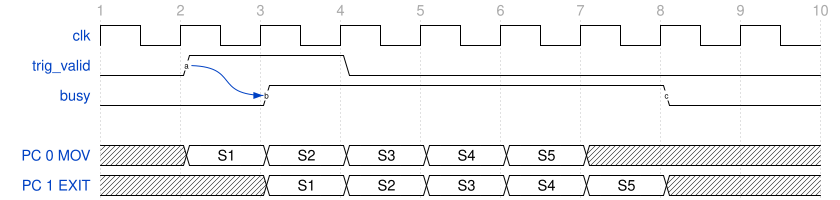

# Interfaces (v1)

In v1 the unit has a deliberately simple boundary: the testbench plays both the
host (triggers, register-file writes) and the DRAM banks (a synchronous memory
model). v2 replaces this with the HBM2 command interface and memory-mapped
register files. **[bankside]** throughout, unless marked.

## Parameters

| Name | Default | Meaning |
|---|---|---|
| `ROW_W` | 14 | Row address width (HBM2 pseudo-channel) |
| `COL_W` | 5 | Column address width (32 columns of 256 bits) |

## Ports

| Port | Dir | Width | Description |
|---|---|---|---|
| `clk` | in | 1 | Unit clock (DRAM core clock) |
| `rst_n` | in | 1 | Synchronous reset, active low |
| **Trigger** | | | |
| `trig_valid` | in | 1 | One issue slot this cycle |
| `trig_row` | in | ROW_W | Row of the triggering command |
| `trig_col` | in | COL_W | Column of the triggering command |
| **Bank read** | | | |
| `bank_rd_en` | out | 1 | The instruction in S1 reads a bank |
| `bank_rd_sel` | out | 1 | 0 = EVEN_BANK, 1 = ODD_BANK |
| `bank_rd_row`, `bank_rd_col` | out | ROW_W, COL_W | Address (the trigger's) |
| `bank_rd_data` | in | 256 | Read data, valid in the next cycle |
| **Bank write** | | | |
| `bank_wr_en` | out | 1 | A bank store in S5 |
| `bank_wr_sel` | out | 1 | 0 = EVEN_BANK, 1 = ODD_BANK |
| `bank_wr_row`, `bank_wr_col` | out | ROW_W, COL_W | Address of the store's own trigger |
| `bank_wr_data` | out | 256 | Write data |
| **Configuration** | | | |
| `cfg_wr_en` | in | 1 | Write one register-file entry ([TOP-IF-10]) |
| `cfg_wr_sel` | in | 3 | Register file: 0 GRF_A, 1 GRF_B, 2 SRF_M, 3 SRF_A (the operand codes), 7 CRF; 4 to 6 select nothing ([TOP-IF-9]) |
| `cfg_wr_idx` | in | 5 | Entry index: 0–31 for the CRF, 0–7 otherwise; any other index writes nothing ([TOP-IF-10]) |
| `cfg_wr_data` | in | 256 | Data; CRF uses bits 31:0, SRF bits 15:0, the rest is ignored ([TOP-IF-10]) |
| **Debug (testbench only)** | | | |
| `dbg_rd_sel`, `dbg_rd_idx` | in | 3, 5 | Register file and entry, coded as `cfg_wr_sel` and `cfg_wr_idx` ([TOP-IF-9]) |
| `dbg_rd_data` | out | 256 | Combinational, write-through read of the selected entry, zero-extended; 0 for an unused select or index ([TOP-IF-11], [TOP-IF-12]) |
| **Status** | | | |
| `busy` | out | 1 | The unit is not idle ([TOP-IF-7]) |
| `err_illegal` | out | 1 | Sticky: an illegal instruction was executed ([TOP-ISA-2]); set at the end of its S1 cycle ([TOP-ISA-24]); cleared by reset |

## Timing

- **[TOP-IF-1]** A cycle with `trig_valid = 1` is one issue slot. The instruction
  at the PC enters S1 in that cycle (or, during a multi-cycle NOP, one NOP slot
  is consumed). Either way the slot is one pipeline entry that travels down
  S1 to S5 ([TOP-PIPE-4]).
- **[TOP-IF-2]** **Bank read.** In the S1 cycle of an instruction with a
  bank source, the unit drives `bank_rd_en` = 1, `bank_rd_sel` (the bank
  the source names) and `bank_rd_row`, `bank_rd_col` (its trigger's,
  [TOP-ARCH-6]). These are combinational from `trig_*` and the fetched
  word, since S1 is the trigger's own cycle. In every other cycle
  `bank_rd_en` = 0 and the other `bank_rd_*` outputs are don't-care. The
  bank samples them at the end of that cycle and must drive `bank_rd_data`
  for the whole of the next cycle (S2), like a synchronous SRAM with one
  cycle of read latency. The data is the column's contents after any store
  applied on the same edge ([TOP-IF-3]). The unit uses `bank_rd_data` only
  in the cycle after `bank_rd_en` = 1; in any other cycle its value is
  don't-care. **[bankside]**
- **[TOP-IF-3]** **Bank write.** `bank_wr_*` are registered outputs, driven
  from the S4/S5 register, valid in the S5 cycle of a bank store
  ([TOP-ARCH-8]). `bank_wr_en` = 1 in that cycle only, and the other
  `bank_wr_*` outputs are don't-care while it is 0. The bank writes
  `bank_wr_data` into the column at the end of that cycle. A read and a
  write can be in the same cycle, to the same bank or not, and the bank
  must take both. When they name the same column on the same edge, the
  write is applied first and the read returns the written data. **[bankside]**,
  v1 only. The options and the read-after-store distance it gives
  ([TOP-HAZ-6]) are in the
  [theory of operation](theory_of_operation.md#the-v1-bank).
- **[TOP-IF-4]** **Reset.** On `rst_n = 0`: PC ← 0, the loop state
  (`loop_active`, `loop_cnt`, [TOP-ISA-3]) and the NOP counter cleared,
  all pipeline stages invalid, `err_illegal` ← 0. Register files keep their
  contents ([TOP-ARCH-5]).
- **[TOP-IF-5]** **Configuration writes** take effect at the end of the cycle.
  `dbg_rd_data` shows the written value already in the cycle of the write,
  through write-through ([TOP-IF-12]), and from the stored entry from the
  next cycle on. Which writes take effect is [TOP-IF-8] and [TOP-IF-10].
- **[TOP-IF-6]** The host must write register files only while `busy = 0` and
  `trig_valid = 0`. This is a programming rule for the host
  ([programmer's guide](programmers_guide.md#programming-rules)).
- **[TOP-IF-8]** **A configuration write that breaks [TOP-IF-6] is
  ignored.** In a cycle with `cfg_wr_en` = 1 and `busy` = 1 or
  `trig_valid` = 1, no register-file or CRF entry changes. The S5 write of
  that cycle, if any, goes ahead as usual. The `busy` used is the output's
  value in that same cycle ([TOP-IF-7]). The
  [TOP-IF-6] assertion still fires, and nothing is flagged on the ports.
  **[bankside]** Options weighed:
  - the S5 write wins only when both write the same file, and the
    configuration write goes ahead otherwise (closest to ANEMOS, below).
    But then a write that lands mid-run depends on what is in the pipeline
    that cycle and, for the CRF, on how the fetch reads ahead (#27).
  - the configuration write wins. That drops an instruction's result
    without a trace.
  - ignore it whenever the rule is broken (chosen). The outcome depends only
    on `busy` and `trig_valid`, both visible on the ports. It costs one gate
    on `cfg_wr_en`, and no register or CRF entry can change under a running
    program.

  ANEMOS applies a host register write while a kernel runs. If an
  instruction's write-back to the same file falls in the same cycle, the
  decoder ORs the two writes' enables, indices and source selects bit by
  bit (`instr_decoder.cpp`, `out_method`, at `f2d4018`; read, not run). That
  isn't a behaviour to copy.

  Worked case: a kernel's last trigger is in cycle *c* and ends it with no
  NOP slots left and `loop_active` = 0 (EXIT, say). Its last entry is in S5
  in cycle *c* + 4, so `busy` = 1 in cycles *c* + 1 to *c* + 4 and 0 from
  *c* + 5 on ([TOP-IF-7]). A host write of SRF_A[0] in cycle *c* + 2 is
  ignored: `dbg_rd_*` still shows the old SRF_A[0] in cycle *c* + 3. The
  same write in cycle *c* + 5, the first with `busy` = 0 and `trig_valid` =
  0, takes effect ([TOP-IF-5]). One in cycle *c* + 4 is ignored too, so a
  configuration write that counts never meets an S5 write ([TOP-HIER-6]).
- **[TOP-IF-7]** **Busy.** In each cycle *t*, `busy` = 1 if any of these
  holds, and 0 otherwise:
  1. an entry ([TOP-PIPE-4]) is in S2, S3, S4 or S5 in cycle *t*: a slot
     was issued in one of the cycles *t* − 4 to *t* − 1, and no cycle from
     its issue to *t* − 1 had `rst_n` = 0. Every slot counts: an
     instruction, an illegal word, EXIT, each slot of a multi-cycle NOP,
     the `NOP 1` slot of [TOP-ISA-27];
  2. a multi-cycle NOP has slots left: at least one of its slots was
     issued before cycle *t* and at least one was not ([TOP-ISA-12]). In
     the cycle of its last slot it still has that slot left;
  3. `loop_active` = 1 in cycle *t* ([TOP-ISA-3]). It changes at the end
     of the S1 cycle of the JUMP that sets or clears it.

  `busy` depends only on state the unit holds in registers during cycle
  *t*. No input enters it combinationally: neither `trig_valid` nor
  anything else. An entry in S1 doesn't count, since it exists only in a
  cycle with `trig_valid` = 1. The designer may build `busy` as an OR of
  those registers or as a register of its own with the same value.
  **[bankside]**

  So, for the host and for DV:
  - **Rising edge.** From idle (`busy` = 0), the first trigger in cycle *f*
    leaves `busy` = 0 in cycle *f* and makes it 1 from cycle *f* + 1.
  - **Falling edge.** After the last trigger, in cycle *l*, `busy` = 1 in
    cycles *l* + 1 to *l* + 4. From *l* + 5 on it is 0, if that slot left
    no NOP slots and `loop_active` = 0. Otherwise it stays 1 until reset:
    a run cut off inside a NOP or a loop keeps the unit busy, and the host
    can't write configuration until it resets the unit or sends the rest
    of the slots. The edge that ends a cycle with `rst_n` = 0 clears every
    term ([TOP-IF-4]), so `busy` = 0 from the next cycle.
  - It doesn't depend on what the slots issue, only on the trigger
    sequence, the NOP slots left and the loop state.

  **Consistency with [TOP-IF-8].** A configuration write takes effect only
  in a cycle with `busy` = 0 and `trig_valid` = 0. That is a cycle with no
  entry anywhere in S1 to S5, no NOP slots left and `loop_active` = 0. In
  particular no S5 write is in that cycle ([TOP-HIER-6]), and no program
  is part-way through. Counting an entry in S1 in `busy` as well (option
  (1b) below) would accept exactly the same writes, since `trig_valid` is
  in the condition already. The script checks both over 142160 random
  cycles.

  Options weighed:
  - **(1) The trigger's own cycle.** (a) `busy` from registers only, rising
    the cycle after the first trigger (chosen). (b) `busy` also 1 in the
    trigger's cycle, combinational from `trig_valid` (draft 0.1 read
    literally, "valid in S1"). They differ only in cycle *f* of case P
    below. (b) puts a path from an input to an output through the unit, which
    the host's timing has to close in the same cycle, and gains nothing for
    [TOP-IF-8].
  - **(2) Which entries count.** (a) every slot (chosen). (b) only entries
    that write a register file or the bank, so NOP slots, illegal words and
    EXIT end `busy` early. Under (b) the falling edge depends on what the
    last slots decode to, and `pcu_datapath` would need a write flag per
    stage just for `busy`. Under (a) it depends on the trigger sequence
    alone, and DV predicts it without decoding. In case S below (b) falls 3
    cycles sooner, and in the script's random runs by up to 15 cycles (a
    trailing run of slots that write nothing). (a) costs up to 4 cycles
    before the host may write, after each run.
  - **(3) The last NOP slot.** It still counts as "slots left" in its own
    cycle (chosen). Under (2a) this changes nothing, since that slot's
    entry keeps `busy` = 1 for the next 4 cycles anyway. It is stated so
    that the NOP term is a plain "counter ≠ 0".

  The papers have no `busy` output: their host keeps to fixed command
  timing. ANEMOS has none either: its interface unit drives only
  `decode_en` and `rf_access` (`interface_unit.cpp`, at `f2d4018`; read,
  not run).

**Worked cases for [TOP-IF-7].** Generated by
[examples/busy_trace.py](examples/busy_trace.py), which checks that these
tables appear here word for word. "In S2 to S5" lists the entries by the PC
of their slot. "NOP slots left" and `loop_active` are the values during the
cycle. `busy` is the chosen rule; (1b) and (2b) are the options above. The
last column is what [TOP-IF-8] does with a configuration write in that
cycle.

*Case P: rise and fall.* Idle in cycle 1, triggers in cycles 2 and 3:

```
PC 0  MOV GRF_A[0], EVEN_BANK
PC 1  EXIT
```

| Cycle | `trig_valid` | Slot issued (S1) | In S2 to S5 | NOP slots left | `loop_active` | `busy` | (1b) | configuration write |
|---|---|---|---|---|---|---|---|---|
| 1 | 0 | – | – | 0 | 0 | **0** | 0 | takes effect |
| 2 | 1 | PC 0 MOV GRF_A[0], EVEN_BANK | – | 0 | 0 | **0** | 1 | ignored |
| 3 | 1 | PC 1 EXIT | S2: PC 0 | 0 | 0 | **1** | 1 | ignored |
| 4 | 0 | – | S2: PC 1, S3: PC 0 | 0 | 0 | **1** | 1 | ignored |
| 5 | 0 | – | S3: PC 1, S4: PC 0 | 0 | 0 | **1** | 1 | ignored |
| 6 | 0 | – | S4: PC 1, S5: PC 0 | 0 | 0 | **1** | 1 | ignored |
| 7 | 0 | – | S5: PC 1 | 0 | 0 | **1** | 1 | ignored |
| 8 | 0 | – | – | 0 | 0 | **0** | 0 | takes effect |
| 9 | 0 | – | – | 0 | 0 | **0** | 0 | takes effect |

`busy` rises in cycle 3, the cycle after the first trigger, and falls in
cycle 8 = 3 + 5, after EXIT's entry leaves S5. Under (1b) it would rise in
cycle 2. Either way the configuration write is ignored in cycle 2, because
`trig_valid` = 1.



*Figure 1: case P, [TOP-IF-7] and [TOP-IF-8]. "PC 0 MOV" is
`MOV GRF_A[0], EVEN_BANK`. The first trigger is in cycle 2
(marker a) and `busy` rises in cycle 3 (marker b). EXIT, the last slot, is
issued in cycle 3 and is in S5 in cycle 7. `busy` falls in cycle 8 (marker c),
the first cycle in which a configuration write takes effect. Source:
[busy_rise_fall.wave.json](img/busy_rise_fall.wave.json).*

*Case Q: bubbles inside a NOP.* The ADD in cycle 1, the NOP's first slot in
cycle 2, no triggers in cycles 3 to 8, its other two slots in cycles 9 and
10, and EXIT in cycle 11:

```
PC 0  ADD GRF_A[0], GRF_A[1], SRF_A[0]
PC 1  NOP 3
PC 2  EXIT
```

| Cycle | `trig_valid` | Slot issued (S1) | In S2 to S5 | NOP slots left | `loop_active` | `busy` | (1b) | configuration write |
|---|---|---|---|---|---|---|---|---|
| 1 | 1 | PC 0 ADD GRF_A[0], GRF_A[1], SRF_A[0] | – | 0 | 0 | **0** | 1 | ignored |
| 2 | 1 | PC 1 NOP 3 | S2: PC 0 | 0 | 0 | **1** | 1 | ignored |
| 3 | 0 | – | S2: PC 1, S3: PC 0 | 2 | 0 | **1** | 1 | ignored |
| 4 | 0 | – | S3: PC 1, S4: PC 0 | 2 | 0 | **1** | 1 | ignored |
| 5 | 0 | – | S4: PC 1, S5: PC 0 | 2 | 0 | **1** | 1 | ignored |
| 6 | 0 | – | S5: PC 1 | 2 | 0 | **1** | 1 | ignored |
| 7 | 0 | – | – | 2 | 0 | **1** | 1 | ignored |
| 8 | 0 | – | – | 2 | 0 | **1** | 1 | ignored |
| 9 | 1 | PC 1 NOP slot | – | 2 | 0 | **1** | 1 | ignored |
| 10 | 1 | PC 1 NOP slot | S2: PC 1 | 1 | 0 | **1** | 1 | ignored |
| 11 | 1 | PC 2 EXIT | S2: PC 1, S3: PC 1 | 0 | 0 | **1** | 1 | ignored |
| 12 | 0 | – | S2: PC 2, S3: PC 1, S4: PC 1 | 0 | 0 | **1** | 1 | ignored |
| 13 | 0 | – | S3: PC 2, S4: PC 1, S5: PC 1 | 0 | 0 | **1** | 1 | ignored |
| 14 | 0 | – | S4: PC 2, S5: PC 1 | 0 | 0 | **1** | 1 | ignored |
| 15 | 0 | – | S5: PC 2 | 0 | 0 | **1** | 1 | ignored |
| 16 | 0 | – | – | 0 | 0 | **0** | 0 | takes effect |

In cycles 7 and 8 no entry is in the pipeline, and only the NOP's slots
left keep `busy` = 1. In cycle 10, the NOP's last slot, it still has that
slot left (option (3)). A loop works the same way: `loop_active` = 1 holds
`busy` through the bubbles (case R of the script).

*Case S: where option (2b) differs.* Triggers in cycles 1 to 4:

```
PC 0  MOV GRF_B[0], GRF_A[0]
PC 1  NOP 2
PC 2  EXIT
```

| Cycle | `trig_valid` | Slot issued (S1) | In S2 to S5 | NOP slots left | `loop_active` | `busy` | (1b) | (2b) | configuration write |
|---|---|---|---|---|---|---|---|---|---|
| 1 | 1 | PC 0 MOV GRF_B[0], GRF_A[0] | – | 0 | 0 | **0** | 1 | 0 | ignored |
| 2 | 1 | PC 1 NOP 2 | S2: PC 0 | 0 | 0 | **1** | 1 | 1 | ignored |
| 3 | 1 | PC 1 NOP slot | S2: PC 1, S3: PC 0 | 1 | 0 | **1** | 1 | 1 | ignored |
| 4 | 1 | PC 2 EXIT | S2: PC 1, S3: PC 1, S4: PC 0 | 0 | 0 | **1** | 1 | 1 | ignored |
| 5 | 0 | – | S2: PC 2, S3: PC 1, S4: PC 1, S5: PC 0 | 0 | 0 | **1** | 1 | 1 | ignored |
| 6 | 0 | – | S3: PC 2, S4: PC 1, S5: PC 1 | 0 | 0 | **1** | 1 | 0 | ignored |
| 7 | 0 | – | S4: PC 2, S5: PC 1 | 0 | 0 | **1** | 1 | 0 | ignored |
| 8 | 0 | – | S5: PC 2 | 0 | 0 | **1** | 1 | 0 | ignored |
| 9 | 0 | – | – | 0 | 0 | **0** | 0 | 0 | takes effect |

The MOV, the only slot with a write, leaves S5 after cycle 5. Under (2b)
`busy` falls in cycle 6, and the configuration write column would read
"takes effect" from there. Under the chosen rule it falls in cycle 9 = 4 + 5.

The script also runs 5000 random programs of 2 to 10 words, with random
triggers and resets (seed 24). In every cycle the chosen `busy` and (1b)
accept the same configuration writes. No accepted cycle has an entry in S5,
NOP slots left or `loop_active` = 1. Every trigger outside reset makes exactly
one entry, and every run follows the falling-edge rule above. Rerun from the
repo root: `.venv/bin/python src/top/doc/examples/busy_trace.py` (output
[examples/busy_trace.out](examples/busy_trace.out); exits non-zero if a
check fails or a table here differs from the script's).

**Timing diagrams.** Figure 1 above shows `busy` (case P), and Figure 2 in
the [theory of operation](theory_of_operation.md#why-the-distance-is-4)
shows a bank store and a load of its column on the same edge (case E,
[TOP-IF-2], [TOP-IF-3]). They are drawn from the spec. Waveforms of the RTL
doing the same belong on the designer's and DV's review pages.

## Register-file access through the ports

The configuration port writes one register-file entry per cycle and the
debug port reads one. Both name the entry the same way, with a select code
and an index. In `top` the selection is glue around the five `pcu_regfile`
instances ([TOP-HIER-6], [TOP-HIER-7]). The papers don't describe a port
like this one (v2 replaces it with a memory map), so the rules here are
**[bankside]** unless marked; where ANEMOS's host access does the same
thing, it is the tiebreaker and the rule says so.

- **[TOP-IF-9]** **Select codes.** `cfg_wr_sel` and `dbg_rd_sel` name a
  register file as follows. *W* is the entry width.

  | `cfg_wr_sel`, `dbg_rd_sel` | Register file | Entries (valid index) | Data bits (*W* − 1:0) |
  |---|---|---|---|
  | 0 | GRF_A | 8 (0–7) | 255:0 |
  | 1 | GRF_B | 8 (0–7) | 255:0 |
  | 2 | SRF_M | 8 (0–7) | 15:0 |
  | 3 | SRF_A | 8 (0–7) | 15:0 |
  | 4, 5, 6 | none | – | – |
  | 7 | CRF | 32 (0–31) | 31:0 |

  Codes 0 to 3 are the operand codes of [bankside_isa.yaml](bankside_isa.yaml),
  and the entry counts and widths are the yaml's. 4 and 5 are the bank
  operand codes and 6 is reserved; none of them is a register file. ANEMOS
  numbers its files differently for host access (CRF 0, SRF_M 1, SRF_A 2,
  GRF_A 3, GRF_B 4, `opcodes.h` at `f2d4018`), in the row bits of its memory
  map; v1's port is not that map, so bankside reuses its own operand codes.

- **[TOP-IF-10]** **Which configuration writes take effect.** A
  configuration write changes an entry only if all of these hold in its
  cycle:
  1. `cfg_wr_en` = 1, and [TOP-IF-8] doesn't ignore it (`busy` = 0 and
     `trig_valid` = 0);
  2. `cfg_wr_sel` names a register file in [TOP-IF-9] (not 4, 5 or 6);
  3. `cfg_wr_idx` is a valid index of that file: below 8 for a GRF or SRF,
     any value for the CRF.

  Then entry `cfg_wr_idx` of that file takes `cfg_wr_data[W−1:0]` at the end
  of the cycle ([TOP-IF-5]); the bits of `cfg_wr_data` above *W* are
  ignored. If any condition fails, no entry of any file changes and nothing
  is flagged on the ports. An index of 8 to 31 for a GRF or SRF is not
  taken modulo 8: it writes nothing. **[ANEMOS]** (unused select and
  out-of-range index ignored), **[bankside]** (the data bits above *W*
  ignored, no flag). ANEMOS's interface unit passes on a host register-file
  write only for its five file codes (`interface_unit.cpp`,
  `rlsb <= RF_GRF_B`), and its register files drop a write whose index is
  not below their size (`rf_twoport.h`, `rf_threeport.h`,
  `wr_addr < size`), both at `f2d4018`; read, not run.

- **[TOP-IF-11]** **What a debug read returns.** `dbg_rd_data` is a
  combinational function of `dbg_rd_sel`, `dbg_rd_idx` and the register
  files in the same cycle; it has no latency and no side effect.
  - If `dbg_rd_sel` names a file and `dbg_rd_idx` is a valid index of it
    ([TOP-IF-9]), bits *W* − 1:0 are the entry and bits 255:*W* are 0: an
    SRF entry is in bits 15:0 with bits 255:16 = 0, a CRF entry in bits 31:0
    with bits 255:32 = 0.
  - Otherwise (select 4, 5 or 6, or an index of 8 to 31 for a GRF or SRF),
    all 256 bits are 0.
  - An entry never written since power-up reads as [TOP-ARCH-9] says.

  **[ANEMOS]** (0 for an out-of-range index: its register files return 0
  for a read index not below their size, in the same files), **[bankside]**
  (the rest: ANEMOS has no host read of its register files; its decoder
  notes "I don't see the need for read", `instr_decoder.cpp`).

- **[TOP-IF-12]** **A debug read in the cycle of a write.** The debug read
  is write-through, like every read port of `pcu_regfile` ([TOP-HAZ-1],
  [TOP-HIER-4]): if in the same cycle the file's write port writes the entry
  the debug port selects, `dbg_rd_data` shows the value being written
  (zero-extended as in [TOP-IF-11]), not the value stored. This holds for
  both writers of the port: an S5 write of a running program and a
  configuration write that takes effect ([TOP-IF-10]). A configuration write
  that is ignored ([TOP-IF-8], [TOP-IF-10]) is not shown. **[bankside]**
  Options weighed:
  - (a) write-through (chosen). In every cycle `dbg_rd_data` equals what the
    entry will hold after the clock edge, which is the state the reference
    model has once that cycle's write is done, so a check through the debug
    port can be made in any cycle without knowing whether a write is in
    flight. The debug port is one more read port of the same module, with
    no parameter, and it shows the same value as an S2 read of that entry
    in that cycle. It costs one comparator and one multiplexer, which
    synthesis removes with the tied-off port ([debug port](#debug-port)).
  - (b) the stored value only, the write visible from the next cycle. A
    check in the cycle of a write sees the state before it. `pcu_regfile`
    would need write-through as a per-port parameter, and DV a second read
    behaviour to verify.
  - (c) not specified: tests would have to keep the debug port away from
    entries being written, which a test can't see during a random program.

  ANEMOS has no debug read, and its register-file read ports are not
  write-through: `read_method` reads the stored `reg[]` signals, which change
  only after the clock edge (`rf_twoport.h`, `rf_threeport.h` at `f2d4018`;
  read, not run).

**Worked cases.** From
[examples/cfg_dbg_ports.py](examples/cfg_dbg_ports.py), which also writes and
reads back every select and index (8 × 32 pairs) and checks the table of
[TOP-IF-9] against the yaml. Before each case GRF_A[1] holds 0x0001 and
GRF_B[0] holds 0x0100 (lane 0, the rest 0).

| Case | Port values | Result |
|---|---|---|
| Host bug: index 9 meant as 1 | `cfg_wr_sel` = 0, `cfg_wr_idx` = 9, `cfg_wr_data` = 0xABCD, idle | no entry changes; `dbg_rd_sel` = 0, `dbg_rd_idx` = 9 reads 0. Taken modulo 8 instead, GRF_A[1] would become 0xABCD and the read-back of index 9 would return 0xABCD, so the bug would pass a write-then-read check |
| Unused select | `cfg_wr_sel` = 5, any index, idle | no entry changes; `dbg_rd_sel` = 5 reads 0 |
| SRF high bits | `cfg_wr_sel` = 2, `cfg_wr_idx` = 3, `cfg_wr_data` = all ones, idle | SRF_M[3] ← 0xFFFF; `dbg_rd_sel` = 2, `dbg_rd_idx` = 3 reads 0xFFFF in bits 15:0 and 0 in bits 255:16 |
| S5 write, same cycle ([TOP-IF-12]) | S5 writes GRF_B[0] ← 0x7777 in cycle *t*; `dbg_rd_sel` = 1, `dbg_rd_idx` = 0 | 0x7777 in cycle *t* and after. Under (b): 0x0100 in *t*, 0x7777 from *t* + 1 |
| Configuration write, same cycle | `cfg_wr_sel` = 1, `cfg_wr_idx` = 0, `cfg_wr_data` = 0x5555 in cycle *t*, idle; the debug port selects GRF_B[0] | 0x5555 in cycle *t* and after |
| Configuration write while `busy` = 1 | as above, with `busy` = 1 | ignored ([TOP-IF-8]): 0x0100 in *t* and after |

Rerun from the repo root: `.venv/bin/python src/top/doc/examples/cfg_dbg_ports.py`
(output [examples/cfg_dbg_ports.out](examples/cfg_dbg_ports.out); exits
non-zero if a check fails).

## Debug port

The debug port exists so the testbench can check register contents directly.
It is not part of the architecture: the synthesis wrapper ties it off, so it
doesn't count in the PPA results.

## v2

To be specified with v2:

- the HBM2 command interface (ACT/PRE/RD/WR with timing), replacing the trigger
  and bank ports
- SB / AB / AB-PIM modes and their entry and exit sequences **[paper]**
- AAM: register indices taken from the command address **[paper]**
- the memory map of the CRF, GRF, SRF and configuration registers inside the
  reserved region, replacing the configuration port
