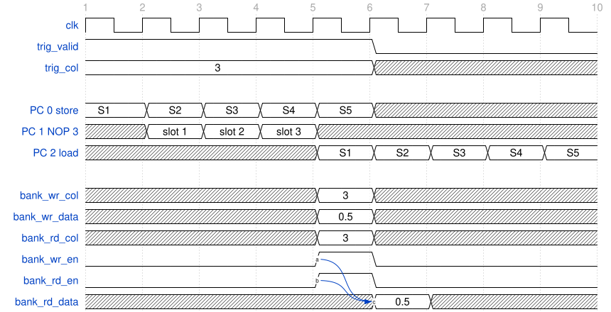

# Theory of operation

## Block diagram

The blocks below are split into modules in [hierarchy.md](hierarchy.md).

```
            triggering command (one per slot)
                     │
  host cfg ──►┌──────▼──────┐
  writes      │  CRF  32×32 │──► fetch/decode ── PC, loop counter, NOP counter
              └─────────────┘          │
                                       ▼ control
  ┌──────────────┐ ┌──────────────┐ ┌───────────┐ ┌───────────┐
  │ GRF_A 8×256  │ │ GRF_B 8×256  │ │ SRF_M 8×16│ │ SRF_A 8×16│
  └──────┬───────┘ └──────┬───────┘ └─────┬─────┘ └─────┬─────┘
         └────────┬───────┴───────────────┴─────────────┘
                  ▼ operand switch (+ bank read data)
          ┌───────────────┐   ┌───────────────┐
          │ 16 × FP16 MUL │──►│ 16 × FP16 ADD │◄── GRF_B accumulator
          └───────────────┘   └───────┬───────┘    (late read + bypass)
                                      ▼
                       write-back: GRF / SRF / bank write port
```

## Architecture

- **[TOP-ARCH-1]** One unit serves one bank pair, EVEN_BANK and ODD_BANK, and
  accesses at most one of them per instruction. **[paper]**
- **[TOP-ARCH-2]** The datapath has 16 lanes of IEEE 754 binary16 (FP16), 256 bits
  in total, which is one DRAM column access. **[paper]**
- **[TOP-ARCH-3]** The clock is the DRAM core clock (300 MHz target). One
  column-command slot (tCCD_L = 4 tCK at 1.2 GHz) equals one unit clock, so the
  unit must accept one instruction per cycle. **[paper]**

### Register files

| Register file | Size | Read ports | Notes |
|---|---|---|---|
| CRF | 32 × 32-bit | 2 (S1: fetch, and the word a JUMP leads to) | The microkernel. **[paper]** |
| GRF_A | 8 × 256-bit | 2 (S2) | Paired with the even bank. **[paper]** |
| GRF_B | 8 × 256-bit | 2 (S2) + 1 (S4, accumulator) | Paired with the odd bank; MAC accumulates here. **[paper]** |
| SRF_M | 8 × 16-bit | 1 (S2) | Scalar multiplier operand, broadcast to all 16 lanes. **[paper]** |
| SRF_A | 8 × 16-bit | 1 (S2) | Scalar addend, broadcast to all 16 lanes. **[paper]** |

The sizes are **[paper]**. The read-port counts are **[bankside]**: for
the GRFs and SRFs they follow from the legal operand combinations
([TOP-ARCH-10]), for the CRF from the zero-slot JUMP ([TOP-ISA-4]). Each file also has
one debug read port, which the synthesis wrapper ties off ([TOP-HIER-7]).

- **[TOP-ARCH-4]** Each register file has one write port, used by stage S5 and, when
  the unit is idle (`busy = 0` and `trig_valid = 0`, [TOP-IF-6]), by the host
  configuration port. **[bankside]**
- **[TOP-ARCH-5]** Register-file contents are **not reset**: neither `rst_n`
  ([TOP-IF-4]) nor anything else clears or initialises the CRF, GRF_A, GRF_B,
  SRF_M or SRF_A. Only control state (PC, the loop state of [TOP-ISA-3], NOP
  counter, pipeline valid bits, `err_illegal`) is reset. Programs must write
  a register before reading it, and the host must load every CRF entry the
  program executes. The reference model keeps a *written* flag per entry,
  set by an S5 write or a configuration write that takes effect
  ([TOP-IF-10]) and never cleared (not by reset either), and reports as an
  error any read of an entry whose flag is clear: a source read in S2, a MAC
  accumulator read in S4, or the CRF entry of an instruction that executes.
  Debug reads ([TOP-IF-11]) are not reported. **[bankside]**
  The five files hold 5376 bits (CRF 32 × 32 = 1024, GRF_A and GRF_B
  2 × 8 × 256 = 4096, SRF_M and SRF_A 2 × 8 × 16 = 256; draft 0.1 said
  "about 4.6 kbit"). Not resetting them saves the reset input of every one of
  those flip-flops and its routing. Options weighed:
  - (a) no reset (chosen).
  - (b) reset every entry to 0, as ANEMOS does: its `rf_twoport` and
    `rf_threeport` clear all entries on reset (`write_update_thread`, at
    `f2d4018`; read, not run). Then a program that forgets to load an SRF
    or GRF entry computes with 0 and can still pass a test whose data
    happens to tolerate it, and a reset between runs would wipe data the
    host loaded ([TOP-IF-4] keeps it).
  - (c) no reset in the RTL but 0 in simulation (an `initial` block or a
    simulator default). Simulation would then hide exactly the bug (b)
    hides, and silicon would behave differently from every test.

  ANEMOS clears its register files on reset; bankside doesn't. A VER-2
  comparison sees the difference only in a kernel that reads an entry it
  never wrote, which [TOP-ARCH-5] forbids.
- **[TOP-ARCH-9]** **Reading an entry never written.** An entry not written
  since power-up holds its **power-up value**: a bit pattern the spec doesn't
  predict, which may differ from entry to entry and from one power-up to the
  next. **[bankside]** Precisely:
  - Every read of the entry returns the same bits, on every read port and the
    debug port ([TOP-IF-11]), until the entry is first written. Reset doesn't
    change them ([TOP-ARCH-5]).
  - An instruction that reads it computes with those bits like with any
    others: data movement copies them, arithmetic treats them as FP16 values
    (a NaN among them gives 0x7E00, [TOP-FP-6]). Nothing is flagged in
    hardware.
  - An executed CRF entry that was never written runs as whatever instruction
    its bits encode, an illegal one included ([TOP-ISA-2]).
  - In the RTL the storage has no reset, no `initial` block and no initial
    value in its declaration, so the simulator decides the power-up value.
  - In simulation (Verilator, 2-state, so there is no X), every run gives
    each register-file bit a random power-up value, drawn from the run's
    seed: the model is built with `--x-initial unique` (Verilator's default)
    and run with `+verilator+rand+reset+2` and `+verilator+seed+<seed>`.
    Verilator's run-time default is 0, which would make an unwritten entry
    read as 0 in every test, so a run must never use it. The seed is printed
    with the run, so the values are reproduced with it. A 4-state simulator
    would show X; bankside doesn't use one.
  - DV and the reference model don't predict the value. A test that reads an
    unwritten entry on purpose, with an instruction or through the debug
    port, checks only that the value is stable as above, and the
    reference-model comparison ([VER-1]) stops at the model's error.

  Options weighed for the simulated value: random per run (chosen); X, which
  Verilator can't hold; 0, which hides a missing load (option (c) above); a
  fixed non-zero pattern such as 0xFFFF (a NaN in every lane), which would
  catch a missing load in arithmetic but not in a MOV that copies it, and
  the same in every run. Random values, with a new seed per run, are the
  ones no test can come to depend on.
- **[TOP-ARCH-10]** **Read ports.** The functional read ports are those of
  the table: CRF 2 (S1), GRF_A 2 (S2), GRF_B 3 (2 in S2, 1 in S4 for the
  MAC accumulator), SRF_M 1 (S2), SRF_A 1 (S2). For each GRF and SRF the
  count is the most entries of that file one legal instruction reads in S2
  plus the most read in S4, since different instructions are in S2 and S4 in
  the same cycle. Every read port is write-through ([TOP-HAZ-1]). The CRF
  needs 2 because a slot that resolves a JUMP reads the JUMP and the word it
  leads to in the same cycle, and [TOP-ISA-27] keeps it from needing a
  third; the fetch is defined in
  [`pcu_ctrl`'s doc](../../pcu_ctrl/doc/README.md#fetch-and-the-zero-slot-jump)
  (#27). **[bankside]**
  The counts are computed from the yaml by
  [examples/regfile_ports.py](examples/regfile_ports.py)
  ([hierarchy.md](hierarchy.md#worked-case-read-ports-from-the-yaml)): GRF_B's
  S2 maximum is 2 (`ADD GRF_A[0], GRF_B[1], GRF_B[2]`) and its S4 maximum is
  1, so 3. Options weighed for GRF_B:
  - (a) three ports (chosen).
  - (b) forbid GRF_B as a MAC multiplier source, as proposed for R11. It
    doesn't reach two ports: `ADD GRF_A[0], GRF_B[1], GRF_B[2]` and `MUL`
    with two GRF_B sources stay legal ([TOP-ISA-17], [TOP-ISA-18]), and one
    of them can be in S2 in the cycle a MAC reads its accumulator in S4, so
    the script still counts 3. It would also remove 8 of the 16 MAC pairs that
    [TOP-ISA-22] settled.
  - (c) two ports, the S4 accumulator read borrowing an S2 port. In
    bankside's pipeline the borrowed port is wanted by the instruction
    issued 2 slots after the MAC, so it would need a new programming rule:
    that instruction reads at most one GRF_B entry as a source. Breaking it
    would give a wrong value with nothing to show it, and the assembler,
    the assertions and the model would all have to check one more rule. The
    saving is one 8-entry, 256-bit read multiplexer. ANEMOS shares in this
    way, without a rule: its GRF_B port-1 address is the OR of the S2
    source address and the delayed accumulator address
    (`instr_decoder.cpp`, `grfb_rd_addr1`, at `f2d4018`, where
    `MULT_STAGES` = 1; read, not run), so a MAC and the instruction issued
    one cycle after it that also reads GRF_B through port 1 both read the
    entry whose index is the OR of the two.

  The cost of (a) is one more 8 × 256 read multiplexer and its write-through
  bypass; the PPA run (syn) measures it.

## Pipeline

Five stages. **[paper]** for the stages and their order; **[bankside]** for
what is read and written in each.

| Stage | Name | What happens |
|---|---|---|
| S1 | Fetch/decode | Read CRF[PC] and decode. Resolve JUMP (zero slots): read the word it leads to in the same cycle. Issue the bank read request. |
| S2 | Operand | Bank read data arrives. Read GRF/SRF source operands (everything except the MAC accumulator). MOV applies ReLU here when R = 1 (FILL ignores R, [TOP-ISA-16]). |
| S3 | MULT | 16 FP16 multipliers (MUL, MAD, MAC). Other instructions pass through. |
| S4 | ADD | 16 FP16 adders (ADD, MAD, MAC). MAC reads its accumulator here. Others pass through. |
| S5 | Write-back | Write the GRF or SRF, or drive the bank write port. |

- **[TOP-PIPE-1]** **Every write is in S5.** Every instruction passes
  through all five stages in order, one stage per cycle, so an instruction
  issued in cycle *c* is in S5 in cycle *c* + 4 whatever it is. An
  instruction that doesn't use MULT or ADD carries its value through that
  stage unchanged. Every write an instruction makes is done in its S5 cycle
  and in no other: a GRF or SRF write from any instruction (MOV, FILL, ADD,
  MUL, MAD, MAC), and a bank store ([TOP-ARCH-8]). So there is at most one
  write in the whole unit per cycle, the writes come in program order, and
  one write port per register file is enough ([TOP-ARCH-4]). **[paper]**
  (five stages, the fifth writes back), **[bankside]** (every instruction
  through every stage, bank stores in S5). v1 only for bank stores: v2
  revisits their timing against the DRAM write timing ([TOP-ARCH-8]).

  The paper says MAC goes through MULT and ADD "while MULT and ADD skip the
  fourth and third stages, respectively", and that the unit "can skip the
  second stage" when no bank data is needed (Section IV-B). It doesn't say
  whether skipping a stage makes the instruction finish sooner. bankside
  reads "skip" as "the stage does nothing for it", which keeps the
  latency fixed. Options weighed:
  - (a) every write in S5 (chosen).
  - (b) ANEMOS's timing: a MOV whose source is a register, and a bank store,
    write in the cycle they are decoded, while bank loads and arithmetic
    results go through its write pipeline (`instr_decoder.cpp`,
    `grfa_wr_en_comb`, `even_out_en`, `wr_en_pipe[MULT_STAGES +
    ADD_STAGES]`, at `f2d4018`; read, not run).
  - (c) the paper's "skip" read as a shorter latency: MUL and ADD would
    write a cycle before MAC and MAD, MOV and FILL three cycles before.

  Under (b) and (c) an instruction can write before an older one:
  `ADD GRF_A[0], GRF_A[1], GRF_A[1]` followed directly by
  `MOV GRF_A[0], SRF_M[1]` ends with the ADD's result, not the MOV's
  (case H below). Two instructions can also write one file in the same
  cycle (case I), which needs a second write port. Under (a) neither can
  happen. The cost of (a) is latency: a MOV's result is readable 3 slots
  later ([TOP-HAZ-3]), not on the next slot.
- **[TOP-PIPE-4]** **Every slot is a pipeline entry.** Each cycle with
  `trig_valid` = 1 and `rst_n` = 1 puts exactly one entry into S1 ([TOP-IF-1]),
  and the entry moves one stage per cycle until it leaves S5, whatever
  the slot issues: an instruction, an illegal word ([TOP-ISA-24]), EXIT, one
  slot of a multi-cycle NOP ([TOP-PIPE-3]), or the `NOP 1` slot of
  [TOP-ISA-27]. An entry that writes nothing does nothing in S2 to S5. No
  other cycle makes an entry: a JUMP is never an entry of its own, since it
  is resolved inside the slot of the instruction it leads to ([TOP-ISA-4]).
  The edge that ends a cycle with `rst_n` = 0 removes every entry
  ([TOP-IF-4]). **[bankside]** This is what "valid in S2 to S5" means for
  `busy` ([TOP-IF-7]). The alternative, entries only for instructions that
  write, is weighed there.
- **[TOP-PIPE-2]** The pipeline is clocked continuously. A cycle with no triggering
  command inserts a bubble; instructions already in flight keep moving and
  complete. **[bankside]**
- **[TOP-PIPE-3]** A multi-cycle NOP occupies one slot per triggering command for
  IMM0 slots (one slot if IMM0 = 0, [TOP-ISA-12]). JUMP occupies no slot
  ([TOP-ISA-4]). **[paper]** (zero-cycle JUMP), **[ANEMOS]** (NOP count).

### Timing of one instruction

Instruction *i* issued in cycle *c*:

| cycle | c | c+1 | c+2 | c+3 | c+4 |
|---|---|---|---|---|---|
| stage | S1 | S2 | S3 | S4 | S5 |
| events | fetch, decode, bank request | bank data, read sources | multiply | add, read accumulator | write |

## Hazards

The unit **cannot stall**. Each instruction is triggered by a host command at a
fixed rate, and nothing tells the host to wait. Dependencies are therefore
handled by forwarding where the published kernels need it, and by a
programming rule everywhere else. **[bankside]**

- **[TOP-HAZ-1]** Register files are **write-through**: every read port
  (the S2 source reads, the S4 accumulator read and the debug read) returns
  the value being written when the file's write port writes the same entry
  in the same cycle. In particular, a read in S2 in the same cycle as an S5
  write to the same entry returns the new value. The write itself takes
  effect at the end of the cycle. **[bankside]** Options weighed:
  - (a) write-through (chosen): distance 3 ([TOP-HAZ-3]). Cost: per read
    port, an index comparator and a 2-to-1 multiplexer in front of the read
    data.
  - (b) no write-through: an S2 read sees a write only from the next cycle,
    so the distance becomes 4. Every kernel needs one more gap slot per
    dependency: the GEMV store in the
    [programmer's guide](programmers_guide.md#gemv-partial-sum-no-loop) needs
    `NOP 3`, and the in-place ReLU loop takes 5 slots per column instead of
    4. The MAC accumulator would also need its own bypass multiplexer
    ([TOP-HIER-5] uses write-through for it).
  - (c) full forwarding from S3, S4 and S5 to S2: not possible for every
    producer, since an ADD or MAC result exists only at the end of S4, two
    cycles after the next instruction's S2.

  The papers don't say how the register files are read and written within a
  cycle. ANEMOS's register files are not write-through: their read method
  returns the stored `reg[]` signals, which change only after the clock edge
  (`rf_twoport.h`, `rf_threeport.h` at `f2d4018`; read, not run). Its
  pipeline is shorter (one MULT and one ADD stage, `MULT_STAGES` =
  `ADD_STAGES` = 1), so its distances differ anyway, and VER-2 inserts the
  bankside gap slots when it translates a kernel.
- **[TOP-HAZ-2]** **Accumulator bypass.** MAC reads its accumulator GRF_B[DST#] in
  S4, not S2. If the instruction in S5 in that cycle writes the same GRF_B
  entry, the accumulator is taken from the S5 result instead of the register
  file. This applies whatever the producer is (MAC, ADD, MUL, MAD, MOV or FILL).
  **[bankside]**
- **[TOP-HAZ-3]** **Programming rule for source operands.** An instruction must not
  read a GRF or SRF entry as a source (anything read in S2) if that entry is
  written by an instruction issued fewer than **3 slots** earlier. In other
  words, at least 2 slots must separate the producer from the consumer.
  **[bankside]**
- **[TOP-HAZ-4]** The MAC accumulator has no such rule: a MAC may follow any
  producer of its GRF_B entry immediately. **[bankside]**

### Why the distance is 3

Producer *P* issued at cycle *c* writes in S5, cycle *c+4*. Consumer *C* issued
*k* slots later:

| Consumer reads in | at cycle | needs | so | without write-through |
|---|---|---|---|---|
| S2 (sources) | c+k+1 | c+k+1 ≥ c+4 (write-through, [TOP-HAZ-1]) | k ≥ 3 | k ≥ 4 |
| S4 (MAC accumulator) | c+k+3 | k = 1: bypass from S5 ([TOP-HAZ-2]); k ≥ 2: register file | k ≥ 1 | k ≥ 2 |

Bubbles only add cycles between producer and consumer, so counting in slots is
always safe.

The same in general: a read in cycle *t* sees every write whose S5 cycle is *t*
or earlier, and no other. An S2 read in cycle *t* is by an instruction issued
in cycle *t* − 1, so it sees the instructions issued in cycle *t* − 3 or
earlier; any instruction 3 or more slots earlier is among them, because each
slot is a cycle of its own. A MAC's S4 read in cycle *t* + 2 (same
instruction) sees the instructions issued in cycle *t* − 2 or earlier, which is
every instruction before it. So [TOP-HAZ-4] holds whatever else is in flight,
and so does [TOP-HAZ-3] once the 2 slots before the consumer don't write its
sources.

Back-to-back MACs into one GRF_B entry, as in the published GEMV kernels,
therefore run at one per cycle. The bypass forms a one-cycle loop through the
FP16 adder, so the adder must fit in one clock period.

### Worked case: the distance, cycle by cycle

Case A: a producer and a consumer at the [TOP-HAZ-3] limit, k = 3 slots, one
trigger per cycle in cycles 1 to 4 and none after. Lane 0 values; before the
program GRF_A[1] = 0.5, SRF_M[1] = 2.0 (written by the host).

```
PC 0  MOV GRF_A[1], SRF_M[1]               ; P: GRF_A[1] <- 2.0
PC 1  NOP 2                                ; [TOP-HAZ-3]
PC 2  ADD GRF_B[2], GRF_A[1], GRF_A[1]     ; C: reads GRF_A[1] in S2
```

| Cycle | `trig_valid` | S1 | S2 | S3 | S4 | S5 | GRF_A[1] after the edge |
|---|---|---|---|---|---|---|---|
| 1 | 1 | PC 0 | – | – | – | – | 0.5 |
| 2 | 1 | PC 1, slot 1 | PC 0: reads SRF_M[1] = 2.0 | – | – | – | 0.5 |
| 3 | 1 | PC 1, slot 2 | – | PC 0 | – | – | 0.5 |
| 4 | 1 | PC 2 | – | – | PC 0 | – | 0.5 |
| 5 | 0 | – | PC 2: reads GRF_A[1] = **2.0 (write-through)**, twice | – | – | PC 0: GRF_A[1] ← 2.0 | 2.0 |
| 6 | 0 | – | – | PC 2 | – | – | 2.0 |
| 7 | 0 | – | – | – | PC 2: 2.0 + 2.0 | – | 2.0 |
| 8 | 0 | – | – | – | – | PC 2: GRF_B[2] ← 4.0 | 2.0 |

The consumer's S2 read (cycle 5) is in the producer's S5 cycle, so the value
comes through write-through ([TOP-HAZ-1]) and GRF_B[2] gets 4.0, as in-order
execution gives. Without write-through the read in cycle 5 returns the stored
0.5 and GRF_B[2] gets 1.0; it would take `NOP 3` (k = 4). The NOP's slots are
shown in S1 only. They do travel down S2 to S5 as entries ([TOP-PIPE-4]),
but they carry nothing, so no register value depends on them.

![Case A: the ADD's S2 read in cycle 5 meets the MOV's S5 write of GRF_A[1]](img/hazard_distance_3.svg)

*Figure 1: case A, [TOP-HAZ-1] and [TOP-HAZ-3]. The MOV writes GRF_A[1] in S5
in cycle 5 (marker a); the ADD, issued 3 slots later, reads it in S2 in the
same cycle (marker b) and gets the new value through write-through. Source:
[hazard_distance_3.wave.json](img/hazard_distance_3.wave.json).*

The distance sweep of the script puts the consumer k = 1 to 4 slots after the
producer (`NOP k−1` between, no bubbles). "ok" means the result equals
in-order execution:

| k | S2 source, write-through (chosen) | S2 source, no write-through | MAC accumulator, write-through (chosen) | MAC accumulator, no write-through |
|---|---|---|---|---|
| 1 | old value | old value | ok | old value |
| 2 | old value | old value | ok | ok |
| 3 | ok | old value | ok | ok |
| 4 | ok | ok | ok | ok |

The S2 consumer is case A's ADD; the accumulator case is
`MOV GRF_B[2], SRF_M[1]` followed by `MAC GRF_B[2], GRF_A[1], SRF_M[2]`.
Case D of the script traces back-to-back MACs right after the MOV that writes
their accumulator ([TOP-HAZ-4]).

The script also runs 20000 random programs (2 to 8 instructions over six
entries, random NOPs and random bubbles, seed 8). All 8159 that keep
[TOP-HAZ-3] end with the same registers as in-order execution under
write-through; without write-through 717 of them don't.

Script: [examples/hazard_trace.py](examples/hazard_trace.py), output
[examples/hazard_trace.out](examples/hazard_trace.out). Rerun from the repo
root: `.venv/bin/python src/top/doc/examples/hazard_trace.py` (exits non-zero
if a check fails).

### What happens when a rule is broken

- **[TOP-HAZ-5]** The hardware still does something defined. An S2 read in
  cycle *t* returns the value of the **newest write to that entry whose S5
  cycle is *t* or earlier** (a write in cycle *t* itself through
  write-through, [TOP-HAZ-1]). If no instruction has written the entry, it
  returns what the host wrote last, or the power-up value ([TOP-ARCH-9]).
  Writes of instructions still in S3 or S4 are not seen. An SVA assertion
  flags the broken rule in simulation, counting slots as [TOP-HAZ-3] does,
  the reference model raises an error, and the assembler rejects the
  program. **[bankside]**

  Draft 0.1 said "the old value". That is right only when no other write to
  the entry is in flight. Two cases from the script show the difference:
  - **Case B, an older write in flight.** PC 1 breaks the rule (k = 2), and
    PC 0 also writes the entry, one slot earlier. The read meets PC 0's S5
    write and returns PC 0's value, not the value held before the program.
  - **Case C, a bubble.** The same program with a cycle without a trigger
    after PC 1. The rule is still broken in slots (k = 2), but the read is 3
    cycles after PC 1 and meets its S5 write, so it returns PC 1's value and
    the result equals in-order execution.

  Case B, one trigger per cycle; before the program GRF_A[1] = 0.5, SRF_M[0]
  = 1.0, SRF_M[1] = 2.0:

  ```
  PC 0  MOV GRF_A[1], SRF_M[0]             ; GRF_A[1] <- 1.0
  PC 1  MOV GRF_A[1], SRF_M[1]             ; GRF_A[1] <- 2.0
  PC 2  NOP 1                              ; breaks [TOP-HAZ-3]: k = 2 from PC 1
  PC 3  ADD GRF_B[2], GRF_A[1], GRF_A[1]
  ```

  | Cycle | S1 | S2 | S3 | S4 | S5 |
  |---|---|---|---|---|---|
  | 1 | PC 0 | – | – | – | – |
  | 2 | PC 1 | PC 0: reads SRF_M[0] = 1.0 | – | – | – |
  | 3 | PC 2 | PC 1: reads SRF_M[1] = 2.0 | PC 0 | – | – |
  | 4 | PC 3 | – | PC 1 | PC 0 | – |
  | 5 | – | PC 3: reads GRF_A[1] = **1.0 (PC 0's write, write-through)** | – | PC 1 | PC 0: GRF_A[1] ← 1.0 |
  | 6 | – | – | PC 3 | – | PC 1: GRF_A[1] ← 2.0 |
  | 7 | – | – | – | PC 3: 1.0 + 1.0 | – |
  | 8 | – | – | – | – | PC 3: GRF_B[2] ← 2.0 |

  In-order execution gives 4.0; "the old value" (0.5) would give 1.0; the
  hardware gives 2.0. In case C the ADD issues in cycle 5, reads in cycle 6,
  meets PC 1's write and gives 4.0.

  The script checks the rule's wording on every S2 read of the 20000 random
  programs, legal or not (140122 reads): each returns the newest write with
  an S5 cycle no later than the read. For DV: a test that breaks
  [TOP-HAZ-3] on purpose ([VER-10]) predicts the read from the cycles of the
  trigger sequence, not from the slot count.

## FP16 arithmetic

- **[TOP-FP-1]** Format: IEEE 754-2019 binary16. **[paper]** (FP16), **[bankside]**
  (full IEEE behaviour).
- **[TOP-FP-2]** MUL and ADD are each **correctly rounded**, with
  round-to-nearest, ties-to-even. **[ANEMOS]** (its `half.hpp` defaults),
  **[bankside]**
- **[TOP-FP-3]** MAC and MAD are **unfused**: two roundings. **[ANEMOS]**
  (measured bit-exact), matching the paper's separate MULT and ADD stages.
  - MAC: `acc ← round(acc + round(a × b))`
  - MAD: `d ← round(round(a × b) + c)`
- **[TOP-FP-4]** Subnormals are supported as inputs and outputs (no flush to zero).
  Overflow rounds to ±Inf according to RNE. **[bankside]**
- **[TOP-FP-5]** Special cases follow IEEE 754: 0 × ±Inf = NaN, Inf − Inf = NaN,
  any NaN input gives a NaN result, x + (−x) = +0, (−0) + (−0) = −0, and the
  sign of a product is the XOR of the operand signs. **[bankside]**
- **[TOP-FP-6]** Every NaN that MUL, ADD, MAC or MAD produces is the
  **canonical quiet NaN 0x7E00** (sign 0, exponent all ones, significand
  `10 0000 0000`). This holds whatever made the result a NaN: a NaN operand of
  either sign, quiet or signalling, with any payload, or an invalid operation
  (0 × ±Inf, Inf − Inf). The payloads and signs of NaN operands are not
  propagated. In MAC and MAD it holds at each of the two roundings of
  [TOP-FP-3]: a NaN product is 0x7E00, and so is the sum it then feeds.
  **[bankside]**. The papers say nothing about NaNs. ANEMOS doesn't settle
  them either; it inherits them from its FP16 library (see
  [NaN results compared](#nan-results-compared) for why it isn't followed as
  the tiebreaker). Data movement keeps NaNs as they are ([TOP-FP-9]).
- **[TOP-FP-7]** No exception flags are kept. **[bankside]**

**Reference.** NumPy's `float16` arithmetic is correctly rounded for `+` and
`×`. NumPy computes in float32 and rounds once more to FP16, and that double
rounding is harmless because float32's 24-bit significand is at least
2 × 11 + 2 bits. So NumPy is a valid oracle, except for NaN bit patterns:
NumPy's NaN bits come from the host's floating-point unit and differ from
[TOP-FP-6] (see the NumPy column below), so NumPy can only tell that a result
is a NaN. The bit pattern of a NaN result is fixed by [TOP-FP-6] alone.

### NaN results compared

The cases below are each FP16 operation on the bits shown (`a + b` or
`a × b`, with *a* first). The bankside column is [TOP-FP-6]. The ANEMOS
column is the `half` library that its SystemC model computes with (half 2.2.0,
`src/half.hpp` at ANEMOS commit `f2d4018`), compiled and run. The NumPy column
is NumPy 2.5.1 `float16` on x86-64, run. Both alternatives propagate an input
NaN, as IEEE 754-2019 recommends:

| Operation | Case | bankside ([TOP-FP-6]) | ANEMOS (half 2.2.0) | NumPy 2.5.1, x86-64 |
|---|---|---|---|---|
| ADD 0x7C00, 0xFC00 | Inf − Inf (invalid) | 0x7E00 | 0x7FFF | 0xFE00 |
| MUL 0x0000, 0x7C00 | 0 × Inf (invalid) | 0x7E00 | 0x7FFF | 0xFE00 |
| ADD 0xFE00, 0x3C00 | negative quiet NaN + 1 | 0x7E00 | 0xFE00 | 0xFE00 |
| MUL 0x7C01, 0x3C00 | signalling NaN × 1 | 0x7E00 | 0x7E01 | 0x7E01 |
| ADD 0x7E01, 0xFE02 | two NaNs | 0x7E00 | 0x7E01 | 0xFE02 |
| ADD 0xFE02, 0x7E01 | the same, swapped | 0x7E00 | 0xFE02 | 0x7E01 |
| ADD 0x3C00, 0xFE02 | NaN second | 0x7E00 | 0xFE02 | 0xFE02 |

What the cases show:

- The two propagating references disagree with each other on 4 of the 7
  cases. For an invalid operation half returns 0x7FFF and x86 returns its
  negative default NaN (0xFE00). With two NaN operands half keeps the first and
  x86 NumPy the second. So propagation would not give bankside a bit-exact
  oracle either: a NaN would still be compared as a class against one of them.
- Under propagation the result of an instruction with two NaN operands
  depends on which operand reaches which adder or multiplier input. The bankside
  spec doesn't otherwise fix that order (ADD and MUL are commutative), and it
  would have to for MAC's accumulator and MAD's addend too. With [TOP-FP-6] the
  order never shows.
- A canonical NaN is one constant on the unit's output multiplexer.
  Propagation needs a NaN detector on each operand, a 16-bit selection between
  the operands and a forced quiet bit, per lane, in each of the 32 FP16 units.
  Both are small; the canonical NaN is the smaller.
- IEEE 754-2019 recommends ("should") but does not require that a NaN result
  carry an input NaN's payload, and it doesn't specify a NaN's sign, so
  [TOP-FP-6] is conforming ([TOP-FP-1]). RISC-V's F and Zfh extensions make the
  same choice (the canonical NaN is 0x7E00 in half precision).

Why ANEMOS isn't the tiebreaker here: its NaN bits are not a choice its model
makes but a property of whichever FP16 library is compiled in. Its SystemC
model uses half, with the rules in the table (the first NaN operand, quietened;
0x7FFF for an invalid operation). Its HLS path (`__SYNTHESIS__`) uses
the AC datatypes' `ac_ieee_float16` instead, whose NaN rule we haven't checked. The
draft's choice stands: **[bankside]**.

For DV: against ANEMOS ([VER-2]) and NumPy ([VER-4]) a NaN result can only
be compared as a class, as the verification plan already says. Because
[TOP-FP-6] fixes the pattern, a NaN result can in addition be checked bit-exact
against 0x7E00, both in the RTL-versus-model comparison ([VER-1]) and on the
FP16 units on their own.

## ReLU

- **[TOP-FP-8]** MOV with R = 1 applies ReLU to each lane by its sign bit
  (bit 15) alone: if the sign bit is 1 the lane becomes +0 (0x0000), and if it
  is 0 the lane passes unchanged ([TOP-FP-9]). The exponent and significand are
  not looked at. **[paper]**: ISCA 2021, Section III-C, implements ReLU as "a
  2-to-1 multiplexer controlled by the sign bit of a given input value".

  ANEMOS instead compares the value with zero: `in < 0 ? half_cast<half>(0.0)
  : in` (`src/grf.cpp`, ANEMOS commit `f2d4018`). That comparison is false for
  −0 and for every NaN, so ANEMOS passes them through unchanged. The paper
  states the mechanism, so the paper is followed; the tiebreaker isn't needed.
  (The same paper paragraph also says ReLU "returns zero if a given input value
  is a negative number"; −0 and NaNs aren't negative numbers, and the
  multiplexer sentence is the one that defines what happens to them.) bankside
  therefore **intentionally differs** from ANEMOS on −0 and on NaNs with the
  sign bit set, and only there: the two rules differ on 1024 of the 65536 input
  patterns, 0x8000 and 0xFC01 to 0xFFFF. [VER-2] masks them.

- **[TOP-FP-9]** MOV with R = 0 and FILL copy each lane's 16 bits unchanged,
  NaNs included: a signalling NaN stays signalling, and a NaN's sign and payload
  are kept. With R = 1, MOV changes a lane only as [TOP-FP-8] says, so a NaN
  with the sign bit clear also passes bit for bit. [TOP-FP-6] applies to
  arithmetic results only. **[bankside]**. ANEMOS also copies the bits (the
  run below shows 0x7C01 and 0xFC01 kept by its MOV(RELU) path).

### ReLU compared

Each input is one lane of a `MOV(RELU)`. The ANEMOS column is its `grf.cpp`
expression on the half 2.2.0 type, compiled and run:

| Input | Class | bankside ([TOP-FP-8]) | ANEMOS (value < 0) |
|---|---|---|---|
| 0x3C00 | +1 | 0x3C00 | 0x3C00 |
| 0xBC00 | −1 | 0x0000 | 0x0000 |
| 0x0000 | +0 | 0x0000 | 0x0000 |
| 0x8000 | −0 | 0x0000 | 0x8000 |
| 0x8001 | smallest negative subnormal | 0x0000 | 0x0000 |
| 0x7C00 | +Inf | 0x7C00 | 0x7C00 |
| 0xFC00 | −Inf | 0x0000 | 0x0000 |
| 0x7E00 | positive quiet NaN | 0x7E00 | 0x7E00 |
| 0x7C01 | positive signalling NaN | 0x7C01 | 0x7C01 |
| 0xFE00 | negative quiet NaN | 0x0000 | 0xFE00 |
| 0xFC01 | negative signalling NaN | 0x0000 | 0xFC01 |

Where the options differ in a program: a kernel that loads a column holding
−0 or a negative NaN with `MOV(RELU) GRF_A[0], EVEN_BANK` and stores it back
writes 0x0000 in bankside and the input unchanged in ANEMOS. Combined with
[TOP-FP-6], a NaN that bankside's own arithmetic produces is always 0x7E00,
whose sign bit is clear, so it survives a later ReLU as a NaN in both models;
only NaNs with the sign bit set that come from the bank or the host are
cleared to +0.

A NumPy reference for ReLU (as in [VER-3]) has to use the sign bit too, for
example `np.where(np.signbit(x), np.float16(0), x)`, which matches
[TOP-FP-8] on all 65536 patterns. `np.maximum(x, 0)` does not: it returns
0x8000 for −0 and passes NaNs through.

The cases are checked by [examples/fp_relu_nan.py](examples/fp_relu_nan.py),
and the ANEMOS and NumPy columns come from runs it compares against
([examples/README.md](examples/README.md)).

## Bank access

- **[TOP-ARCH-6]** The bank operand's address is implicit: the row and column of
  the triggering command. **[paper]** In v1 the testbench supplies these with
  the trigger ([interfaces.md](interfaces.md)).
- **[TOP-ARCH-7]** At most one bank operand per instruction (one column read per
  command). **[paper]** (Table II's MUL and ADD combination counts follow from
  it; for MAC and MAD see [TOP-ISA-22] in the
  [programmer's guide](programmers_guide.md#legal-combinations-compared-with-the-paper)).
- **[TOP-ARCH-8]** **Bank stores.** A bank store (MOV or FILL with
  EVEN_BANK or ODD_BANK as dst) is driven on `bank_wr_*` in its S5 cycle
  ([TOP-PIPE-1], [TOP-IF-3]). It goes to the bank its dst names and to the row
  and column of **its own triggering command**, the trigger of its S1 cycle,
  which the unit carries down the pipeline with the instruction. The trigger
  in the S5 cycle, if there is one, plays no part. **[paper]** (the address
  is that of the command that triggers the instruction, Section IV-B),
  **[bankside]** (S5). v1 only: in v2 the bank is a DRAM bank and its write
  timing is the HBM2 write timing, so v2 revisits both the cycle and how the
  address reaches the bank.

  The two addresses differ whenever the slots after a store have other
  columns. For example, the GEMV store of the
  [hierarchy worked case](hierarchy.md#worked-case-the-gemv-pattern-through-the-modules)
  is triggered with column 6 in cycle 6 and written in cycle 10. Its own
  trigger's address puts it in column 6. That trace has no trigger in cycle
  10, so with the S5 cycle's trigger the store would have no address at
  all. Had the host started the next run at once, it would have landed in a
  column of that run's. ANEMOS drives a store in the cycle of its own command
  (`even_out_en`, above), so it too writes the command's own address.

### The v1 bank

In v1 the testbench is the bank ([interfaces.md](interfaces.md)). The unit
sees EVEN_BANK and ODD_BANK as synchronous SRAMs behind one read port
(`bank_rd_*`) and one write port (`bank_wr_*`), each used at most once per
cycle:

- a read requested in S1 is sampled at the end of that cycle, and its data
  is on `bank_rd_data` in the next cycle, S2 ([TOP-IF-2]);
- a store is written at the end of its S5 cycle ([TOP-IF-3]);
- when a store and a read of the same column fall on the same clock edge,
  the store is applied first and the read returns the stored data
  ([TOP-IF-3]).

**[bankside]** throughout. The papers' bank is a DRAM bank driven by the
host's commands, with no cycle-level model to follow. ANEMOS's unit only
drives a store onto its bank bus (`even_out_en`, `odd_out_en`) and has no
bank model of its own; how its DRAM side orders a write and a read on one
edge was not checked. Options weighed for the same-edge order:
- (a) write first (chosen): distance 4 ([TOP-HAZ-6]). It is the same rule as
  the register files' write-through ([TOP-HAZ-1]): a read in cycle *t* sees
  every write whose S5 cycle is *t* or earlier. So [TOP-HAZ-5] and
  [TOP-HAZ-7] have the same form. The testbench's bank model applies the
  write before it samples the read.
- (b) read first, as many SRAM macros do: distance 5, one more gap slot
  before every reload of a column just stored.
- (c) undefined, as in an SRAM whose same-address collision is not
  specified: [TOP-HAZ-6] would then have to forbid a read 4 slots after a
  store as well, so the distance would be 5 too, and a broken rule would have
  no defined result.

- **[TOP-HAZ-6]** **Programming rule for bank columns.** In v1, an instruction
  must not read a bank column (same bank, row and column) that a bank store
  issued fewer than **4 slots** earlier writes. In other words, at least 3
  slots must separate the store from the read. If the rule is broken, the
  read returns what [TOP-HAZ-7] says. **[bankside]** Like [TOP-HAZ-3] it
  counts slots, since bubbles only add cycles between the store and the
  read.

### Why the distance is 4

Store *P* issued in cycle *c* writes the bank at the end of cycle *c* + 4.
Reader *C* issued *k* slots later requests its column in S1, in cycle *c* +
*k* or later (later only if there were bubbles), and the bank samples the
request at the end of that cycle:

| Bank applies on the same edge | *C* sees *P* if | so, without bubbles |
|---|---|---|
| store first (chosen) | *c* + *k* ≥ *c* + 4 | k ≥ 4 |
| read first | *c* + *k* > *c* + 4 | k ≥ 5 |

That is one slot more than [TOP-HAZ-3], because a register source is read
in S2 and a bank source is requested in S1.

**Worked case E: store then load at the limit, k = 4.** One trigger per
cycle in cycles 1 to 5, each with column 3 of the same row. Lane 0 values;
before the program GRF_A[1] = 0.5 (written by the host) and EVEN_BANK column
3 holds 0.75.

```
PC 0  MOV EVEN_BANK, GRF_A[1]      ; P: column 3 <- 0.5
PC 1  NOP 3                        ; [TOP-HAZ-6]
PC 2  MOV GRF_A[0], EVEN_BANK      ; C: loads column 3
```

| Cycle | `trig_valid` | S1 | S2 | S3 | S4 | S5 | EVEN_BANK col 3 after the edge |
|---|---|---|---|---|---|---|---|
| 1 | 1 | PC 0 | – | – | – | – | 0.75 |
| 2 | 1 | PC 1, slot 1 | PC 0: reads GRF_A[1] = 0.5 | – | – | – | 0.75 |
| 3 | 1 | PC 1, slot 2 | – | PC 0 | – | – | 0.75 |
| 4 | 1 | PC 1, slot 3 | – | – | PC 0 | – | 0.75 |
| 5 | 1 | PC 2: `bank_rd_en`, EVEN col 3 | – | – | – | PC 0: `bank_wr_en`, EVEN col 3 ← 0.5 | 0.5 |
| 6 | 0 | – | PC 2: `bank_rd_data` = **0.5** | – | – | – | 0.5 |
| 7 | 0 | – | – | PC 2 | – | – | 0.5 |
| 8 | 0 | – | – | – | PC 2 | – | 0.5 |
| 9 | 0 | – | – | – | – | PC 2: GRF_A[0] ← 0.5 | 0.5 |

The load's request and the store meet on the edge at the end of cycle 5. The
store is applied first, so `bank_rd_data` in cycle 6 is 0.5 and GRF_A[0] gets
0.5, as in-order execution gives. With a read-first bank the load would get
0.75, and it would take `NOP 4` (k = 5).



*Figure 2: case E, [TOP-IF-2], [TOP-IF-3] and [TOP-HAZ-6]. "PC 0 store" is
`MOV EVEN_BANK, GRF_A[1]` and "PC 2 load" is `MOV GRF_A[0], EVEN_BANK`. The
store drives `bank_wr_*` in its S5 cycle, cycle 5 (marker a). The load, issued 4 slots
later, drives `bank_rd_*` in the same cycle (marker b). The bank applies the
store first, so `bank_rd_data` in cycle 6 is the stored 0.5 (marker c).
Source: [bank_store_load.wave.json](img/bank_store_load.wave.json).*

The bank distance sweep of the script puts the load k = 1 to 6 slots after
the store, with no bubbles: the smallest safe k is 4 with a write-first bank
and 5 with a read-first one. The script also runs 20000 random programs with
bank loads, stores, register moves, ADDs with a bank source, NOPs and random
bubbles (seed 10). All 9151 that keep [TOP-HAZ-3] and [TOP-HAZ-6] end with
the same registers and bank columns as in-order execution. With a read-first
bank, 40 of them don't.

- **[TOP-HAZ-7]** **When [TOP-HAZ-6] is broken.** The hardware still does
  something defined. A bank read requested in S1 in cycle *t* returns, for
  its bank, row and column, the data of the **newest bank store to that
  column whose S5 cycle is *t* or earlier**. A store in cycle *t* itself
  counts, because the bank applies it first ([TOP-IF-3]). If no instruction
  has stored to the column, the read returns the bank's earlier contents:
  whatever the testbench's bank held before the program. Stores of
  instructions still in S2 to S4 are not seen. An SVA assertion flags the
  broken rule in simulation, counting slots as [TOP-HAZ-6] does, and the
  reference model raises an error. The assembler can't see the rule: it
  depends on the addresses the host sends. **[bankside]**

  Draft 0.1 said "the old data". That is right only when no other store to
  the column is in flight. The same two cases as for [TOP-HAZ-5] show the
  difference:
  - **Case F, an older store in flight.** PC 1 breaks the rule (k = 3), and
    PC 0 also stores to the column, one slot earlier. The read meets PC 0's
    store and returns PC 0's data, not the data from before the program.
  - **Case G, a bubble.** The same program with a cycle without a trigger
    after PC 1. The rule is still broken in slots (k = 3), but the read is
    4 cycles after PC 1. It meets PC 1's store, and the result equals
    in-order execution.

  Case F, one trigger per cycle in cycles 1 to 5, every trigger with column
  3. Before the program GRF_A[1] = 0.5, GRF_A[2] = 0.25 and EVEN_BANK column
  3 holds 0.75:

  ```
  PC 0  MOV EVEN_BANK, GRF_A[1]      ; column 3 <- 0.5
  PC 1  MOV EVEN_BANK, GRF_A[2]      ; column 3 <- 0.25
  PC 2  NOP 2                        ; breaks [TOP-HAZ-6]: k = 3 from PC 1
  PC 3  MOV GRF_A[0], EVEN_BANK
  ```

  | Cycle | S1 | S2 | S3 | S4 | S5 | EVEN_BANK col 3 after the edge |
  |---|---|---|---|---|---|---|
  | 1 | PC 0 | – | – | – | – | 0.75 |
  | 2 | PC 1 | PC 0: reads GRF_A[1] = 0.5 | – | – | – | 0.75 |
  | 3 | PC 2, slot 1 | PC 1: reads GRF_A[2] = 0.25 | PC 0 | – | – | 0.75 |
  | 4 | PC 2, slot 2 | – | PC 1 | PC 0 | – | 0.75 |
  | 5 | PC 3: bank read col 3 | – | – | PC 1 | PC 0: col 3 ← 0.5 | 0.5 |
  | 6 | – | PC 3: `bank_rd_data` = **0.5 (PC 0's store)** | – | – | PC 1: col 3 ← 0.25 | 0.25 |
  | 7 | – | – | PC 3 | – | – | 0.25 |
  | 8 | – | – | – | PC 3 | – | 0.25 |
  | 9 | – | – | – | – | PC 3: GRF_A[0] ← 0.5 | 0.25 |

  In-order execution gives 0.25. "The old data" (0.75) would give 0.75. The
  hardware gives 0.5. In case G the load issues in cycle 6, meets PC 1's
  store on that cycle's edge, and gives 0.25.

  The script checks the rule's wording on every bank read of its 20000
  random programs, legal or not (33137 reads): each returns the newest store
  to its column with an S5 cycle no later than the read's S1 cycle. Draft
  0.1's "old data", read as the newest store issued 4 or more slots before
  the read, disagrees on 889 of them. For DV: a test that breaks
  [TOP-HAZ-6] on purpose ([VER-10]) predicts the read from the cycles of the
  trigger sequence, not from the slot count.

### Worked cases: all writes in S5

Option (b) of [TOP-PIPE-1] against the chosen (a), from the same script,
one trigger per cycle. Before the program GRF_A[1] = 0.5 and SRF_M[1] = 2.0.

- **Case H, write after write.**
  `ADD GRF_A[0], GRF_A[1], GRF_A[1]` at PC 0, `MOV GRF_A[0], SRF_M[1]` at
  PC 1. In order GRF_A[0] ends as 2.0, the MOV's value. With every write in
  S5 the ADD writes in cycle 5 and the MOV in cycle 6, so GRF_A[0] = 2.0.
  With ANEMOS's timing the MOV writes in its decode cycle, cycle 2, and the
  ADD overwrites it in cycle 5, so GRF_A[0] = 1.0.
- **Case I, two writes in one cycle.** The same ADD, then `NOP 3`, then
  `MOV GRF_A[1], SRF_M[1]` issued in cycle 5. With ANEMOS's timing the ADD's
  write of GRF_A[0] and the MOV's write of GRF_A[1] both fall in cycle 5,
  so GRF_A needs two write ports. With every write in S5 they are in cycles
  5 and 9.

Script: [examples/hazard_trace.py](examples/hazard_trace.py) (sections 4
and 5), output [examples/hazard_trace.out](examples/hazard_trace.out). Rerun
from the repo root: `.venv/bin/python src/top/doc/examples/hazard_trace.py`
(exits non-zero if a check fails).
